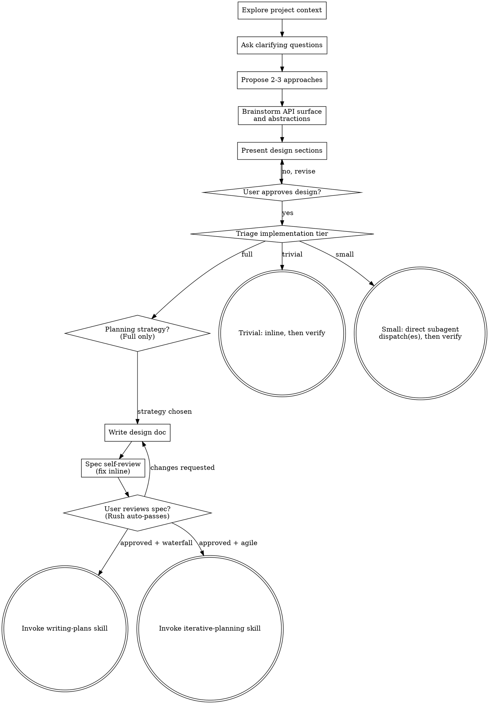

# Brainstorming Ideas Into Designs

Help turn ideas into fully formed designs and specs through natural collaborative dialogue.

Start by understanding the current project context, then ask questions one at a time to refine the idea. Once you understand what you're building, present the design and get user approval.

## Anti-Pattern: "This Is Too Simple To Need A Design"

Every project goes through this process. A todo list, a single-function utility, a config change — all of them. "Simple" projects are where unexamined assumptions cause the most wasted work. The design can be short (a few sentences for truly simple projects), but you MUST present it and get approval unless user explictly allows autonomous work.

## Checklist

You MUST complete each of these items in order, tracking progress against this checklist itself — not the harness task/todo tracker (it doesn't survive subagent dispatch; see `jj-superpowers:using-superpowers`):

1. **Explore project context** — check files, docs, recent commits (only if instructed to by user), relevant skills, rules, dependencies and guidance. Find existing abstractions, helpers, utilities, interfaces, traits to be reused. **If `.agents/layout.yaml` exists**, also read it and list the capability/plane specs likely affected by the work (use `code_map` to filter by paths the work will touch). Load full `SPEC.yaml` only for the specs that look most relevant. Create a JSONL file containing a coarse list of relevant symbols (files, classes, functions, variables, etc...) to avoid re-exploring during later stages
2. **Ask clarifying questions** — one at a time, understand purpose/constraints/success criteria. For questions where you have multiple answer proposals, use your system's "ask questions" tool
3. **Propose 2-3 approaches** — with trade-offs and your recommendation
4. **Brainstorm API surface and abstractions** — explore project context again to find any existing implementations of proposed additions; inventory current public and internal APIs, identify ad hoc branching and leaky boundaries, and propose interface changes that make the work generic instead of special-cased. **If the project has agent specs and the design changes normative behavior** (new requirement, changed requirement, new capability/plane, typed API change in a code-as-spec module), classify the change:
   - **New capability or plane** — note that `writing-specs` must author it BEFORE implementation begins. If the capability has 15 or more requirements OR has obvious sub-areas with distinct code paths, prompt: "Should this capability start with sub-specs, or start flat and graduate when it reaches 15 requirements?"
   - **Spec amendment** — note which `REQ-`/`INV-` IDs change and **which spec file they live in** (parent `SPEC.yaml` or a specific sub-spec, e.g., `chat-workspace/streaming`). The design doc MUST include a "spec amendment block" listing the affected IDs and the specific sub-spec file so `writing-plans` schedules the correct `spec-update` task.
     Include a spec amendment block in the design doc using this format:
     ```
     **Spec amendment block:**
     - File: `docs/agent-specs/capabilities/chat-workspace/streaming/SPEC.yaml`
     - IDs changing: REQ-CHAT-STR-001 (new), REQ-CHAT-003 (amended)
     - Nature: <one sentence describing what changes>
     ```
   - **Non-normative refactor** — no spec change needed.

   **If the work includes user-facing interactions** (a screen, panel, form, editor, CLI flow, dashboard), also brainstorm the UI design entities — load `ui-interaction-design.md` (in this skill's directory). Produce the required core (user stories, user flows, navigation/IA map, key states, error/warning surfacing, progress & responsiveness), bias every flow toward low-friction/forgiving defaults for a forgetful, lazy user, and choose a navigation/layout paradigm deliberately. Normative UI behavior (state machines, interaction contracts, error/progress semantics) is formalized via `jj-superpowers:writing-specs`.
5. **Present design** — in sections scaled to their complexity, get user approval after each section. Use your system's "ask questions" tool.
6. **Triage implementation tier and planning strategy** — after design approval, PROPOSE a tier (Trivial / Small / Full) with reasoning; the user may veto via your system's "ask questions" tool, but your proposal is the default (no mandatory round-trip). **Then, only if you set the Full tier**, PROPOSE a planning strategy (Waterfall / Agile) — same propose/override pattern, no mandatory round-trip; Trivial/Small are inherently single-shot and have no strategy. Step 6 is **after** the step-5 design-approval gate, so both the triage-tier and the strategy proposals are **within Rush's scope** (if Rush was activated at design approval, it auto-resolves them per the canonical Rush-resolution table — see the Triage Gate below).
7. **Write design doc** — save to `docs/superpowers/specs/YYYY-MM-DD-<topic>-design.md` for the Full tier; for Trivial/Small keep the approved design and verification command in the conversation
8. **Spec self-review** — quick inline check for placeholders, contradictions, ambiguity, scope (see below). Don't be afraid to go back to asking questions and approvals.
9. **Adversarial self-review** — run the convergent review loop (`jj-superpowers:hypothesis-driven-improvement` Simple In-Line Mode) over the spec with rotating lenses, then ensemble with external harnesses when available (see below; harness detection, harness choice, and model/effort are owned by `jj-superpowers:choosing-model-and-effort`).
10. **User reviews written spec** — ask user to review the spec file before proceeding. **This gate respects the autonomy level:** under Rush it auto-passes (the step-9 automated adversarial spec-review loop still runs); under Manual it pauses and asks as today.
11. **Transition to implementation** — route by planning strategy: **Agile** → invoke `jj-superpowers:iterative-planning` (it owns the phase loop in place of a single `writing-plans` call); **Waterfall** (and any non-Full tier) → invoke `jj-superpowers:writing-plans` to create the implementation plan, or proceed using your system's recommended workflow (confirm with user using "ask questions" tool)

## Process Flow



## Triage Gate

After design approval, match the planning ceremony to the task. You (the orchestrator) **propose** one of three tiers **with reasoning**; the user may veto via your system's "ask questions" tool, but your proposal is the **default — there is no mandatory round-trip**. Triage chooses *how much planning ceremony*, never whether to skip design approval.

| Tier | Path | Who verifies | Plan files? |
|------|------|--------------|-------------|
| **Trivial** | Implement inline in this session, then verify | orchestrator runs the named verify command | none |
| **Small** | 1–2 **direct subagent dispatches** | orchestrator runs the named verify command conversationally (implementers stay subject to the contended-command rule; the orchestrator is not, so it owns Small-tier verification) | none |
| **Full** | Write spec → `writing-plans` → `project-network.dot` graph | `verify` nodes in the graph | yes |

**Tier criteria:**

- **Trivial** — single obvious file, no new abstraction, verification nameable in one command, no design risk.
- **Small** — local scope, ≤2 implementer dispatches, obvious file boundaries, **no new architecture, no cross-file design risk** (design risk forces Full, because the `design_review` gate lives only there).
- **Full** — new architecture, new public API surface, multiple interacting components, cross-file design risk, or anything that benefits from a written, reviewable spec/plan.

**Choosing the lightest adequate tier is the CORRECT default, not a risk.** Do not reflexively reach for Full. If the work genuinely fits Trivial, run it inline no plan files (with or without subagents). If the overhead of writing plan files is expected to be larger than direct invocation of subagents, skip writing plan files and dispatch subagents directly.

## Planning Strategy (Full tier only)

Tier and strategy are **two orthogonal axes** of one gate — keep them visibly independent. Tier chooses *how much planning ceremony*; strategy chooses *whether the plan is written all at once or one phase at a time*. **Only the Full tier can be Agile** (Trivial/Small are inherently single-shot, so they have no strategy axis). Propose a strategy **immediately after you set a Full tier**, using the **same propose/override pattern as the tier** — your proposal is the default, the user may veto via the "ask questions" tool, no mandatory round-trip.

| Strategy | What it means | Transition (step 11) |
|----------|---------------|----------------------|
| **Waterfall** (default) | One `project-network.dot` for the whole project, as today. | `jj-superpowers:writing-plans` |
| **Agile** | The plan-one-phase loop: brainstorm once, then plan-one-phase → execute → fold-learnings → plan-next. | `jj-superpowers:iterative-planning` |

**Propose Agile** when scope signals indicate one graph would be unwieldy or premature — recommend Waterfall (even for Full) if none hold:

- estimated **whole-project** task-node count **> ~10–12** (a single graph that large is hard to plan well up front and strains one execution session), or
- **design uncertainty** — a later phase's task list cannot be written now without guessing, because it depends on an artifact (API shape, data format, measurement) an earlier phase will produce. Ordinary sequential dependency (order matters, but the later tasks are already specifiable) does **not** qualify, or
- **expected context size** (all tasks + context docs + execution) would exceed one comfortable execution session.

## Rush Boundary and Autonomy

**Rush begins after design approval.** Brainstorming's clarifying-question gate (step 2) and the design-approval gate (step 5) are **above** the Rush boundary and are **never** auto-resolved by Rush. Step 6 (triage tier + strategy) is **below** the boundary, so under Rush both proposals are auto-resolved with their recommended option per the **canonical Rush-resolution table** in `jj-superpowers:using-superpowers` (see its **Autonomy Level** subsection — the single source of truth for the table, the safety floor, and the retry budget; referenced here by name, not transcribed).

**Optional Rush offer.** At the design-approval gate, when you assess ambiguity is low, you **may** offer Rush once (single offer, not a nag).

**Step-10 spec user-review gate respects autonomy.** Under Rush it auto-passes; the **step-9 automated adversarial spec-review loop still runs** regardless (Rush removes the human sign-off wait, never the check itself). Under Manual it pauses and asks as today.

**Manual is unchanged.** Without Rush, every gate above still pauses and asks exactly as before.

> **Worked Trivial example:** "Fix a typo'd error string in one file." Single obvious file, no new abstraction, one-command verification (e.g. the project's test/lint command on that file), no design risk. Propose **Trivial**, get design approval as always, then edit the file inline in this session and run the named verify command. No spec, no `writing-plans`, no subagents.

**Guardrails preserved at every tier.** Design approval (the HARD-GATE), file-scope discipline, and named verification apply at Trivial, Small, and Full alike. The only thing triage varies is the amount of planning ceremony.

**Small-tier dispatch reuses the existing implementer contract.** A Small-tier direct dispatch MUST use the `sdd-implementer` named agent (fallback: the `implementer-prompt.md` prompt), passing the **approved design + exact file scope + verify command** as the dynamic context *in place of* a task file. This is non-negotiable: it carries over file-scope enforcement, the contended-command boundary, the no-nested-harness rule, the implementer status protocol (`DONE`/`BLOCKED`/…), and the "search before building a helper" discipline. Small tier changes *what context the implementer receives* (a conversational design, not a task file), never *which disciplines apply*.

**Off-graph tiers preserve the spec-sync gate.** `writing-plans`/`executing-plans` are normally where `spec-code-sync` runs before source edits in projects with `.agents/layout.yaml`. Because Trivial/Small skip those skills, **you (the orchestrator) MUST invoke `spec-code-sync` before any source edit** at Trivial/Small tier when the project has `.agents/layout.yaml` (run the candidate-spec lookup on the touched paths; route amendments per its rules). Skipping the plan files must not silently skip spec sync.

**Self-escalation.** Any tier hitting unexpected uncertainty mid-flight stops and **re-triages upward** (Trivial→Small→Full as warranted), or asks the user. Trivial/Small produced no spec or graph, so escalation to Full means writing them then — name that cost when escalating.

## The Process

**Understanding the idea:**

- Check out the current project state first (files, docs, recent commits (only if the user requests it), relevant skills, rules, dependencies and guidance)
- Collect a list of existing relevant traits, interfaces and other symbols; ground on existing project patterns (unless the user asks for a fresh pattern/refactoring)
- Ask questions one at a time to refine the idea
- Prefer multiple choice questions when possible, but open-ended is fine too
- Only one question per message - if a topic needs more exploration, break it into multiple questions
- Prefer using your harness's tools to ask questions: this makes it easier for users to reply
- Focus on understanding: purpose, constraints, limitations, scope, backward compatibility requirements (or lack thereof), focus
- Determine how exhaustive testing should be: don't cargo-cult TDD, only use tests when invariants can't be checked using type system/compiler/linting

**Exploring approaches:**

- Propose 2-3 different approaches with trade-offs
- Before presenting the approaches, try to figure out which choices have obviously superior approaches and group them into a single confirmation question and present it as a yes/no question to save time. If the user replies "no", fall back to presenting approaches one-by-one. Just make sure that you present the different options too.
- Present options conversationally with your recommendation and reasoning, prefer using your harness's tools to ask questions:
- Lead with your recommended option and explain why

**Brainstorming the API surface:**

- See the `designing-with-types-and-abstractions` skill for general guidance
- **Search before you build:** before proposing any new helper, utility, or type, search the codebase, the standard library, and the current dependencies for something that already does it. Reuse it unless there is a documented reason not to, and record the reused utilities in the design.
- Inventory the current public and internal APIs, data shapes, and call boundaries before deciding what should stay stable and what should change
- Look for manual branching, duplicated code paths, leaky internal APIs, and backend-specific conditionals that should become a shared abstraction instead of accumulating more branches
- Propose the interface, trait, type, and module boundary changes needed to make the current work scope generic and extensible
- For Rust, prefer traits, enums, exhaustive pattern matching, and static dispatch by default; use dynamic dispatch only at true runtime selection boundaries
- For TypeScript, prefer interfaces, discriminated unions, explicit capability types, and exhaustive pattern matching so the compiler can rule out invalid combinations
- Encode as many invariants as possible in the type system; avoid designs that depend on callers remembering hidden rules
- Think in interfaces first, then implementations
- Each unit should be self-contained: a method, type, or module should be understandable and verifiable without reading external invariants or unrelated code
- Core principle: you should be able to reason about each API unit independently. Any consumers of an API unit should not have to be aware of the API's implementation, only its interface. Any additional invariants not encoded in the type system must be documented. This way, parallel implementation subagents can start performing implementations without waiting for the dependent APIs to be implemented by other subagents.
- Keep files short, split existing long files to keep code readable

**Presenting the design:**

- Once you believe you understand what you're building, present the design
- Scale each section to its complexity: a few sentences if straightforward, up to 200-300 words if nuanced
- Ask after each section whether it looks right so far
- Cover: architecture, components, data flow, error handling, testing
- For user-facing work, also cover: navigation, layout, shortcuts, the key states per surface, and the three non-negotiable UI requirements — **errors/warnings surfaced to the UI**, **progress reported** for long/async work, and the **UI never freezing** (work never blocks the render thread). See `ui-interaction-design.md`.
- Cover implementation topology: independent units, shared interfaces, sequencing constraints, and verification gates the planner must preserve
- Cover tooling: which commands belong to implementation vs verification, and how verbose tools should produce concise/structured output
- Be ready to go back and clarify if something doesn't make sense

**Design for isolation and clarity:**

- Break the system into smaller units that each have one clear purpose, communicate through well-defined interfaces, and can be understood and tested independently
- For each unit, you should be able to answer: what does it do, how do you use it, and what does it depend on?
- Can someone understand what a unit does without reading its internals? Can you change the internals without breaking consumers? If not, the boundaries need work.
- Smaller, well-bounded units are also easier for you to work with - you reason better about code you can hold in context at once, and your edits are more reliable when files are focused. When a file grows large, that's often a signal that it's doing too much.

**Working in existing codebases:**

- Explore the current structure before proposing changes. Follow existing patterns, but propose cleaner designs/abstractions if possible.
- Where existing code has problems that affect the work (e.g., a file that's grown too large, unclear boundaries, tangled responsibilities), include targeted improvements as part of the design - the way a good developer improves code they're working in.
- Don't propose unrelated refactoring. Stay focused on what serves the current goal, but propose relevant improvements, e.g. by introducing abstractions instead of creating ad-hoc solutions/branches.
- Check whether existing traits/interfaces can be used or extended to avoid introducing new API shapes (prefer generic boundaries to reduce cognitive load).

## After the Design

**Documentation:**

- For the Full tier, write the validated design (spec) to `docs/superpowers/specs/YYYY-MM-DD-<topic>-design.md`.
- For Trivial/Small tiers, keep the approved design and verification command in the conversation instead of writing a spec file.
- **For user-facing work**, the design (written or kept in conversation) MUST include a verification checklist that maps **each agreed user story to an acceptance check and each agreed user flow to a flow-completion check** (with its step budget), plus one check each for error/warning surfacing, progress reporting, and non-blocking responsiveness. These become `verify` nodes (Full) or the named verification (Trivial/Small). A story or flow with no check is a gap — close it.

**Spec Self-Review:**
After writing the spec document, look at it with fresh eyes:

1. **Placeholder scan:** Any "TBD", "TODO", incomplete sections, or vague requirements? Fix them.
2. **Internal consistency:** Do any sections contradict each other? Does the architecture match the feature descriptions?
3. **Ambiguity check:** Could any requirement be interpreted two different ways? If so, pick one and make it explicit.
4. **Context comprehensiveness** Does this spec contain all information necessary to continue in a new session?
5. **Implementation topology:** Does the spec identify independent implementation units, shared interfaces, sequencing constraints, and verification gates clearly enough for `writing-plans` to build a project network diagram?
6. **Tooling and output:** Does the spec identify contended verification commands and any concise/structured output requirements?
7. **UI coverage (if user-facing):** Does every agreed user story and user flow have a verification check? Are the key states (empty/loading/partial/error/success), error/warning surfaces, progress reporting, and non-blocking responsiveness all specified, and are flows biased toward low-friction defaults?

Fix any issues inline. No need to re-review — just fix and move on.

**Adversarial self-review**

Keep the step 8 spec self-review above (your own fresh-eyes pass). Then run a **convergent review loop** as the default, invoking `jj-superpowers:hypothesis-driven-improvement`'s **Simple In-Line Mode** over the written spec.

*Severity taxonomy.* Every finding is tagged **Major**, **Minor**, or **Nit**:

- **Major** — changes the outcome: structural/design flaw, correctness error, genuine ambiguity (two readings → materially different builds), missing/contradicted requirement, wrong abstraction boundary. Must be resolved **and** re-reviewed.
- **Minor** — under-specification or local improvement resolvable unambiguously with no design decision. Folded in immediately, same round; does not by itself trigger another round.
- **Nit** — cosmetic/preference. Dropped (or folded trivially). Never loops.

**Convergence = a review round that surfaces zero Major findings.** On that round, fold in any outstanding Minors (you, the orchestrator, edit the spec doc directly — there is no implementer here) and drop Nits, with **no confirming round on the Minors**. Minors remain subject to the accept/refute gate: a Minor-looking finding that is actually wrong may be refuted with justification.

*Lenses.* Each round dispatches ~**3 reviewers**, each assigned a **distinct lens** from this encouraged menu: correctness/soundness, completeness/missing-requirements, ambiguity/interpretability, API & design soundness, concurrency, parallelism, performance, DRYness/duplication, ease of abstraction & extensibility, testability/verification, over/under-engineering (YAGNI). Pick the ~3 most relevant (or high-risk) to this spec and **rotate lens assignments across rounds** for diversity. Reviewers read the immutable spec read-only, so they fan out safely.

*External-harness ensembling.* After the subagent loop converges (a zero-Major round), run a **default-on-when-available** ensemble pass at the **orchestrator** level (the subagent no-other-harness rule is unaffected — that governs the reviewer subagents, not you). This skill owns the review **loop**; `jj-superpowers:choosing-model-and-effort` owns the **harness** — detection, harness choice, model and effort, and the reviewer-only gate. Do not restate them here.

- Run the **same lens-based review** through each available harness.
- The combined loop is `subagent-converge → ensemble pass`. An ensemble pass's **Major** findings **re-open the subagent loop**; after it re-converges, ensemble runs again. The loop ends when an **ensemble pass yields zero Major**.
- External **Minor/Nit** findings are folded-and-go (or dropped) exactly like subagent Minors/Nits, and **do NOT re-open the loop** — only an ensemble **Major** re-opens it.
- If **no** external harness is available, **skip silently**. The user may opt out.

**User Review Gate:**
After the spec review loop passes, ask the user to review the written spec before proceeding:

> "Spec written to `<path>`. Please review it and let me know if you want to make any changes before we start writing out the implementation plan."

Wait for the user's response. If they request changes, make them and re-run the spec review loop. Only proceed once the user approves.

**This gate respects the autonomy level** (see the Rush Boundary and Autonomy notes above): under **Rush** it **auto-passes** without waiting on user sign-off — but the step-9 automated adversarial spec-review loop above **still runs**. Under **Manual** it pauses and asks as today.

**Implementation:**

- For the Full tier, route by the planning strategy chosen in step 6: **Waterfall** → invoke `jj-superpowers:writing-plans` to create a detailed implementation plan; **Agile** → invoke `jj-superpowers:iterative-planning`, which owns the phase loop in place of a single `writing-plans` call. Do NOT invoke any other skill; the strategy-selected skill is the next step.
- For Trivial/Small tiers, use the approved inline or direct-subagent path per the Triage Gate and run the named verification before claiming completion. Remember the off-graph spec-sync requirement: invoke `spec-code-sync` before any source edit when the project has `.agents/layout.yaml`.

## Key Principles

- **One question at a time** - Don't overwhelm with multiple questions
- **Multiple choice preferred** - Easier to answer than open-ended when possible
- **YAGNI ruthlessly** - Remove unnecessary features from all designs, but without omitting requested items silently
- **Minimize friction for user-facing work** - Assume a forgetful, lazy user: autosave, remembered state, smart defaults, undo-over-confirm; always surface errors/warnings, report progress, and never freeze the UI
- **Explore alternatives** - Always propose 2-3 approaches before settling
- **Incremental validation** - Present design, get approval before moving on
- **Be flexible** - Go back and clarify when something doesn't make sense
