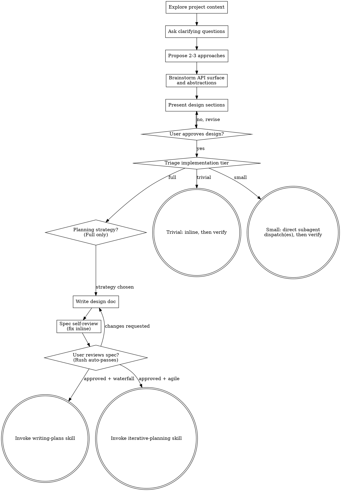

# Brainstorming Ideas Into Designs

Help turn ideas into fully formed designs and specs through natural collaborative dialogue.

Start by understanding the current project context, then ask questions one at a time to refine the idea. Once you understand what you're building, present the design and get user approval.

## Anti-Pattern: "This Is Too Simple To Need A Design"

Every task gets a **design and an approval** — a todo list, a single-function utility, a config change, all of them. "Simple" tasks are where unexamined assumptions cause the most wasted work. For a truly simple task the design is a few sentences, but you MUST present it and get approval unless the user explicitly allows autonomous work.

**What scales is the ceremony, not the gate.** Design approval is universal; the spec document, the API-surface brainstorm, and the adversarial review loop are not. See the Tier Gate. The opposite failure — running Full-tier ceremony on a one-line change — wastes exactly the time this skill exists to save, and is just as much a defect as skipping the design.

## Checklist

Work through these in order, tracking progress against this checklist itself — not the harness task/todo tracker (it doesn't survive subagent dispatch; see `jj-superpowers:using-superpowers`).

**Scale the checklist to the work.** Steps 1, 2, 5, 6 and 11 run for *every* task. The rest are **Full-tier only** — see the Tier Gate below for exactly which steps each tier skips. Running a 3-reviewer adversarial spec loop on a typo fix is a defect, not diligence.

| Step | Trivial | Small | Full |
|------|---------|-------|------|
| 1 Explore context | light | light | full (+ symbol cache) |
| 2 Clarifying questions | ✅ | ✅ | ✅ |
| 3 Propose 2-3 approaches | skip | if design choice exists | ✅ |
| 4 API surface & abstractions | skip | skip | ✅ |
| 5 Present design + approval | ✅ (a few sentences) | ✅ | ✅ (sectioned) |
| 6 Triage tier | ✅ | ✅ | ✅ |
| 7 Write design doc | skip | skip | ✅ |
| 8 Spec self-review | skip | skip | ✅ |
| 9 Adversarial spec review | skip | skip | ✅ |
| 10 User reviews written spec | skip | skip | ✅ |
| 11 Transition to implementation | ✅ | ✅ | ✅ |

Steps 7–10 operate on a written spec document. **Trivial and Small produce no spec document, so steps 7–10 have nothing to operate on and are skipped outright** — not performed against the conversational design.

1. **Explore project context** — check files, docs, recent commits (only if instructed to by user), relevant skills, rules, dependencies and guidance. Find existing abstractions, helpers, utilities, interfaces, traits to be reused. **If `.agents/layout.yaml` exists**, also read it and list the capability/plane specs likely affected by the work (use `code_map` to filter by paths the work will touch). Load full `SPEC.yaml` only for the specs that look most relevant. **Full tier only:** create a JSONL file containing a coarse list of relevant symbols (files, classes, functions, variables) to avoid re-exploring during later stages — at Trivial/Small the exploration is small enough that the cache costs more than it saves.
2. **Ask clarifying questions** — one at a time, understand purpose/constraints/success criteria. For questions where you have multiple answer proposals, use your system's "ask questions" tool
3. **Propose 2-3 approaches** — with trade-offs and your recommendation. **Skip at Trivial** (there is no design choice to make). At Small, do this only when a real design choice exists.
4. **Brainstorm API surface and abstractions** *(Full tier only — Trivial/Small are defined by having no new architecture or cross-file design risk)* — explore project context again to find any existing implementations of proposed additions; inventory current public and internal APIs, identify ad hoc branching and leaky boundaries, and propose interface changes that make the work generic instead of special-cased. **If the project has agent specs and the design changes normative behavior** (new requirement, changed requirement, new capability/plane, typed API change in a code-as-spec module), classify the change:
   - **New capability or plane** — note that `writing-specs` must author it BEFORE implementation begins. If the capability has 15 or more requirements OR has obvious sub-areas with distinct code paths, prompt: "Should this capability start with sub-specs, or start flat and graduate when it reaches 15 requirements?"
   - **Spec amendment** — note which `REQ-`/`INV-` IDs change and **which spec file they live in** (parent `SPEC.yaml` or a specific sub-spec, e.g., `chat-workspace/streaming`). The design doc MUST include a "spec amendment block" listing the affected IDs and the specific sub-spec file so `writing-plans` schedules the correct `spec-update` task.
     Include a spec amendment block in the design doc using this format:
     ```
     **Spec amendment block:**
     - File: `docs/agent-specs/capabilities/chat-workspace/streaming/SPEC.yaml`
     - IDs changing: REQ-CHAT-STR-001 (new), REQ-CHAT-003 (amended)
     - Nature: <one sentence describing what changes>
     ```
   - **Non-normative refactor** — no spec change needed.

   **If the work includes user-facing interactions** (a screen, panel, form, editor, CLI flow, dashboard), also brainstorm the UI design entities — load `ui-interaction-design.md` (in this skill's directory). Produce the required core (user stories, user flows, navigation/IA map, key states, error/warning surfacing, progress & responsiveness), bias every flow toward low-friction/forgiving defaults for a forgetful, lazy user, and choose a navigation/layout paradigm deliberately. Normative UI behavior (state machines, interaction contracts, error/progress semantics) is formalized via `jj-superpowers:writing-specs`.
5. **Present design** — in sections scaled to their complexity, get user approval after each section. Use your system's "ask questions" tool.
6. **Triage implementation tier and planning strategy** — after design approval, PROPOSE a tier (Trivial / Small / Full) with reasoning; the user may veto via your system's "ask questions" tool, but your proposal is the default (no mandatory round-trip). **Then, only if you set the Full tier**, PROPOSE a planning strategy (Waterfall / Agile) — same propose/override pattern, no mandatory round-trip; Trivial/Small are inherently single-shot and have no strategy. Step 6 is **after** the step-5 design-approval gate, so both the triage-tier and the strategy proposals are **within Rush's scope** (if Rush was activated at design approval, it auto-resolves them per the canonical Rush-resolution table — see the Triage Gate below).
7. **Write design doc** *(Full tier only)* — save to `docs/superpowers/specs/YYYY-MM-DD-<topic>-design.md`. Trivial/Small keep the approved design and verification command in the conversation and skip straight to step 11.
8. **Spec self-review** *(Full tier only)* — quick inline check of the written spec for placeholders, contradictions, ambiguity, scope (see below). Don't be afraid to go back to asking questions and approvals.
9. **Adversarial self-review** *(Full tier only)* — run the convergent review loop (`jj-superpowers:hypothesis-driven-improvement` Simple In-Line Mode) over the spec with rotating lenses, then ensemble with external harnesses when available (see below; harness detection, harness choice, and model/effort are owned by `jj-superpowers:choosing-model-and-effort`).
10. **User reviews written spec** *(Full tier only)* — ask user to review the spec file before proceeding. **This gate respects the autonomy level:** under Rush it auto-passes (the step-9 automated adversarial spec-review loop still runs); under Manual it pauses and asks as today.
11. **Transition to implementation** — route by planning strategy: **Agile** → invoke `jj-superpowers:iterative-planning` (it owns the phase loop in place of a single `writing-plans` call); **Waterfall** (and any non-Full tier) → invoke `jj-superpowers:writing-plans` to create the implementation plan, or proceed using your system's recommended workflow (confirm with user using "ask questions" tool)

## Process Flow



## Triage Gate

After design approval, match the planning ceremony to the task. You (the orchestrator) **propose** one of three tiers **with reasoning**; the user may veto via your system's "ask questions" tool, but your proposal is the **default — there is no mandatory round-trip**. Triage chooses *how much planning ceremony*, never whether to skip design approval.

| Tier | Path | Who verifies | Plan files? |
|------|------|--------------|-------------|
| **Trivial** | Implement inline in this session, then verify | orchestrator runs the named verify command | none |
| **Small** | 1–2 **direct subagent dispatches** | orchestrator runs the named verify command conversationally (implementers stay subject to the contended-command rule; the orchestrator is not, so it owns Small-tier verification) | none |
| **Full** | Write spec → `writing-plans` → `project-network.dot` graph | `verify` nodes in the graph | yes |

**Tier criteria:**

- **Trivial** — single obvious file, no new abstraction, verification nameable in one command, no design risk.
- **Small** — local scope, ≤2 implementer dispatches, obvious file boundaries, **no new architecture, no cross-file design risk** (design risk forces Full, because the `design_review` gate lives only there).
- **Full** — new architecture, new public API surface, multiple interacting components, cross-file design risk, or anything that benefits from a written, reviewable spec/plan.

**Choosing the lightest adequate tier is the CORRECT default, not a risk.** Do not reflexively reach for Full. If the work genuinely fits Trivial, implement it inline in this session with no plan files and no subagents. If the work fits Small, or the overhead of writing plan files is expected to be larger than direct invocation of subagents, skip writing plan files and dispatch subagents directly.

## Planning Strategy (Full tier only)

Tier and strategy are **two orthogonal axes** of one gate — keep them visibly independent. Tier chooses *how much planning ceremony*; strategy chooses *whether the plan is written all at once or one phase at a time*. **Only the Full tier can be Agile** (Trivial/Small are inherently single-shot, so they have no strategy axis). Propose a strategy **immediately after you set a Full tier**, using the **same propose/override pattern as the tier** — your proposal is the default, the user may veto via the "ask questions" tool, no mandatory round-trip.

| Strategy | What it means | Transition (step 11) |
|----------|---------------|----------------------|
| **Waterfall** (default) | One `project-network.dot` for the whole project, as today. | `jj-superpowers:writing-plans` |
| **Agile** | The plan-one-phase loop: brainstorm once, then plan-one-phase → execute → fold-learnings → plan-next. | `jj-superpowers:iterative-planning` |

**Propose Agile only for genuine design uncertainty** — recommend Waterfall (even for Full, even for a large graph) otherwise:

- **design uncertainty** — a later phase's task list cannot be written now without guessing, because it depends on an artifact (API shape, data format, measurement) an earlier phase will produce. Completing that earlier phase must actually change how the later phase gets planned. Ordinary sequential dependency (order matters, but the later tasks are already specifiable today) does **not** qualify — that's just edges in one DAG.

If every phase's tasks could be written today without waiting on an earlier phase's output, there is no reason to phase it — write the whole thing as one `project-network.dot` and let the graph's own dependency edges sequence the work. Size and task count are not criteria: a large graph of already-specifiable tasks (however many, however parallel or sequential) is still a single Waterfall plan. Splitting it into phases would only add roadmap/fold-learnings ceremony around a DAG that didn't need it.

## Rush Boundary and Autonomy

**Rush begins after design approval.** Brainstorming's clarifying-question gate (step 2) and the design-approval gate (step 5) are **above** the Rush boundary and are **never** auto-resolved by Rush. Step 6 (triage tier + strategy) is **below** the boundary, so under Rush both proposals are auto-resolved with their recommended option per the **canonical Rush-resolution table** in `jj-superpowers:using-superpowers` (see its **Autonomy Level** subsection — the single source of truth for the table, the safety floor, and the retry budget; referenced here by name, not transcribed).

**Optional Rush offer.** At the design-approval gate, when you assess ambiguity is low, you **may** offer Rush once (single offer, not a nag).

**Step-10 spec user-review gate respects autonomy.** Under Rush it auto-passes; the **step-9 automated adversarial spec-review loop still runs** regardless (Rush removes the human sign-off wait, never the check itself). Under Manual it pauses and asks as today.

**Manual is unchanged.** Without Rush, every gate above still pauses and asks exactly as before.

> **Worked Trivial example:** "Fix a typo'd error string in one file." Single obvious file, no new abstraction, one-command verification, no design risk. Propose **Trivial**, state the one-sentence design ("change the string in `src/err.rs` to X; verify with `cargo test -p foo`"), get approval, edit inline, run the verify command. That is the *whole* interaction. No symbol cache, no 2-3 approaches, no API-surface brainstorm, no spec file, no adversarial review, no `writing-plans`, no subagents. If you find yourself doing any of those on a task like this, you have mis-triaged.

**Guardrails preserved at every tier.** Design approval (the HARD-GATE), file-scope discipline, and named verification apply at Trivial, Small, and Full alike. The only thing triage varies is the amount of planning ceremony — and it varies it *a lot*: Trivial is steps 1, 2, 5, 6, 11 and nothing else.

**Small-tier dispatch reuses the existing implementer contract.** A Small-tier direct dispatch MUST use the `sdd-implementer` named agent (fallback: the `implementer-prompt.md` prompt), passing the **approved design + exact file scope + verify command** as the dynamic context *in place of* a task file. This is non-negotiable: it carries over file-scope enforcement, the contended-command boundary, the no-nested-harness rule, the implementer status protocol (`DONE`/`BLOCKED`/…), and the "search before building a helper" discipline. Small tier changes *what context the implementer receives* (a conversational design, not a task file), never *which disciplines apply*.

**Off-graph tiers preserve the spec-sync gate.** `writing-plans`/`executing-plans` are normally where `spec-code-sync` runs before source edits in projects with `.agents/layout.yaml`. Because Trivial/Small skip those skills, **you (the orchestrator) MUST invoke `spec-code-sync` before any source edit** at Trivial/Small tier when the project has `.agents/layout.yaml` (run the candidate-spec lookup on the touched paths; route amendments per its rules). Skipping the plan files must not silently skip spec sync.

**Self-escalation.** Any tier hitting unexpected uncertainty mid-flight stops and **re-triages upward** (Trivial→Small→Full as warranted), or asks the user. Trivial/Small produced no spec or graph, so escalation to Full means writing them then — name that cost when escalating.

## Technique

The Checklist above is *what* to do. This is *how* to do the conversational parts well.

**Asking questions (step 2).** One question per message — if a topic needs more exploration, break it into several. Prefer multiple choice; use your harness's ask/question tool so the user can just click. Aim at purpose, constraints, scope, and backward-compatibility needs. Settle how much testing the work warrants: don't cargo-cult TDD — reach for tests when an invariant *can't* be enforced by the type system, compiler, or linter.

**Proposing approaches (step 3).** Lead with your recommendation and say why. Where a choice has an obviously superior answer, batch those into one yes/no confirmation to save a round-trip — but still show the alternatives; if the user says no, fall back to presenting them one at a time.

**Brainstorming the API surface (step 4).** `jj-superpowers:designing-with-types-and-abstractions` owns *how* to shape types and interfaces — load it rather than re-deriving. This step adds three things it can't know:

- **Search before you build.** Before proposing any new helper, utility, or type, search the codebase, standard library, and current dependencies for something that already does it. Reuse unless there's a documented reason not to, and record what you reused in the design.
- **Inventory what exists.** Walk the current public and internal APIs, data shapes, and call boundaries before deciding what stays stable and what changes. Look for manual branching, duplicated code paths, and leaky internals that should become one abstraction instead of accumulating another branch.
- **Design for independent implementation.** A consumer must be usable from its interface alone, with any invariant the types can't carry written down. This is what lets parallel implementer subagents start against a stub without waiting for each other — it is a scheduling constraint, not just good taste.

**Presenting the design (step 5).** Scale each section to its complexity — a few sentences when it's straightforward, up to 200–300 words when it's genuinely nuanced. Ask after each section whether it reads right. Cover architecture, components, data flow, error handling, and testing; plus implementation topology (independent units, shared interfaces, sequencing, verification gates) and which commands belong to implementation vs verification.

For user-facing work also cover navigation, layout, shortcuts, and per-surface key states — and the three non-negotiables: **errors/warnings surfaced**, **progress reported** for long work, and the **UI never freezing**. See `ui-interaction-design.md`.

**In existing codebases.** Follow established patterns, but propose a cleaner abstraction where one is warranted. Where existing code actively obstructs the work (a file that's grown too large, tangled responsibilities), fold a targeted improvement into the design — the way a good engineer improves code they're already in. Don't propose unrelated refactoring.

## After the Design

**Documentation:**

- For the Full tier, write the validated design (spec) to `docs/superpowers/specs/YYYY-MM-DD-<topic>-design.md`.
- For Trivial/Small tiers, keep the approved design and verification command in the conversation instead of writing a spec file.
- **For user-facing work**, the design (written or kept in conversation) MUST include a verification checklist that maps **each agreed user story to an acceptance check and each agreed user flow to a flow-completion check** (with its step budget), plus one check each for error/warning surfacing, progress reporting, and non-blocking responsiveness. These become `verify` nodes (Full) or the named verification (Trivial/Small). A story or flow with no check is a gap — close it.

**Spec Self-Review:**
After writing the spec document, look at it with fresh eyes:

1. **Placeholder scan:** Any "TBD", "TODO", incomplete sections, or vague requirements? Fix them.
2. **Internal consistency:** Do any sections contradict each other? Does the architecture match the feature descriptions?
3. **Ambiguity check:** Could any requirement be interpreted two different ways? If so, pick one and make it explicit.
4. **Context comprehensiveness** Does this spec contain all information necessary to continue in a new session?
5. **Implementation topology:** Does the spec identify independent implementation units, shared interfaces, sequencing constraints, and verification gates clearly enough for `writing-plans` to build a project network diagram?
6. **Tooling and output:** Does the spec identify contended verification commands and any concise/structured output requirements?
7. **UI coverage (if user-facing):** Does every agreed user story and user flow have a verification check? Are the key states (empty/loading/partial/error/success), error/warning surfaces, progress reporting, and non-blocking responsiveness all specified, and are flows biased toward low-friction defaults?

Fix any issues inline. No need to re-review — just fix and move on.

**Adversarial self-review**

Keep the step 8 spec self-review above (your own fresh-eyes pass). Then run a **convergent review loop** as the default, invoking `jj-superpowers:hypothesis-driven-improvement`'s **Simple In-Line Mode** over the written spec.

*Severity.* Every finding is tagged **Critical**, **Important**, or **Minor** — the scale defined once in `jj-superpowers:requesting-code-review` (Severity Scale). In this loop:

- **Critical / Important** (blocking) — must be resolved **and** re-reviewed.
- **Minor** — folded in immediately, same round (purely cosmetic ones may be dropped); does not by itself trigger another round.

**Convergence = a review round that surfaces zero Critical/Important findings.** On that round, fold in any outstanding Minors (you, the orchestrator, edit the spec doc directly — there is no implementer here), with **no confirming round on the Minors**. Minors remain subject to the accept/refute gate: a Minor-looking finding that is actually wrong may be refuted with justification.

*Lenses.* Each round dispatches ~**3 reviewers**, each assigned a **distinct lens** from this encouraged menu: correctness/soundness, completeness/missing-requirements, ambiguity/interpretability, API & design soundness, concurrency, parallelism, performance, DRYness/duplication, ease of abstraction & extensibility, testability/verification, over- and under-engineering. Pick the ~3 most relevant (or high-risk) to this spec and **rotate lens assignments across rounds** for diversity. Reviewers read the immutable spec read-only, so they fan out safely.

*External-harness ensembling.* After the subagent loop converges (a zero-Critical/Important round), run a **default-on-when-available** ensemble pass at the **orchestrator** level (the subagent no-other-harness rule is unaffected — that governs the reviewer subagents, not you). This skill owns the review **loop**; `jj-superpowers:choosing-model-and-effort` owns the **harness** — detection, harness choice, model and effort, and the reviewer-only gate. Do not restate them here.

- Run the **same lens-based review** through each available harness.
- The combined loop is `subagent-converge → ensemble pass`. An ensemble pass's **Critical/Important** findings **re-open the subagent loop**; after it re-converges, ensemble runs again. The loop ends when an **ensemble pass yields zero Critical/Important**.
- External **Minor** findings are folded-and-go (or dropped) exactly like subagent Minors, and **do NOT re-open the loop** — only an ensemble **Critical/Important** finding re-opens it.
- If **no** external harness is available, **skip silently**. The user may opt out.

**User Review Gate (step 10):**

> "Spec written to `<path>`. Please review it and let me know if you want to make any changes before we start writing out the implementation plan."

If they request changes, make them and re-run the review loop. Only proceed once approved.

**Transition (step 11):** Full/Waterfall → `jj-superpowers:writing-plans`. Full/Agile → `jj-superpowers:iterative-planning` (it owns the phase loop in place of a single `writing-plans` call). Invoke no other skill; the strategy-selected one is the next step. Trivial/Small → take the inline or direct-subagent path per the Triage Gate and run the named verification before claiming completion — and remember the off-graph spec-sync rule: invoke `spec-code-sync` before any source edit when the project has `.agents/layout.yaml`.

## Two Biases

Everything else in this skill is a step. These two are judgment calls you make continuously:

- **Cut what nobody asked for.** Strip speculative features from every design — but never silently drop something the user *did* ask for. Say out loud what you are cutting and why.
- **Assume a forgetful, lazy user** on anything user-facing: autosave, remembered state, smart defaults, undo over confirm.
