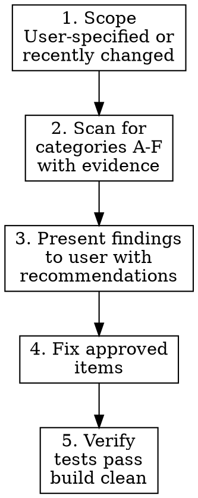

# Deslopify

## Overview

Code should say what it means and mean what it says. Slop is code that's redundant, misleading, unnecessarily complex, testing the obvious, or hiding assumptions.

**Core principle:** Remove what obscures meaning. Keep what provides it.

## When to Use

This skill runs in two modes. Establish which one you are in before doing anything.

### Rubric mode — automatic, no user request needed

Review and planning nodes load this skill as their **rubric** and cite its sections. They do not ask permission first, and they do not restate its checks. Current callers:

- `jj-superpowers:subagent-driven-development` `simplification` nodes (the `sdd-simplifier` agent) — apply **section E**, the sole owner of duplication detection in a planned graph.
- `jj-superpowers:requesting-code-review` and `jj-superpowers:receiving-code-review` — apply the canonical **file-size rule** in section F.
- `jj-superpowers:writing-plans` and `jj-superpowers:executing-plans` — apply the file-size rule when sizing touched files.

In rubric mode you are a **reviewer**, not a cleaner: apply only the sections the caller cites, report findings with evidence, and **do not** run the Process below, ask a scoping question, or edit code. The caller owns what happens to the findings.

### Sweep mode — explicit user request only

A standalone cleanup pass over a scope the user names. Triggered when the user says:
- "deslopify this code"
- "review for quality"
- "clean up unnecessary code"
- "this code is sloppy, improve it"

Sweep mode runs the full Process below, including the scoping question and the approval gate. **Never start a sweep on your own initiative** — an unrequested sweep rewrites code the user did not ask you to touch.

**Not for:**
- Large dead-code or deduplication cleanup → use the "Large Cleanup Mode" below
- Which tests to write → `jj-superpowers:test-driven-development` and `what-to-test.md`
- Debugging failures → `jj-superpowers:systematic-debugging`

## Scoping (sweep mode)

Ask the user what scope to review. Default suggestion: recently changed files. Offer whole-directory if they want thoroughness.

Never deslopify code you don't understand. Read before removing.

## Large Cleanup Mode

For broad cleanup, reorganization, deduplication, or dead-code removal across multiple directories, use `jj-superpowers:codebase-cleanup`. It provides the map/reduce workflow, subagent prompt pack, review gates, and deletion approval gates for large cleanup work.

## The Deslopify Checklist

Six categories. Scan for each. Gather findings with evidence before presenting.

### A. Suspicious Logic

Code that quietly does something other than what the caller would expect. Ordinary bugs (inverted conditions, off-by-one) are review basics, not slop categories.

- **Silent assumption masking in branches**: Control flow that hides unmet assumptions instead of surfacing them. When `foo.bar` is `Optional<T>` but the code assumes it's always present, silently handling the `None` case masks a potential bug. Fail fast (return `Err`, panic, throw) when assumptions are violated. If a fallback is genuinely correct — which is rare — document *why* and make the decision explicit.
- **Silent fallbacks**: Code that silently defaults instead of surfacing a real choice or error
- **General fallbacks**: `orElse`, `unwrap_or`, catch-all branches that hide logic rather than making it explicit
- **Unreasonable defaults**: Defaults that silently produce wrong behavior instead of failing fast

**Fix:** Fail fast on unmet assumptions; make any genuinely correct fallback explicit and documented.

### B. Undocumented Invariants

Assumptions that aren't encoded in types or documented — code that works but only if you "just know" something.

- Implicit assumptions not encoded in types
- Preconditions callers must satisfy but aren't documented
- State machines with unwritten transitions
- Functions where "you just have to know" the calling order

**Fix:** Encode in types, add assertions, or add doc comments.

### C. Tautological / Redundant Tests

Tests that restate the implementation, check what the compiler already enforces, or cannot fail by construction. Criteria live in `jj-superpowers:test-driven-development` (`what-to-test.md`).

**Fix:** Remove the test, or replace it with a test of a real invariant.

### D. Overengineering

Abstractions and configurability added for hypothetical future use.

- Abstractions with one implementation
- Configurability for hypothetical future needs
- Generic interfaces for a single concrete use
- Premature optimization
- **Unnecessary branching**: `if`/`match` branches that always take one path, feature flags permanently on
- **Placeholders**: TODO stubs, `unimplemented!`, empty `catch` blocks that swallow errors
- **Legacy shims**: Compatibility adapters for APIs no longer needed
- **Compatibility wrappers where API compatibility wasn't requested**: Wrappers preserving an interface no consumer requires

**Fix:** Remove it until a second use case actually exists, or the consumer is real.

### E. Under-engineering / Duplication

Duplication and inconsistency that should be unified or at least made consistent.

- Duplicated logic reimplemented for a differently-named type — could be replaced with a newtype + delegation/traits/interfaces
- Duplicates of utility functions and types already implemented elsewhere — can they be made generic? Can traits/interfaces avoid duplication even if it adds modest complexity?
- Duplicated logic that could be extracted
- Unnecessary wrapper functions
- Comments that restate the code, are verbose, or reference transient artifacts (ticket IDs, doc/handoff paths) → for the rules and a cleanup pass, use `jj-superpowers:writing-comments`
- Unused parameters not caught by linters
- Code that could be made generic but isn't — same pattern across multiple types deserves a trait/interface rather than N copies
- **Inconsistent configuration schema**: Similar config structs with slightly differing field names, enum variants with identical semantics but different names, Even when configs can't share a schema, enforce consistent field naming so users don't track many variants of semantically identical fields.
- **Cacheable work not cached**: Expensive computations, lookups, or transformations that are repeated without caching — without a reason to recompute each time
- **Unused caches**: Caches that exist but aren't consulted where they should be — the work is recomputed anyway, making the cache dead code

**The overengineering / under-engineering distinction:** Overengineering creates abstractions for hypothetical future uses. Under-engineering ignores duplication that already exists across the codebase. One is premature; the other is neglecting the second use case that has already arrived.

**Fix:** Extract shared abstractions when duplication exists. Use traits/interfaces/newtypes. Avoid N copies of the same logic for differently-named types. Cache expensive operations and reuse existing caches.

### F. Poor Organization

Files and modules structured in ways that obscure rather than reveal the codebase's shape.

- **Long files (canonical file-size rule)**: Files over ~500 lines usually mix multiple responsibilities and warrant a decomposition check; files over ~1000 lines are presumptively unacceptable and should be split before merge. Split by responsibility, not by arbitrary line count. This is the single source of truth for the ~500/1000-line thresholds; other skills cross-reference it rather than restating the numbers.
- **Flat modules**: Directories with many files at one level and no submodules. Organize code in a tree that mirrors the domain — group related types, functions, and tests together.
- **Tests mixed with implementation**: Long test suites in the same file as the code they test. Only tests that help readers understand invariants or intent belong near implementation. Exhaustive test suites go in dedicated test files or directories.

**Fix:** Split long files by responsibility. Organize flat modules into subdirectories that reflect the domain. Move comprehensive test suites to dedicated test files; keep only invariant/intent tests near the implementation.

## Process (sweep mode)

Rubric-mode callers skip this entirely — they cite sections and report findings; they do not scope, approve, or edit.

**Step 1:** Ask user for scope. Suggest recently changed files.

**Step 2:** Scan for each category. For every finding, note the file, line, and evidence (why it's slop, not just "this looks wrong").

**Step 3:** Present all findings with recommendations. Let user approve what to fix. Don't remove or change code without approval.

**Step 4:** Fix approved items.

**Step 5:** Run tests and build. Verify nothing broke.

## Guardrails

- **Don't remove tests without checking they're truly redundant** — a bad name is not the same as a bad test
- **Don't refactor code that's about to be replaced** — ask the user first
- **Don't break public API without checking backwards compatibility**
- **Don't treat linter-detectable issues as slop** — use the linter, that's what it's for
- **Don't cache prematurely** — but don't skip caching just because something seems cheap. Repeated operations add up (e.g., text shaping per frame). When an API provides a caching mechanism, there's usually a reason. Implementing performance correctly up front is often better than guessing why things are slow later.
