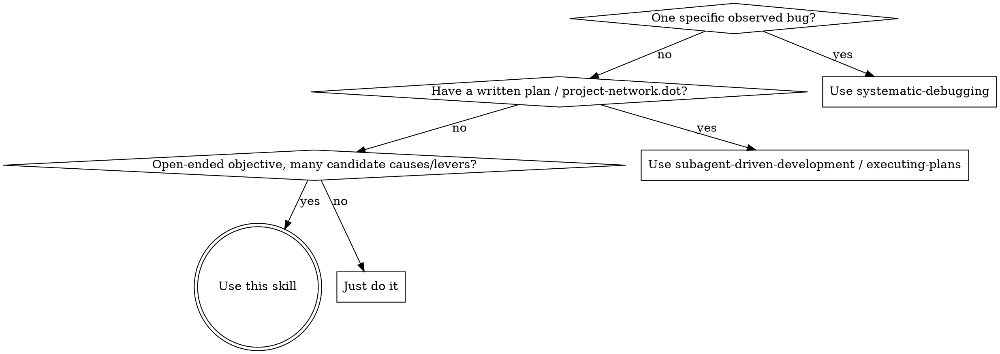
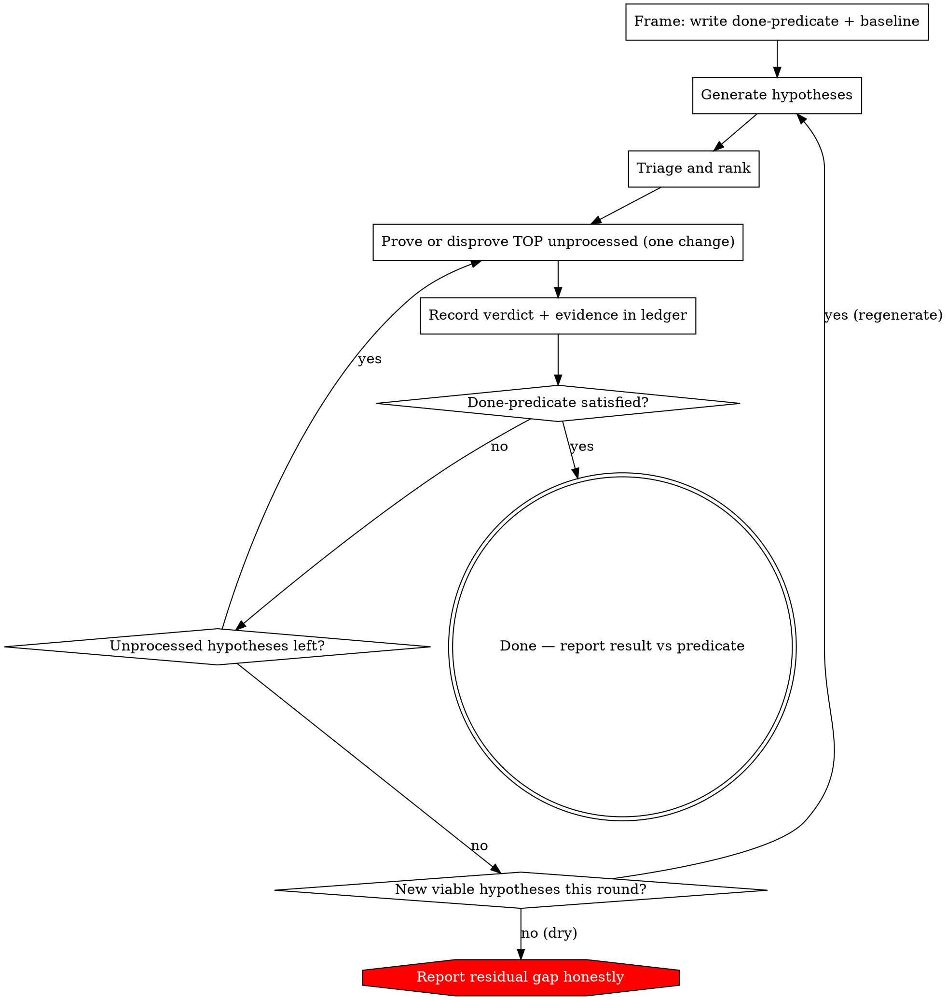

# Hypothesis-Driven Improvement

## Overview

Open-ended objectives ("eliminate all the ways X fails to do Y", "get p99 under the SLO", "harden this flaky pipeline") have no known path. The failure is not chasing the objective — it is **shipping a bundle of plausible fixes from a hunch and declaring victory**, with no measurable definition of done, no idea which change actually helped, and no honest account of what's left.

**Core principle:** Turn the fuzzy objective into a falsifiable *done-predicate*, measure a *baseline*, then drive a hypothesis loop — generate → triage → prove-or-disprove ONE change at a time → record — until the predicate holds or hypotheses run dry. **Evidence over intuition; one change at a time; no silent success.**

## Two Modes

This skill has a heavyweight mode and a lightweight one. **Default to simple in-line; escalate to full only when you need measurement, attribution, or durable state.**

| | **Simple in-line** | **Full** |
|--|--|--|
| Use when | findings come from a reviewer/critic and are real-on-sight (adversarial spec/design/code review, doc hardening) | you must discover causes/levers and *prove* each affects a metric or failure rate (flaky-behavior hardening, perf/optimization) |
| Convergence | a review round surfaces zero Major findings | the done-predicate holds, or hypotheses run dry |
| Overhead | none — runs in the conversation, no files | done-predicate + baseline + ledger + triage |

Everything below the Simple In-Line Mode section (Iron Law, ledger, triage, prove/disprove gate) is **full mode**. Don't apply it to a simple review loop — that's the bureaucracy this mode exists to avoid.

## Simple In-Line Mode

When the loop's "findings" come from a reviewer/critic and are self-evidently real once surfaced, you do **not** need a done-predicate, baseline, ledger, or triage scoring. Run it inline, in the conversation. **No files.**

**Severity taxonomy (governs the loop):** every finding is one of three buckets.

| Severity | Definition | Loop behavior |
|----------|------------|---------------|
| **Major** | Changes the outcome: structural/design flaw, correctness error, genuine ambiguity (two readings → materially different builds), missing/contradicted requirement, wrong abstraction boundary | Must be resolved **and** re-reviewed. Loop continues while any Major appears. |
| **Minor** | Deterministically resolvable with no design decision (under-specification, local improvement with one unambiguous fix) | Folded in **immediately, same round**; does **not** by itself trigger another round. |
| **Nit** | Cosmetic/preference | Dropped or folded trivially. Never loops. |

**Convergence = a review round that surfaces zero Major findings.** On that round, fold any outstanding Minors and drop Nits — there is **no extra confirming round** just for Minors. Fold Minors surfaced in earlier rounds proactively so they don't accumulate.

**Who folds a Minor in (context-dependent):**
- **Document review** (spec/plan/design text, no implementer) → the **orchestrator** edits the document directly.
- **Code-review nodes** with reviewer/implementer separation in force → a Minor still needs an **implementer round-trip + re-verify**; the orchestrator cannot edit code. "Fold-and-go" there means **batch the Minors into one implementer dispatch**, not orchestrator edits.

The lite loop:

1. **Review** — dispatch ~**3 adversarial reviewer subagents** over the current artifact (hostile charter: find real problems, construct the concrete failure), **each with a distinct lens**. Read-only over shared immutable text → safe to fan out (see jj-superpowers:dispatching-parallel-agents).
   - Encouraged lens menu (default, not mandatory): correctness/soundness, completeness/missing-requirements, ambiguity/interpretability, API & design soundness, concurrency, parallelism, performance, DRYness/duplication, ease of abstraction & extensibility, testability/verification, over/under-engineering (YAGNI).
   - The orchestrator picks the ~3 most relevant lenses for the artifact and **rotates lens assignments across rounds** for diversity. Add (e.g. Security) or drop lenses per artifact.
2. **Tag and accept/refute** — for each finding, assign a **Major/Minor/Nit** severity, then decide: *accept* (real, in scope) or *refute* (reviewer is wrong / out of scope). Both directions need justification, not reflex. When a finding is plausible but you think it's wrong, have a second subagent adversarially check before discarding it; equally, don't blindly accept a confident-sounding finding that may be wrong. **Fold-and-go applies only to ACCEPTED Minors** — a Minor may still be refuted with justification.
3. **Correct** — resolve accepted Majors; fold accepted Minors (per the context rule above); drop/fold Nits.
4. **Repeat** — re-review until a round surfaces **zero Major findings**. On that round, fold outstanding Minors and drop Nits — that zero-Major round is your convergence signal. A Major reopens the loop; Minors/Nits alone do not.

**Lite-mode invariants (the only discipline that survives):**
- Adversarially verify findings — tag severity, then accept/refute *with justification*, both directions.
- **Convergence is a zero-Major round**, not a quiet first pass — a fresh Major always forces another resolve-and-re-review cycle; Minors fold in-place and Nits drop without looping.
- No ledger, predicate, baseline, or triage. No files. Keep it in the conversation.

**Ensembling (optional, default-on when available):** after the subagent loop converges (a zero-Major round), an external-harness ensemble pass may run the **same lens-based review** through any available external harness. An ensemble pass's **Major** findings re-open the subagent loop; external **Minor/Nit** findings fold-and-go (or drop) and do **not** re-open it. **Skip silently if no harness is available.** The combined loop terminates when an ensemble pass yields zero Major. (Brief by design — the authoritative description lives in brainstorming.)

Switch to full mode the moment you need to measure a metric, attribute *which* change helped, or carry state across many rounds.

## When to Use



Triggers: "eliminate all possibilities of…", "make X never fail to…", "harden", "reduce flakiness", "drive metric M to target T", intermittent failures with no clear pattern, noisy metrics, optimization without a known cause.

## The Iron Law (Full Mode)

This law governs **full mode**. In simple in-line mode the equivalent invariants are the lite-mode ones above (adversarial accept/refute + loop until a zero-Major round).

```
NO LOOP WITHOUT A WRITTEN DONE-PREDICATE AND A MEASURED BASELINE FIRST
```

Before generating a single fix, write down — in the ledger — two things:

1. **Done-predicate** — a falsifiable statement of "done". Translate the fuzzy objective into something measurable:
   - Hardening: an *enumerable* failure-mode set, each closed, **plus a regression guard** (a test/assertion that stays green). "Eliminate all the ways X fails" is not a predicate until you've written the list of ways and a measure for "closed".
   - Optimization: metric M, the *measurement method*, target T, and the measurement window.
2. **Baseline** — the current measured value of M, or the current failure-mode inventory. If you can't measure the baseline, **instrumenting to get one is hypothesis #1** — you cannot prove improvement against an unknown.

No predicate, no baseline → you are guessing, not improving.

## The Loop



1. **Generate** — enumerate candidate causes/levers. Each hypothesis is a concrete, testable statement: *"If we do A, failure mode F closes / metric M improves."* When subagents are authorized, fan out generation with diverse lenses (input edge cases, resource limits, concurrency, dependency failures, config). Solo brainstorm otherwise.
2. **Triage & rank** — score each by **likelihood-of-impact × magnitude × (1 / cost-to-test)**; sort descending; record in the ledger. Don't act on an unranked list.
3. **Prove or disprove — ONE change at a time** (see below).
4. **Record** — write the verdict, evidence, and change id to the ledger. Move to the next.
5. **Converge** — list exhausted → re-check the done-predicate. Satisfied → done. Not satisfied → regenerate (informed by what you learned; drop disproven ones). **Loop-until-dry:** stop when a generation round produces no new viable hypotheses AND the predicate is unmet → **report the residual gap.** Never let the loop end silently as if the objective were met.

## Prove or Disprove (the core gate)

**One change at a time. Additive.** Each proven change stacks onto the solution line and becomes part of the new baseline; the next hypothesis is tested against that updated baseline.

- **Never bundle.** Shipping timeout + retry + fallback together means you cannot attribute the result to any one of them. Bundled "fixes" are unproven hypotheses wearing a disguise. Split them; prove each.
- **Define the proving test FIRST**, before implementing:
  - Deterministic → a test/assertion. **REQUIRED SUB-SKILL:** use jj-superpowers:test-driven-development to write the failing test first.
  - Non-deterministic / noisy → a metric measured against the baseline **over a stable window with repeated runs**. A single favorable reading on a noisy metric proves nothing.
- **Implement** the candidate as an isolated change, then **measure**.
- **Verdict** ∈ {proven, disproven, inconclusive}:
  - *proven* — advances the predicate with no regression → keep, update baseline.
  - *disproven* — no effect or regresses → keep the change annotated as disproven (see below); do not let it pollute the solution line.
  - *inconclusive* — refine the hypothesis or the test; do not mark processed as if resolved.
- **Disproof by evidence (no implementation needed).** A hypothesis can be disproved by evidence alone (a profile showing the query is 5% of the tail, a log breakdown showing timeouts are 10% of failures). When you do this, **have a subagent confirm the evidence is sufficient** — an adversarial check that the disproof actually holds — before marking it disproven. Cheap disproofs are how you avoid wasted implementation, but only if the evidence is real.

### Keep all attempts (jj)

This repo uses jj. Every candidate is its own change — **never `jj abandon`**. Annotate each with its verdict so the user can prune later. Proven changes integrate into the solution line; disproven/inconclusive ones stay as retained side changes, recorded in the ledger by change id. Nothing is silently discarded.

## Parallelism

Default is **sequential**, because proven changes are additive and shift the baseline. Parallelize a batch ONLY when hypotheses are **orthogonal** (touch disjoint code/behavior, cannot interact) **and** each is provable with an easy, fast, deterministic test. Use worktree isolation for concurrent code changes. When in doubt, sequential. **REQUIRED BACKGROUND:** jj-superpowers:dispatching-parallel-agents.

## The Ledger

A persistent markdown file (e.g. `docs/superpowers/improvement-loops/YYYY-MM-DD-<topic>.md`) is the single source of truth. It survives context compaction — the orchestrator and subagents reconstruct loop state by reading it. Start it before generating hypotheses.

```markdown
# Objective: <fuzzy objective>
Done-predicate: <falsifiable, measurable>
Baseline: <measured value / failure-mode inventory>  (measured <when/how>)

| id | hypothesis | likelihood | impact | status | verdict | evidence / measurement | jj change | notes |
|----|-----------|-----------|--------|--------|---------|------------------------|-----------|-------|
| H1 | bump ffmpeg timeout closes timeouts | high | med | done | proven | failures 2.0%→1.2% over 10k uploads | xqop... | new baseline 1.2% |
| H2 | bad-seek on some containers | med | med | done | disproven | subagent-verified: 0 seek errors in failure logs | (none) | evidence-only |
| H3 | S3 transient errors need retry | med | high | in-progress | — | — | — | — |
```

## Red Flags — STOP

- Building a done-predicate, baseline, ledger, or files for a simple review loop → use simple in-line mode.
- Stopping a review loop after one pass because the big issues are gone → loop until a round surfaces zero Major findings (Minors fold in-place; Nits drop).
- Writing a fix before writing the done-predicate and baseline (full mode).
- A fix-*list* with no likelihood/impact ranking.
- Shipping more than one change before measuring.
- "I can tell it's faster / better" — intuition instead of measurement.
- Declaring the objective met without re-checking the done-predicate.
- Marking an inconclusive result as processed.
- A single metric reading on a noisy system treated as proof.
- The loop ending without either the predicate met or an explicit residual-gap report.

## Rationalization Table

| Excuse | Reality |
|--------|---------|
| "I'm confident it's the timeout, just ship it" | A hunch is hypothesis H1, not a diagnosis. Triage it, prove it, measure it. |
| "Ship all the fixes together to save time" | Bundled changes are unattributable. You won't know what worked or what to revert. One at a time. |
| "'Eliminate all' is impossible, so I'll just do my best" | Then write the predicate you CAN hit (enumerated modes + measured rate + regression guard) and report against it. Vague objective ≠ no predicate. |
| "It looked faster after deploy" | One reading on a noisy metric is noise. Repeated runs over a stable window, vs baseline. |
| "No time to instrument a baseline" | Without a baseline you cannot prove improvement at all. Baseline is hypothesis #1, not optional. |
| "I'll just abandon the failed attempts" | Keep them annotated. The user prunes; disproofs are evidence for the next round. |
| "Hypotheses ran out, I'll wrap up" | Re-check the predicate. If unmet, report the residual gap explicitly — don't imply success. |
| "I'll write a done-predicate + ledger for this spec review" | If findings are real-on-sight from a reviewer, that's simple in-line mode: review → tag severity + accept/refute → correct → loop until a zero-Major round. No predicate, no ledger, no files. |
| "The review found nothing major, we're done" | Convergence is a round that surfaces **zero Major findings** (re-review confirms the fixes held). On that round fold outstanding Minors and drop Nits — but a single fresh Major reopens the loop. |

## Common Mistakes

- **Predicate drift** — quietly redefining "done" to match what you achieved. Pin it in the ledger up front; if it must change, say so explicitly.
- **Triage theater** — ranking once and never re-ranking after evidence changes likelihoods. Re-triage each round.
- **Confirmation bias in measurement** — cherry-picking the favorable run. Pre-commit the measurement method.
- **Treating disproof as failure** — a confidently disproven hypothesis is progress; it shrinks the search space.

## Cross-References

- jj-superpowers:systematic-debugging — for a single observed bug (root cause first).
- jj-superpowers:subagent-driven-development / executing-plans — for executing a known plan.
- jj-superpowers:test-driven-development — write the proving test first for deterministic hypotheses.
- jj-superpowers:dispatching-parallel-agents — fan-out generation/triage/orthogonal proving.
- jj-superpowers:verification-before-completion — evidence before any "done" claim.
- jj-superpowers:tool-output-discipline — keep metric/measurement output concise and structured.
