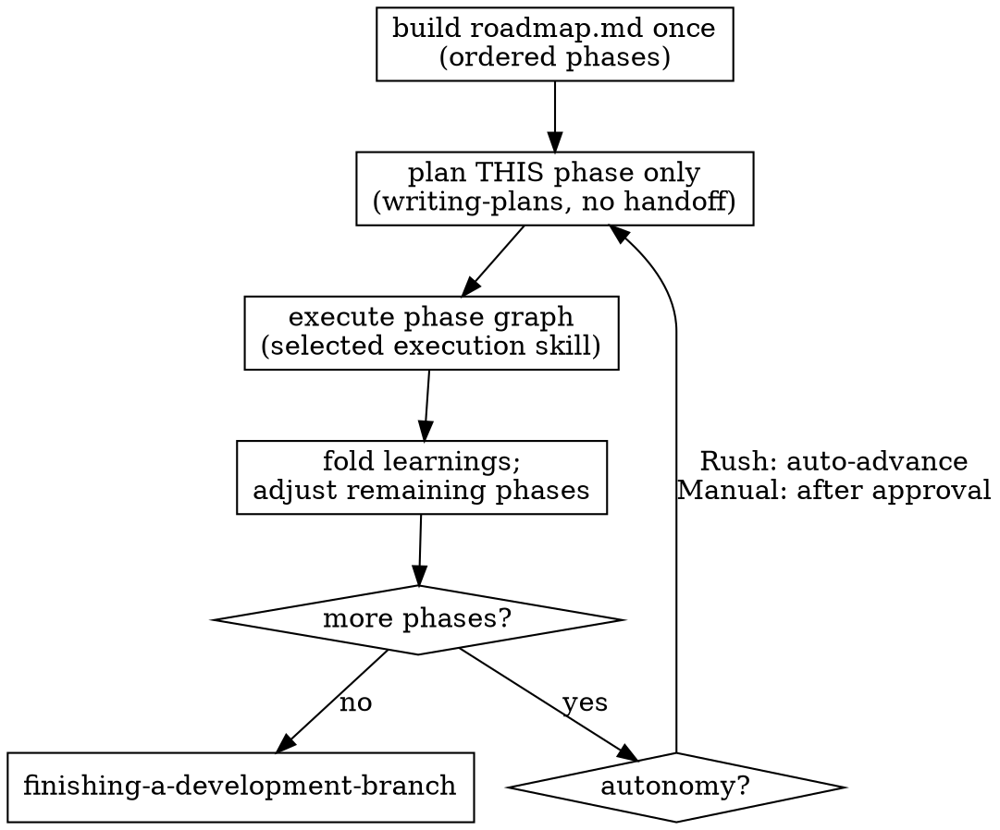

# Iterative Planning (Agile phase loop)

## Overview

Some designs are too large or too uncertain to plan as one `project-network.dot` up front. This skill runs the **plan-one-phase loop**: build an ordered roadmap once, then for each phase plan it, execute it, fold what you learned back into the roadmap, and only then move on. You never plan all phases in advance — later phases are shaped by what earlier phases actually produce.

**Reach for this when** the whole project would exceed one comfortable execution session, a later phase's task list can't be written without guessing because it depends on an artifact an earlier phase produces, or the whole-project `task` count runs past ~10–12.

This is a technique skill. It **delegates**: it does not reimplement planning or execution.

**REQUIRED SUB-SKILL:** Use `jj-superpowers:writing-plans` to plan each phase.
**REQUIRED SUB-SKILL:** Use `jj-superpowers:subagent-driven-development` or `jj-superpowers:executing-plans` to execute each phase's graph.
**REQUIRED SUB-SKILL:** Use `jj-superpowers:finishing-a-development-branch` once all phases are done.

## The loop

```
docs/superpowers/plans/YYYY-MM-DD-<feature>/
  roadmap.md            # durable phase manifest (resumable index)
  phase-01-<name>/      # normal plan dir: plan.md, project-network.dot, context/, tasks
  phase-02-<name>/
  ...
```

1. **Build `roadmap.md` once** from the approved design: an *ordered* list of phases, each a one-line goal + rough scope. Lightweight — **not** detailed plans. Record Strategy, Autonomy, and Execution in the header.
2. **For each phase, in order:**
   a. **Plan.** Invoke `writing-plans` **scoped to this phase only** → a normal, valid phase graph that reaches its own `final`. The per-phase `writing-plans` call **skips its own Execution Handoff** — execution-skill selection is owned here (see below).
   b. **Execute** that phase's graph via the selected execution skill.
   c. **Fold learnings.** After the phase's `final`, append a completion note (new APIs/types, deviations, surprises, follow-ups) to that phase's roadmap entry, then re-examine remaining phases and adjust if warranted (split / merge / reorder / insert / drop) — within the drift guardrail below.
   d. **Boundary checkpoint.** Manual → pause and present the phase summary + proposed next phase for approval. Rush → auto-advance. Resolve per the **Autonomy Level table in `using-superpowers`**.
3. **All phases `[done]`** → `finishing-a-development-branch`.



## Execution-skill selection (owned here)

In Agile, **this skill** owns the subagent-vs-inline decision. It is made **once** at roadmap time, recorded in `roadmap.md`'s `Execution:` field, and applied to every phase. On resume the loop reads that field to rehydrate the choice — the skipped per-phase handoff has no other source, so the field is **mandatory**. Under Rush, auto-resolve this selection per the **Autonomy Level table in `using-superpowers`**.

## Phase sizing heuristic (advisory, not a gate)

A phase is a vertically-sliced, independently-verifiable increment delivering a coherent working capability. Count `task` nodes — the only work nodes a phase graph authors:
- **Floor (~3 `task` nodes):** reach a real `verify` node and deliver a usable increment, not a single trivial edit. Merge smaller phases unless a hard sequencing boundary forces the split.
- **Ceiling (~8 `task` nodes):** one plan + execution cycle should fit comfortably in one execution session.
- Tildes, not assertions: a coherent 8–9 task capability is fine. Prefer keeping a capability whole over splitting to hit the number; split only at a natural `verify` boundary. Each phase builds on the **integrated** result of prior phases.

## Terminal phase failure

A phase reaches `final` when every `verify` node in its graph has passed. If it cannot, **never** silently skip the phase or proceed to the next one (later phases build on integrated prior results):
- **Structural** (`BLOCKED_STRUCTURAL`) → mark the phase `[blocked]`, return to brainstorming for that phase's design (floor #2). Downstream phases do **not** start.
- **Stuck mechanical failure** (verify/quality exhausts the mechanical retry budget) → mark `[blocked]` (floor #4).

## Mid-phase resume contract

A phase is a normal plan with its own `project-network.dot`. The **phase graph** is the intra-phase resume state (readiness re-derived from the graph + what is filed in jj, exactly as any non-Agile resume). `roadmap.md` tracks **phase granularity only**: `[planned]` / `[in progress]` / `[blocked]` / `[done]`. A floor halt mid-phase leaves the phase `[in progress]`; a resumed session re-reads that phase's graph to continue. No new intra-phase persistence is introduced.

## Roadmap-drift guardrail (Rush × Agile)

The baseline is the **approved roadmap**, measured in **phases**. Under Rush, floor #3 applies when **either**:
- an inserted phase pursues a goal **not traceable to the approved design**, or
- the phase count grows **materially** beyond the approved roadmap (rule of thumb > ~+50% phases).

Reorder / merge / split / drop within the original scope, and inserts that are clearly decomposition of an approved goal, do **not** trip the guardrail.

## `roadmap.md` template

```markdown
# <Feature> Roadmap (Agile)

> **Goal:** <one sentence>
**Strategy:** Agile   **Autonomy:** Rush | Manual   **Execution:** subagent-driven | inline

## Phases
1. [done] phase-01-<name> — <goal>
   - **Learnings:** <new APIs/types, deviations, surprises, follow-ups>
   - **Auto-advanced** (Rush trail marker; omitted under Manual)
2. [in progress] phase-02-<name> — <goal>
3. [blocked] phase-03-<name> — <goal>
   - **Blocked:** <structural → returned to brainstorming | stuck → mechanical budget exhausted at verify-NN>
4. [planned] phase-04-<name> — <goal>
```

The `**Learnings:**` line and the optional `**Auto-advanced**` marker together are the Rush trail entry — there is no separate trail artifact; the roadmap entry *is* the trail.
