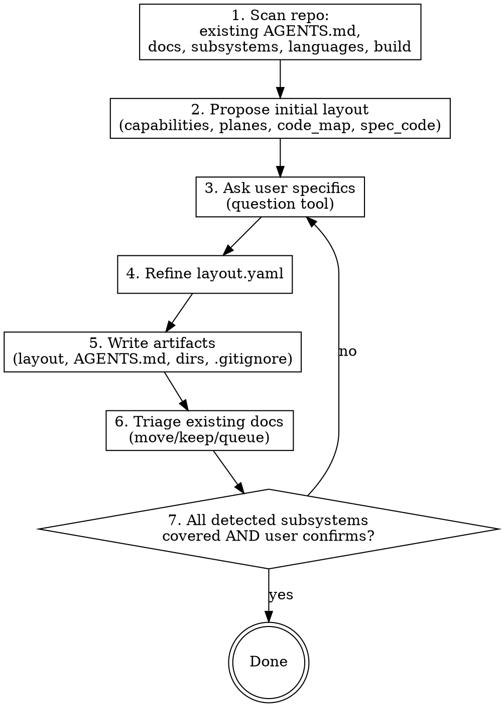

# Project Layout

Establish and maintain the per-project structure that every other skill in this set relies on. The hub is `.agents/layout.yaml`. Everything else (specs, queues, blogs, project-specific skills) hangs off it.

## When to use

- A project has no `.agents/layout.yaml` and you're about to do non-trivial work in it.
- `AGENTS.md` has grown long with layout details that should live in the manifest.
- You need to register a project-specific code-style skill (the `projx-frontend` pattern).
- A user asks to audit the layout (manifest, `AGENTS.md`, spec and queue directories).
- A subsystem has developed its own spec/skill set and needs a nested AGENTS.md.

**Not for:**
- Writing a spec → `writing-specs`.
- Auditing spec ↔ code drift → `spec-drift-detector`.
- General code documentation → `documentation`.

## Bootstrap loop (brownfield-first)

Brownfield is the default. Iterate; don't scaffold-and-leave.

### Step 1 — Scan
Inspect (read-only): existing `AGENTS.md`, `docs/`, top-level dirs, languages (Cargo.toml / package.json / pyproject.toml), build system. Identify **candidate subsystems** — anything that looks like an independent unit: a service directory, a top-level crate, a frontend app, a CLI. Subsystem detection is heuristic; record the set so step 7 can check coverage.

### Step 2 — Propose
Draft a starting `layout.yaml` with `capabilities`, `planes`, `code_map`, `spec_code`. When a candidate subsystem has 5 or more obvious sub-areas with distinct code paths (e.g., an API service with distinct endpoint groups, a frontend with distinct feature areas), propose sub-spec directories upfront rather than one flat spec — list the proposed sub-specs and ask the user to confirm before creating them.
(This structural signal — distinct code areas — is a bootstrap hint used before requirements are written. The authoring trigger from `writing-specs` — 15+ requirements — applies later when requirements are being specified.)
Don't try to be exhaustive — name what's obvious, leave the rest for user input.

### Step 3 — Ask
Use the question tool. Cover: which mdbook sections this project needs (users / developers / operators / contributors — some projects have none), preferred spec partition tweaks, glossary seeds, `external_tracker` config, whether `agent_blog` is on, whether handoffs are committed (default no).

### Step 4 — Refine
Edit `layout.yaml` per answers. Add `schema_version: 2`. Keep `excluded_paths:` short — generated files, vendored code, build output.

### Step 5 — Write
Create:
- `.agents/layout.yaml` (the manifest — see `references/manifest-schema.md`)
- `AGENTS.md` at repo root (~15 lines — see `references/agents-md-template.md`)
- `docs/agent-specs/{capabilities,planes}/`, `glossary.md`, `invariants.md` (empty stubs only if user wants stubs)
- `docs/agent-specs/capabilities/<slug>/<sub-spec>/SPEC.yaml` stubs for any pre-agreed sub-spec split.
- `.agents/tech-debt/{docs,code,tests,perf}/` (or just `docs/` if user prefers minimal) — one directory per queue; entries are per-file (see `references/manifest-schema.md` → Tech-debt queues). Add a `.gitkeep` to the required `docs/` so the empty dir is tracked.
- `.gitignore` additions — see `references/gitignore-defaults.md`. Ask before committing changes that ignore previously-tracked paths.
- Optional mdbook scaffold if user opted in.

### Step 6 — Triage existing docs
For each existing doc that overlaps with the new system:
- **Leave alone** — clearly unrelated (LICENSE, architecture diagrams, etc.).
- **Excerpt-via-writing-specs** — high-quality prose that describes normative behavior; hand off to `writing-specs` (don't auto-convert).
- **Queue for rewrite** — outdated or unclear; write a new entry file under `.agents/tech-debt/docs/<YYYY-MM-DD>/<HHMMSS>-<slug>.md` (per-entry format in `references/manifest-schema.md`).

Never auto-generate specs from code or prose. Quality > coverage.

### Step 6.5 — Migrate legacy tech-debt queues
If the project predates schema v2 — manifest is `schema_version: 1`, or `tech_debt.queues.*` point at `.md` files / single-file queues exist on disk — convert them to per-entry directories using the **migration recipe** in `references/manifest-schema.md` (split each entry into `<queue>/<YYYY-MM-DD>/<HHMMSS>-<slug>.md`, drop `status:`/`last_verified:`, delete the old `<queue>.md`, bump `schema_version` to `2`). This is the only migration path; `spec-drift-detector` reports legacy queues and routes them here.

### Step 7 — Termination check
Stop when **both** are true:
- a. Every candidate subsystem from step 1 has been classified as one of:
  - **Capability/plane-bearing** → assigned in `code_map`, OR has a stub `SPEC.yaml` (status `draft`), OR has an explicit `tech-debt/docs/` entry deferring the spec work.
  - **Infrastructure / non-product** → noted as such in the bootstrap conversation (build glue, internal libraries, dev tooling, test scaffolding). These do NOT need any spec, stub, or queue entry; their absence from `code_map` is correct. The user explicitly confirms this classification.
- b. The user confirms the overall structure.

If (b) without (a), list the unclassified subsystems and ask the user: capability/plane work OR infrastructure? **No silent acceptance.**

## Registering project-specific skills (projx-frontend pattern)

When a user asks to add a project-specific skill (e.g., a code-style guide for a particular frontend or backend stack):

1. Confirm the skill belongs at the project level, not in the global skill set. Project skills cover libraries, patterns, anti-patterns specific to this codebase.
2. Walk the user through frontmatter triggers. Apply the **anti-keyword-bloat check**:
   - Triggers MUST be specific enough that the skill loads only when relevant.
   - Triggers MUST NOT include generic terms ("React", "Rust") without further specifier ("React component in `js/foo/`", "Rust trait in `crates/bar/`").
   - Wide-net descriptions force the skill into every session, defeating context efficiency.
3. Place the skill at `.agents/skills/<name>/SKILL.md` per `layout.yaml` `project_skills.root`.
4. Delegate the skill body content to `writing-skills`. This skill only handles registration/placement.

## Nested AGENTS.md

When a subsystem grows its own spec set and skills, add a nested `AGENTS.md` (e.g., `js/projx_frontend/AGENTS.md`):
- Points to the local subset of specs.
- Lists subsystem-specific skills if any.
- Inherits everything from root `AGENTS.md` and `layout.yaml`; only override what differs.

Keep these as short as the root.

## Handoffs and agent blog (end of a work session)

When a work session ends, check `layout.yaml`:
- **`handoffs.enabled`** and the work is incomplete, blocked, or paused → write `.agents/handoffs/<YYYY-MM-DD>/<HHMM>-<topic>.md` (under `handoffs.path`): what was done, what remains, the blocker, and where to resume.
- **`agent_blog.enabled`** → write `.agents/blog/<YYYY-MM-DD>/<HHMM>-<topic>.md` (under `agent_blog.path`), ~10-30 lines: what happened and what was learned.

Skip both when disabled. Retention is pruned by `spec-drift-detector`.

## Anti-patterns

- **Inventing schema fields not in `manifest-schema.md`.** Stick to the published schema. If you need a new field, propose updating the schema first.
- **Scaffolding without asking.** Bootstrapping is conversational. Never silently overwrite an existing `AGENTS.md` or `.gitignore`.
- **Generating specs from code.** `project-layout` triages and queues; `writing-specs` authors. Never bypass.
- **Bulk-registering project skills without trigger checks.** Bloated triggers turn project skills into always-loaded noise.

## References (load on demand)

- `references/manifest-schema.md` — full `layout.yaml` schema with field-by-field notes.
- `references/agents-md-template.md` — the short root `AGENTS.md` template.
- `references/gitignore-defaults.md` — proposed `.gitignore` additions per artifact.
- `references/brownfield-checklist.md` — concrete questions to ask during bootstrap.
- `references/find-references-script.md` — the `.agents/scripts/find-references` deletion-handling helper to install during bootstrap.
