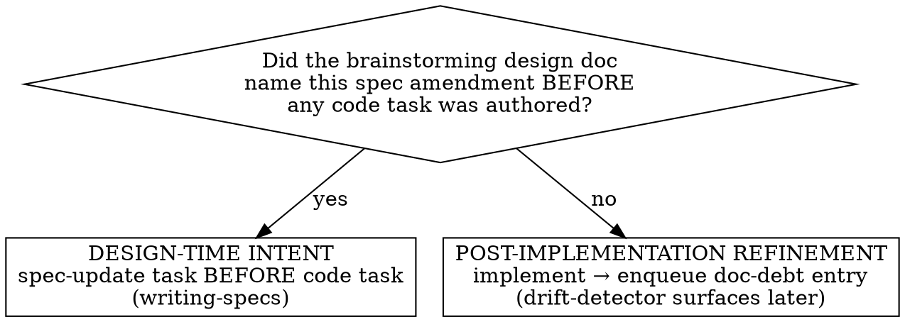

# Spec ↔ Code Sync

The workflow gate around code changes in projects with an agent-spec ecosystem. Decides what doc/spec work each code change owes, when it must happen, and how to detect code edits that would silently drift the spec.

**Spec reference:** `docs/superpowers/specs/2026-05-28-agent-spec-ecosystem-design.md` §5.2, §3.2, §3.3.

## Golden rules

> **A. Shorter is better.** Don't fill the tech-debt queue with vague hand-waves.
> **B. Shorter is not an excuse to skip.** Run the candidate-spec lookup for every touched path; surface every spec that might be relevant. The lookup is a hint, not a gate — but don't skip it just because some paths are technical/non-product.

## When to use

- A plan or in-session edit will touch source files in a project that has `.agents/layout.yaml`. `writing-plans` and `executing-plans` MUST invoke this skill before any source-file edit; the "loading mechanism" is skill discipline (the LLM following the MUST), same as everywhere else in this ecosystem.
- You are about to edit a file you suspect may be a code-as-spec module.

**Not for:**
- Authoring specs → `writing-specs`.
- Auditing existing drift → `spec-drift-detector`.
- Bootstrapping the manifest → `project-layout`.

## Preflight

1. Read `.agents/layout.yaml`. Verify `schema_version`. Bail with a clear message if unknown.
2. Build the **touched-paths set**: every file the upcoming change will create, modify, or delete.
3. For each touched path, look up `code_map`:
   - matched → load only the listed candidate specs;
   - unmatched → no spec loaded; enters the candidate-spec lookup below (which will note "no candidates" and proceed without blocking).
   (`excluded_paths` is not consulted here; it's used by `spec-drift-detector`, not this skill.)

   **Sub-spec hit:** if a `code_map` entry returns a sub-spec slug (`<parent>/<leaf>`), load that sub-spec's `SPEC.yaml` **and** the parent's `SPEC.yaml` (frontmatter + cross-cutting requirements). Parent-level requirements apply across all sub-specs and must not be violated.

4. **Frontmatter precedence check** (per design §3.3 — **best-effort**, see caveat below): for each loaded spec, compare its frontmatter `owns:` and `code_spec:` against the corresponding `code_map`/`spec_code.modules` entries in `layout.yaml`. Spec frontmatter is canonical. (Note: specs are now stored as a single `SPEC.yaml` file; the frontmatter is the YAML root of that file, not a separate Markdown frontmatter header.) On disagreement:
   - If the layout entry would have routed the touched path differently than the spec frontmatter would, surface this immediately: "`layout.yaml` says path X is owned by capability A; the loaded spec's frontmatter says A no longer owns X (or now owns Y instead). Treating frontmatter as authoritative." Then re-resolve ownership for any affected touched paths using frontmatter.
   - Record the divergence as a `layout.yaml` staleness issue. If the agent can also write `layout.yaml`, update it in the same change; otherwise flag for `spec-drift-detector`.

   **Caveat — `code_map` staleness is not caught here, nor in diff-scoped drift checks.** This precedence check only sees specs loaded via `code_map` in step 3. If `code_map` is stale and *omits* a path that some spec's frontmatter actually owns, the canonical spec is never loaded and the divergence stays invisible. `spec-drift-detector`'s default diff-scoped mode uses `code_map` too and has the same blind spot. **Only `spec-drift-detector --full-audit` walks spec frontmatter directly to catch this class of drift**; schedule it periodically (the design recommends weekly or before significant integration milestones), not just per-change.
5. Load filtered tech-debt entries for touched paths (grep across the per-entry files in the queue directories by path; don't load every entry).

## Candidate-spec lookup (runs first)

For each touched path, look up `code_map` and surface candidate specs:

> "Paths in this change suggest the following specs are likely relevant:
> - `js/projx_frontend/src/upload/handler.ts` → capability `video-upload`, plane `observability`
> - `js/projx_frontend/src/subsystems/chat/streaming/sseClient.ts` → capability `chat-workspace/streaming` (sub-spec of `chat-workspace`), planes `auth`, `observability`
> - `js/projx_frontend/src/utils/retry.ts` → (no entries; possibly technical/shared)
> Load and consult the listed specs. For sub-specs, also load the parent spec's cross-cutting requirements."

`code_map` is a hint, not a gate. Many touched files won't have any `code_map` entry — that's normal:

- **Technical/non-product files** (build glue, config, internal infrastructure libraries, shared helper crates/packages, test scaffolding, dev tooling) are expected to lack spec mapping. Their absence from `owns:` is not a finding. Internal libraries used only by capability-bearing code don't need their own spec — their consumers' specs govern observable behavior.
- **Files inside a capability that the spec didn't list as anchors** (helpers, shared utilities, integration glue used by the work) are normal. Use the spec for the *behavior*; the file list is just a starting hint.

**Never silently fall back to whole-corpus glob matching** — but also never block a change just because some touched files have no `code_map` entry. The goal is "consult relevant specs", not "fence the work".

If a substantial change has *no* candidate specs at all, the skill MAY ask: "no specs flagged for this change — is that expected (technical/refactor work), or might a spec be missing?" The user/agent answers and proceeds.

`excluded_paths` exists for genuinely non-product paths (generated files, vendor, build) — `spec-drift-detector` uses it to skip irrelevant areas during audits. Don't grow it to suppress this skill's prompts; it's not for that.

## Change classification (the operational test)

After the candidate-spec lookup runs, classify the change. Use the **operational test** — no judgement-by-feel:

- **Design-time intent** ⇔ the brainstorming-step design doc named the spec amendment BEFORE any code task was authored.
  - **Action**: require a `spec-update` task in the plan, scheduled BEFORE the implementing task. `writing-specs` runs first; code runs second.
- **Post-implementation refinement** (= queued normative debt that MUST be resolved later, not optional polish) ⇔ everything else, including mid-implementation realizations that a spec should change.
  - **Action**: implement first; immediately enqueue an entry by writing a new file `.agents/tech-debt/docs/<YYYY-MM-DD>/<HHMMSS>-<slug>.md` describing what spec change is owed (per-entry format in `project-layout/references/manifest-schema.md`). Drift-detector will surface this later as a queue item and pair it with related drift findings. The debt is real and persistent until resolved through `writing-specs`.



Mid-implementation realizations are NOT design-time intent. They are refinement. Don't relitigate the test.

**Before routing any spec amendment to `writing-specs`, apply golden rule D (don't duplicate the code).** If the spec change you're about to request would only transcribe the signature, enum, or constant you just edited — restating *what the code is* with no added timing model, edge case, contract, or *why* — there is no spec work owed. Don't manufacture a requirement to "cover" a code change; the code is canonical for that fact. Route to `writing-specs` only when the change alters an intricacy the code can't show.

## Code-as-spec detection (atomic three-artifact rule)

For each touched path, check whether it matches any `spec_code.modules` entry.

If yes, the change is governed by the atomic three-artifact rule (writing-specs SKILL.md §"Code-as-spec module changes"):

(a) module signature + RFC2119 doc edit;
(b) any prose section in `SPEC.yaml` (purpose, actors_and_surfaces, failure_modes, etc.) updated;
(c) `SPEC.yaml` requirements list updated if an ID is bound.

**Detection of a code-first edit**: if the agent is about to edit (a) without (b) and (c) in the same change, this skill MUST:
1. Stop the edit.
2. Route to `writing-specs` with the three-artifact procedure.
3. Resume the edit only as part of the atomic change set.

This is the single check that prevents silent spec drift via typed-API edits.

## impl: annotation surfacing

When surfacing candidate specs for a code change, also grep the touched files for existing `impl:` annotations:

```
grep -rn 'impl: REQ-' <touched-files>
```

Surface any annotations found:
> "Found `impl: REQ-CAM-001` in handler.ts — this file is annotated as implementing REQ-CAM-001. Load the camera-status-view spec."

This supplements `code_map` lookup: a file that has `impl:` annotations but no `code_map` entry should still have its annotated specs loaded and consulted.

`impl:` annotations work unchanged for both flat (`impl: REQ-CHAT-001`) and nested (`impl: REQ-CHAT-STR-001`) IDs — the grep pattern `impl: REQ-` captures both.

## Unrelated debt noticed mid-task

When the agent notices code-quality or spec issues unrelated to the current task:

Apply the autonomous-session routing rule (design spec §8.3):

- **Inline-fix** SHALL be taken only when: on-path, trivial (single-file, no new abstractions, no behavior change), AND covered by the current change's verification.
- Otherwise **enqueue** a new per-entry file in the matching queue directory (`code/`, `tests/`, `perf/`, `docs/`), at `<queue>/<YYYY-MM-DD>/<HHMMSS>-<slug>.md`.
- **External filing** SHALL NOT happen autonomously unless the user has provided an allowlist of item kinds.

## Surfacing matching open queue items

When loading filtered tech-debt entries for touched paths, surface to the agent:

> "Open queue items for paths in this change:
> - code/2026-05-28/142233-replace-adhoc-retry.md (handler.ts:142–178) — Replace ad-hoc retry. Effort: small.
> Consider folding into this change."

The agent decides; don't auto-fold.

## On change completion

Final prompt before declaring the change done:

> "Reflection check: did this change alter any normative requirement that hasn't been reflected in the spec? If yes, return to `writing-specs`. If no, resolve the relevant queue items you folded in by deleting their entry files (VCS history is the audit trail)."

## Anti-patterns

- **Silently glob-matching paths-with-no-code_map-hit against all spec frontmatter.** Defeats the fast index. The lookup is a hint; report "no candidates for this path" and move on (or, for a substantial change with no candidates anywhere, surface the question per §"Candidate-spec lookup").
- **Calling mid-implementation realizations "design-time intent" to avoid the queue.** The test is mechanical: was it in the design doc? If not, it's refinement.
- **Editing a code-as-spec module and "noting it for later".** Breaks the atomic rule. Route through writing-specs now. (Reminder: the three-artifact rule now refers to `SPEC.yaml` prose sections and requirements list, not separate `SPEC.md`/`requirements.yaml` files.)
- **Bulk-adding paths to `excluded_paths` to silence drift-detector noise that you don't want to deal with.** That's the agent equivalent of `// TODO: fix this`. Push back; deferral goes in the queue, not in the manifest. (Reminder: `excluded_paths` is read by drift-detector, not by this skill — but agents sometimes try to repurpose it anyway.)
- **Manufacturing a spec requirement that just restates the code you changed.** A REQ that transcribes the new signature/enum/constant adds no normative intent (golden rule D). No spec work is owed for a change that only alters what the code already shows. Don't route it to writing-specs to "be safe".
- **Folding too many unrelated debt items into one change.** Surface, ask, fold deliberately. A change that does five things at once is hard to review and roll back.
- **Loading only the sub-spec without the parent when a code_map hit returns a sub-spec slug.** Parent-level requirements are cross-cutting and apply everywhere. Always load both.
- **Reporting a sub-spec slug as "no candidates found" because the slug has a slash.** Slugs with `/` are valid sub-spec references; resolve them to `capabilities/<parent>/<leaf>/SPEC.yaml`.
