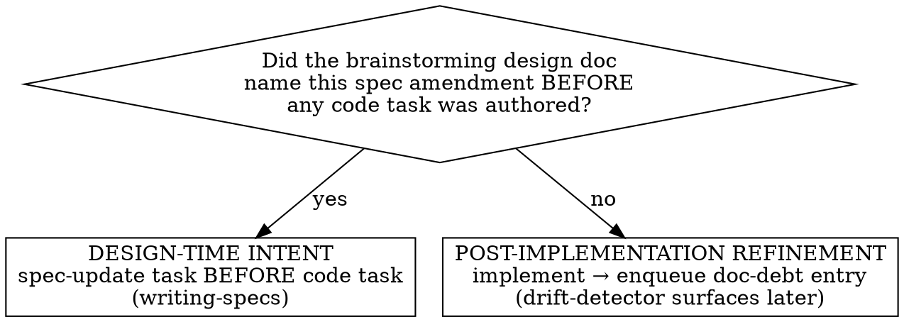

# Spec ↔ Code Sync

The workflow gate around code changes in projects with an agent-spec ecosystem. Decides what doc/spec work each code change owes, when it must happen, and how to detect code edits that would silently drift the spec.

## When to use

- A plan or in-session edit will touch source files in a project that has `.agents/layout.yaml`.
- You are about to edit a file you suspect may be a code-as-spec module.

**Not for:**
- Authoring specs → `writing-specs`.
- Auditing existing drift → `spec-drift-detector`.
- Bootstrapping the manifest → `project-layout`.

## Preflight

1. Read `.agents/layout.yaml`. Verify `schema_version`. Bail with a clear message if unknown.
2. Build the **touched-paths set**: every file the upcoming change will create, modify, or delete.
3. For each touched path, look up `code_map`:
   - matched → load only the listed candidate specs;
   - unmatched → no spec loaded; enters the candidate-spec lookup below (which will note "no candidates" and proceed without blocking).
   (`excluded_paths` is not consulted here; it's used by `spec-drift-detector`, not this skill.)

   **Sub-spec hit:** a `<parent>/<leaf>` slug also loads the parent (parent rule in `writing-specs` → "Sub-spec authoring").

4. **Frontmatter precedence check** (**best-effort**, see caveat below): for each loaded spec, compare its frontmatter `owns:` and `code_spec:` against the corresponding `code_map`/`spec_code.modules` entries in `layout.yaml`. Spec frontmatter is canonical. On disagreement:
   - If the layout entry would have routed the touched path differently than the spec frontmatter would, surface this immediately: "`layout.yaml` says path X is owned by capability A; the loaded spec's frontmatter says A no longer owns X (or now owns Y instead). Treating frontmatter as authoritative." Then re-resolve ownership for any affected touched paths using frontmatter.
   - Record the divergence as a `layout.yaml` staleness issue. If the agent can also write `layout.yaml`, update it in the same change; otherwise flag for `spec-drift-detector`.

   This check cannot see a stale `code_map` that omits a path — see "Conflict rules" in `project-layout/references/manifest-schema.md`.
5. Load filtered tech-debt entries for touched paths (grep across the per-entry files in the queue directories by path; don't load every entry).

## Candidate-spec lookup (runs first)

For each touched path, look up `code_map` and surface candidate specs:

> "Paths in this change suggest the following specs are likely relevant:
> - `js/projx_frontend/src/upload/handler.ts` → capability `video-upload`, plane `observability`
> - `js/projx_frontend/src/subsystems/chat/streaming/sseClient.ts` → capability `chat-workspace/streaming` (sub-spec of `chat-workspace`), planes `auth`, `observability`
> - `js/projx_frontend/src/utils/retry.ts` → (no entries; possibly technical/shared)
> Load and consult the listed specs. For sub-specs, also load the parent spec's cross-cutting requirements."

`code_map` is a hint, not a gate; unmapped paths, co-ownership, and `excluded_paths` follow "Conflict rules" in `project-layout/references/manifest-schema.md`. Use the spec for the *behavior*; its file list is just a starting hint.

If a substantial change has *no* candidate specs at all, the skill MAY ask: "no specs flagged for this change — is that expected (technical/refactor work), or might a spec be missing?" The user/agent answers and proceeds.

## Change classification (the operational test)

After the candidate-spec lookup runs, classify the change. Use the **operational test** — no judgement-by-feel:

- **Design-time intent** ⇔ the brainstorming-step design doc named the spec amendment BEFORE any code task was authored.
  - **Action**: require a `spec-update` task in the plan, scheduled BEFORE the implementing task. `writing-specs` runs first; code runs second.
- **Post-implementation refinement** (= queued normative debt that MUST be resolved later, not optional polish) ⇔ everything else, including mid-implementation realizations that a spec should change.
  - **Action**: implement first; immediately enqueue an entry by writing a new file `.agents/tech-debt/docs/<YYYY-MM-DD>/<HHMMSS>-<slug>.md` describing what spec change is owed (per-entry format in `project-layout/references/manifest-schema.md`). Drift-detector surfaces it later as a queue item. The debt is real and persistent until resolved through `writing-specs`.



Mid-implementation realizations are NOT design-time intent. They are refinement. Don't relitigate the test.

**Before routing any spec amendment to `writing-specs`, apply golden rule D (don't duplicate the code).** If the spec change you're about to request would only transcribe the signature, enum, or constant you just edited — restating *what the code is* with no added timing model, edge case, contract, or *why* — there is no spec work owed. Don't manufacture a requirement to "cover" a code change; the code is canonical for that fact. Route to `writing-specs` only when the change alters an intricacy the code can't show.

## Code-as-spec detection (atomic three-artifact rule)

For each touched path, check whether it matches any `spec_code.modules` entry.

If yes, the change is governed by the atomic three-artifact rule (`writing-specs` → "Code-as-spec module changes").

**Detection of a code-first edit**: if the agent is about to edit the module without the matching `SPEC.yaml` edits in the same change, this skill MUST:
1. Stop the edit.
2. Route to `writing-specs` with the three-artifact procedure.
3. Resume the edit only as part of the atomic change set.

This is the single check that prevents silent spec drift via typed-API edits.

## impl: annotation surfacing

When surfacing candidate specs for a code change, also grep the touched files for existing `impl:` annotations:

```
grep -rn 'impl: REQ-' <touched-files>
```

Surface any annotations found:
> "Found `impl: REQ-CAM-001` in handler.ts — this file is annotated as implementing REQ-CAM-001. Load the camera-status-view spec."

This supplements `code_map` lookup: a file that has `impl:` annotations but no `code_map` entry should still have its annotated specs loaded and consulted.

`impl:` annotations work unchanged for both flat (`impl: REQ-CHAT-001`) and nested (`impl: REQ-CHAT-STR-001`) IDs — the grep pattern `impl: REQ-` captures both.

## Unrelated debt noticed mid-task

When the agent notices code-quality or spec issues unrelated to the current task:

Apply the autonomous-session routing rule:

- **Inline-fix** SHALL be taken only when: on-path, trivial (single-file, no new abstractions, no behavior change), AND covered by the current change's verification.
- Otherwise **enqueue** a new per-entry file in the matching queue directory (`code/`, `tests/`, `perf/`, `docs/`), at `<queue>/<YYYY-MM-DD>/<HHMMSS>-<slug>.md`.
- **External filing** SHALL NOT happen autonomously unless the user has provided an allowlist of item kinds.

## Surfacing matching open queue items

When loading filtered tech-debt entries for touched paths, surface to the agent:

> "Open queue items for paths in this change:
> - code/2026-05-28/142233-replace-adhoc-retry.md (handler.ts:142–178) — Replace ad-hoc retry. Effort: small.
> Consider folding into this change."

The agent decides; don't auto-fold.

## On change completion

Final prompt before declaring the change done:

> "Reflection check: did this change alter any normative requirement that hasn't been reflected in the spec? If yes, return to `writing-specs`. If no, resolve the relevant queue items you folded in by deleting their entry files (VCS history is the audit trail)."

## Anti-patterns

- **Silently glob-matching paths-with-no-code_map-hit against all spec frontmatter.** Defeats the fast index. The lookup is a hint; report "no candidates for this path" and move on (or, for a substantial change with no candidates anywhere, surface the question per §"Candidate-spec lookup").
- **Calling mid-implementation realizations "design-time intent" to avoid the queue.** The test is mechanical: was it in the design doc? If not, it's refinement.
- **Editing a code-as-spec module and "noting it for later".** Breaks the atomic rule. Route through writing-specs now.
- **Bulk-adding paths to `excluded_paths` to silence drift-detector noise that you don't want to deal with.** That's the agent equivalent of `// TODO: fix this`. Push back; deferral goes in the queue, not in the manifest.
- **Manufacturing a spec requirement that just restates the code you changed.** A REQ that transcribes the new signature/enum/constant adds no normative intent (golden rule D). No spec work is owed for a change that only alters what the code already shows. Don't route it to writing-specs to "be safe".
- **Folding too many unrelated debt items into one change.** Surface, ask, fold deliberately. A change that does five things at once is hard to review and roll back.
