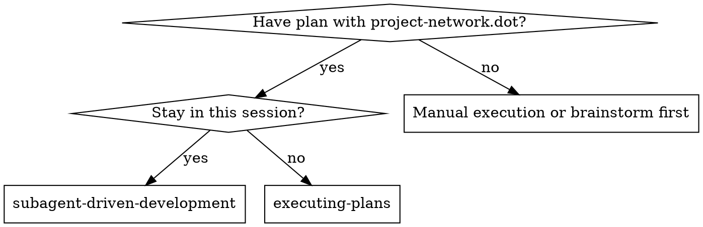
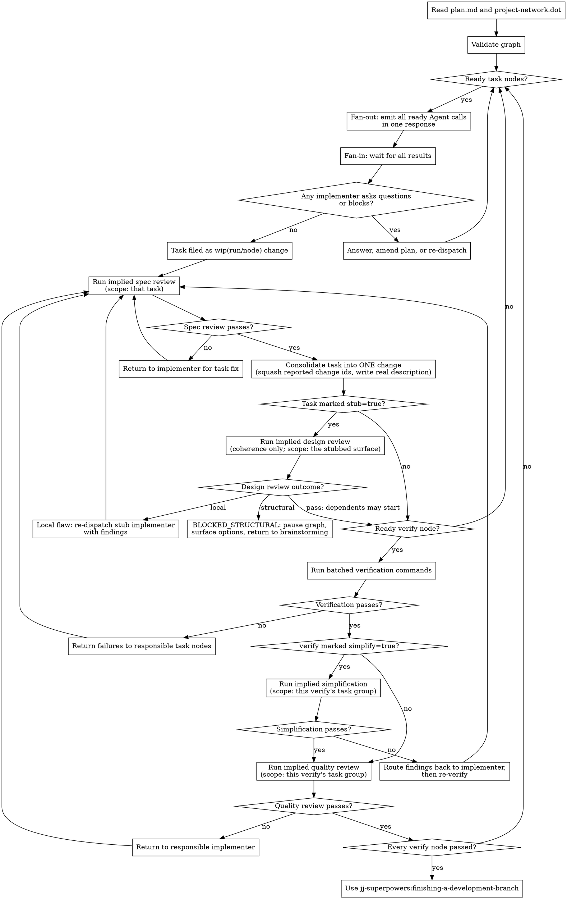

# Subagent-Driven Development

Execute `project-network.dot` from a written plan. Dispatch fresh implementer subagents for ready task nodes, run per-task spec review, batch contended verification commands at verify nodes, then run group-level code-quality review.

**Core principle:** task fan-out + per-task spec gates + verification fan-in + group quality review.

## When to Use



This skill is graph-first. A one-task plan is still executed through the same graph model.

## Graph Contract

Read `plan.md` and `project-network.dot`. Treat the graph as authoritative unless it is invalid or contradicts the task files.

The plan author writes exactly **two** node kinds. Every other gate still runs — you **derive** its trigger and scope from the graph instead of reading them off a node.

| Authored kind | Attributes | Executor | Gate |
|------|------------|----------|------|
| `task` | `file`, `files` (required); `scopes`, `stub` (optional) | implementer subagent | files changed and filed |
| `verify` | `file` (required); `simplify` (optional) | verification subagent or orchestrator command runner | commands exit successfully |

Implied gates — never present in the graph, always run:

| Implied gate | Trigger | Derived scope | Gate |
|--------------|---------|---------------|------|
| `spec_review` | every `task` completes | that task | task matches its task file |
| `design_review` | a `stub=true` task's spec review passes | that task's stubbed surface | stubbed API is coherent |
| `simplification` | a `verify` with `simplify=true` passes | that verify's task group | no accepted duplication remains, or accepted findings routed back, fixed, and re-verified |
| `quality_review` | a `verify` passes — or its `simplification`, when present | that verify's task group | verified group is maintainable |
| `final` | every `verify` node has passed | the whole graph | all gates passed |

**Deriving scope.** These are the only three derivations you need:

- A `verify` node's **task group** = every `task` node that reaches it. This is the scope for its `simplification` and `quality_review`.
- A `spec_review`'s scope = the single `task` that just completed.
- A `design_review`'s scope = the stubbed surface of the `stub=true` task that triggered it.

Edges mean "source node must pass before target node may run." A `stub=true` task's outgoing edges additionally carry its implied `design_review`: a dependent task may not **start** until that stub's spec review *and* design review have passed. Every other implied gate runs on the node it hangs off, so it cannot be missed or misplaced.

The `design_review` rubric is always `designing-with-types-and-abstractions`; there is no node to override it.

## The Process



## Graph Validation

This list is the single source of truth for graph validation; `executing-plans` runs the same checks. Before dispatching work, check:

- `plan.md` references `project-network.dot`.
- Every node is `kind="task"` or `kind="verify"`. Nothing else is authorable.
- Every `task` node has `file` and `files`. Every `verify` node has `file`.
- Every `task` node reaches at least one `verify` node (no orphan tasks).
- No cycles.
- No ready-to-run parallel task nodes have overlapping `files` attributes (the collision check).

That is the whole list. Gate placement is no longer checkable because it is no longer authorable: `spec_review`, `design_review`, `simplification`, `quality_review`, and `final` are derived from `task`/`verify` nodes and their `stub`/`simplify` attributes, so they cannot be missing, misordered, or duplicated.

If the graph is invalid, fix the plan if the correction is mechanical and obvious. Otherwise ask the user before execution. A graph containing authored gate nodes was written against the superseded contract: collapsing it is mechanical — delete the gate nodes, reconnect `task`/`verify` edges through them, mark consumed API-stub tasks `stub=true`, and mark a `verify` whose old chain carried a `simplification` node `simplify=true`.

## Dispatch Rules

Prefer named role agents when the platform supports them. Pass only dynamic invocation context in the task message — **paths, never pasted task text**: graph node id, task or verification file path, relevant context paths, target file list, allowed directory scopes, derived gate scope, upstream reports, verification report, and orchestrator notes. Keep durable role behavior in the named agent's system/developer prompt.

**Concurrent edits are the norm, not the exception.** Parallel implementers, the user, and other sessions all write to the same tree while the graph executes. The `files` collision gate is what keeps dispatched agents off each other's files — it is a correctness mechanism, not an optimization, so never dispatch parallel tasks with overlapping `files` "just this once". Every subagent already carries the concurrency contract (stay in scope, targeted edits, re-read before writing, never revert someone else's change) via the shared preamble in `agents/_preamble.md`. You owe them the other half:

- Give every dispatched agent a `files` list and `scopes` that are accurate and non-overlapping with any concurrently-running agent.
- When re-dispatching after a review failure, re-read the current state of the files first — the tree has moved since the original implementer ran.
- If an agent reports a conflict with someone else's edit, resolve it yourself. Do not tell the agent to force its version through.
- Never let an implementer's out-of-scope edit stand silently: spec review checks containment against the `files`/`scopes` you issued.

**Prompt Assembly Order:** a subagent prompt is a **concatenation of context segments**, and LLM providers cache on the prompt *prefix*. Assemble segments most-stable-first:

| # | Segment | Varies with |
|---|---------|-------------|
| 1 | Agent role / system prompt (named agent, or the fallback template) | nothing |
| 2 | `context/*.md` | the plan |
| 3 | Shared API/interface surface | the plan |
| 4 | This task's file | the task |
| 5 | Target files, allowed scopes, upstream reports | the task |

Keep this order **identical across dispatches**: reordering segments invalidates the prefix cache even when the content is byte-identical. Never hoist a varying segment ahead of a stable one — an orchestrator note belongs after the task file, not before the context docs. `writing-plans` owns the rationale and the plan-authoring consequences; see its "Plan Artifacts Are a Prompt Prefix" section.

**Parallel Dispatch Mechanics:** When multiple task nodes (or spec reviews) are ready and non-conflicting, dispatch them all by making multiple Agent tool calls in a **single response** — not one call per turn. Do not announce dispatch in a text turn and then make Agent calls in subsequent turns; that pattern produces sequential execution regardless of stated intent.

Default to **3–5 concurrent subagents** unless the user specifies otherwise. Maximize parallelism: keep all available slots filled at all times. When a subagent completes and a slot opens, immediately dispatch the next ready task — do not wait for other in-flight agents to finish first. Graph dependencies still govern sequencing: a `verify` node cannot start until all its upstream tasks have passed spec review, but there is no need to hold back dispatch just to form a tidy batch.

If the Workflow tool is available and the user has opted into multi-agent orchestration, you may use it to fan out further.

**Subagent freshness:** By default, fresh subagents should handle every node — clean context reduces noise. When routing spec review or code-quality failures back to an implementer, dispatch a new subagent with the review report and relevant context rather than reusing the original session.

**Exception — complex tasks:** If a task file flags a node as complex, or if the implementer returns `DONE_WITH_CONCERNS`, retain the session identifier. Route spec review and code-quality failures back to the original session (`SendMessage` in Claude Code) rather than a fresh agent — the original implementer holds design decisions and implementation reasoning that a fresh agent would waste time reconstructing. Switch to a fresh agent anyway when: the original session has grown long or context-heavy; the fix requires a fundamentally different approach; or the session is no longer reachable.

Triggers and scopes come from the Graph Contract above. This table adds who executes each one, and what you must pass it. If named agents are unavailable, use the fallback template by filling the dynamic placeholders into the subagent message.

| Graph role | Named agent | Fallback template | What you pass, and the role's own rule |
|------------|-------------|-------------------|----------------------------------------|
| `task` | `sdd-implementer` | `./implementer-prompt.md` | Task file path, relevant context docs, `files`, `scopes` (if any), and any annotations from upstream completed nodes. The task file does not restate `files`/`scopes` — **you are their only source**. |
| `spec_review` | `sdd-spec-reviewer` | `./spec-reviewer-prompt.md` | Dispatch after the task reports `DONE`/`DONE_WITH_CONCERNS`. Pass the **same `files`/`scopes` you gave the implementer**, so the reviewer can check containment. Task-local, and always before verification fan-in. |
| `design_review` | `sdd-design-reviewer` | `./design-reviewer-prompt.md` | The stub task file path and the stubbed surface. Rubric is always `designing-with-types-and-abstractions`. Judges API *coherence* only; **never edits files**. Reports local flaw / `BLOCKED_STRUCTURAL` / pass (see Design-Review Status). No `stub=true` task ⇒ no design review. |
| `verify` | `sdd-verifier` | `./verification-prompt.md` | Run the referenced `verify-*.md` commands once every upstream task has passed spec review. Use the subagent when logs may be long or summarization helps. Build tools serialize on one suite at a time — this is the batched reduction point. |
| `simplification` | `sdd-simplifier` | `./simplification-prompt.md` | The derived task group. **Single owner of duplication detection.** Its method reuses `deslopify` (under-engineering/duplication) and the `code-simplifier` agent — it does not restate their checks. Findings route back to an implementer, then the group **re-verifies**. No `simplify=true` ⇒ no simplification. |
| `quality_review` | `sdd-quality-reviewer` | `./code-quality-reviewer-prompt.md` | The derived task group (not necessarily one task). Mandate is **maintainability/production-risk only** — duplication belongs to `simplification`. |
| `final` | — | — | Use `jj-superpowers:finishing-a-development-branch`. |
| jj filing helper | `sdd-jj-coordinator` | `./jj-coordinator-prompt.md` | See Change Consolidation. |

Verification commands and reports follow `jj-superpowers:tool-output-discipline`: prefer quiet, structured, scoped, or filtered output; expand only when concise output cannot diagnose the failure.

Platform locations:

| Platform | Project/user agent files | Invocation |
|----------|--------------------------|------------|
| Claude Code | plugin `agents/*.md`, `.claude/agents/*.md`, or `~/.claude/agents/*.md` | Agent tool with `subagent_type` set to the named agent |
| Codex | `.codex/agents/*.toml` or `~/.codex/agents/*.toml` | `spawn_agent(agent_type="<name>", message=...)` when custom agents are available |
| OpenCode | plugin-registered agents, `.opencode/agents/*.md`, or `~/.config/opencode/agents/*.md` | `@<name>` or Task tool with the named subagent |

## Change Consolidation

**Consolidate as you go. Do not defer history cleanup to the end of the run.** Otherwise a single unit of work lands one change per implementer commit *plus* one per review round-trip, and a real plan defers hundreds of changes to an end-of-run reorganization — the worst possible moment to reconstruct intent.

The graph already tells you when a unit of work is done and correct: **its spec review passed.** That is the consolidation point.

### Run id and scaffold

At graph start the orchestrator picks a **run id**: the plan slug plus four random characters (`parser-k3f9`). It namespaces every scaffold so concurrent runs, sessions, and work streams never match each other's changes.

Implementers file through the guard (`jj-superpowers:jujutsu`, safety rule 7), naming their paths explicitly:

```sh
node <jujutsu-skill>/scripts/jj-guard.mjs commit -m 'wip(<run>/<node_id>): [what changed]' <paths>...
```

The guard prints the new change id; the implementer reports every id it created. The `wip(<run>/<node_id>)` prefix is a **scaffold**: a human-readable label and a leftover check, destroyed at consolidation. Implementers are not asked for good descriptions — the orchestrator writes the real one once the work is known-correct.

### Consolidate on spec-review pass

When a task's spec review passes, the coordinator collapses the task's reported change ids into the newest one and describes it (Change Description Rules in `jj-superpowers:jujutsu`):

```sh
G="node <jujutsu-skill>/scripts/jj-guard.mjs"
$G run squash --from '<id1> | <id2>' --into <id3> --use-destination-message
$G run describe -r <id3> -m 'feat(parser): parse input with empty-input handling'
```

Parallel implementers interleave, so a task's changes are usually not contiguous; jj rebases around them, and disjoint file scopes keep this conflict-free. In workspace mode, the coordinator then moves the change into the main line (`$G run rebase -r <id3> -B @`) and forgets the workspace.

When `verify`, `simplification`, or `quality_review` sends a fix back, the re-dispatched implementer reports new ids; once re-review passes, squash them **into the task's consolidated change**. A review round is not a unit of work.

**The invariant: one change per `task` node, regardless of commit count or review rounds.** Off-graph work (Small tier) has no node: the implementer commits through the guard with the orchestrator-supplied final description and no scaffold.

### Who runs it

The orchestrator decides; `sdd-jj-coordinator` executes through the guard. Implementers only `commit` their own paths and never squash, describe, or reorganize.

### Finish: no scaffold, divergence, or conflict survives

Scaffolds are `wip(<run>/<node>)` (implementers) and `todo:` (the DAG builder in `jj-organizing-history`). `final` is not reached until all agents have stopped and these return nothing:

```sh
node <jujutsu-skill>/scripts/jj-guard.mjs check --prefix 'wip(<run>/'
jj diff --ignore-working-copy --stat     # @ holds no unfiled edits
```

Any output is a bug: squash each leftover into the change it belongs to and describe it; recover divergence per `jj-superpowers:jujutsu` safety rule 7. Collapsing a whole verify group into one change, or reshaping history, is optional — `jj-superpowers:jj-organizing-history`.

## Verification Ownership

This section is the canonical statement of the contended-command rule; `writing-plans` and `executing-plans` reference it.

Implementers may run narrow task-local checks only when the task file names them. Implementers do not own group compile, test, lint, type-check, build, or smoke-test verification.

`cargo check`, `cargo build`, and `cargo test` are normally verification-node commands even when package-scoped or test-filtered, because they contend on shared target-directory state. A task file may name one only when it documents why that command is safe and necessary for the task.

**Sanctioned exception — API-stub type-check.** A `stub=true` task, whose surface is gated by the implied design review, MAY run a narrow, task-file-documented scoped type-check (e.g. `cargo check -p <crate> -q`) so consumers fan out against a compiling stub. Because `design_review` reviews coherence, not compilation, this scoped check is the one place a compile command belongs in a task. This is the single sanctioned exception; it does not otherwise weaken the contended-command rule.

When implementers run an allowed task-local command, they should use `jj-superpowers:tool-output-discipline` and report concise results.

Spec reviewers inspect implementation against the task file. They do not run group verification commands.

Verification nodes own the authoritative command results for their upstream group.

Code-quality reviewers inspect the verified group and the verification report. They do not rerun the same commands unless code inspection gives a concrete reason to believe the report is stale, incomplete, or contradicted by the diff.

## Model Selection

Use the least powerful model that can handle each role — implementers included. "It is an implementation" is not a reason to reach for the strongest model. Pick model and effort per node from the dispatch table in `jj-superpowers:choosing-model-and-effort`, which also owns the Fable provenance rule, availability handling, and escalation. Do not restate it here.

## Handling Implementer Status

Implementer subagents report one of four statuses.

**DONE:** Run the task's implied `spec_review`.

**DONE_WITH_CONCERNS:** Read concerns. If they affect correctness or scope, address them before spec review. If they are observations, include them for reviewers and proceed. Retain this session's identifier — the task is now considered complex and review failures should be routed back to it (see Subagent Freshness in Dispatch Rules).

**NEEDS_CONTEXT:** Provide missing context and re-dispatch.

**BLOCKED:** Assess the blocker:

1. If it is a context problem, provide more context and re-dispatch.
2. If the task looks under-powered, escalate strictly per `jj-superpowers:choosing-model-and-effort` — it owns the rule (re-read the task file first; escalate only on an empirical **wall**, one step, class before effort; **speculative** escalation asks the user).
3. If the task is too large, split it and update `project-network.dot`.
4. If the plan is wrong, amend the plan if mechanical or ask the user.

Never force the same model to retry without changing instructions, context, or task shape.

When asking the user to choose between valid paths, the orchestrator uses the decision-checkpoint pattern from `jj-superpowers:using-superpowers`: present 2-3 concrete alternatives with a recommendation, and use the harness-native ask/question tool when available.

Subagents cannot use ask/question tools. If a subagent needs a user decision, it must report `NEEDS_CONTEXT` or `BLOCKED` with 2-3 concrete options; the orchestrator asks the user and then re-dispatches or amends the plan.

## BLOCKED Handling

When an implementer reports `STATUS: BLOCKED`, read `SCOPE`.

### `SCOPE: related`

The blocker is a dependency inside this plan.

1. If another graph node produces the missing thing, add or correct the dependency edge and run the producer first.
2. If a new task is needed, add a task file, update `plan.md`, and update `project-network.dot`.
3. If the new work is non-trivial, ask the user before expanding scope.

### `SCOPE: unrelated`

The blocker is a pre-existing gap outside this work scope. Pause and surface options:

> "Implementer for [task] is blocked by a pre-existing issue: [DETAIL].
> Options:
> 1. Add a fix to this plan
> 2. Note it as a separate task for later
> 3. Provide guidance and unblock manually"

Act on the user's choice and update the plan if execution graph changes.

### Design-Review Status (`STATUS: BLOCKED_STRUCTURAL`)

`BLOCKED_STRUCTURAL` is a distinct, design-review-only status, separate from implementer `BLOCKED`. The reviewer charter is **coherence only** (rubric `designing-with-types-and-abstractions`: right variation axis, illegal states unrepresentable, explicit effects, no leaky boundaries) — it does NOT recompile. Reviewers never edit files. The gate reports one of:

- **Local flaw** — the fix is contained to the stub task's own files and changes no type, signature, or symbol a consumer task file references (e.g. fixing the stub's internal type or docs, adding a trait method no consumer cites yet, renaming a private helper). The orchestrator **re-dispatches the stub implementer** with the findings to fix and re-stub, then re-runs the stub's spec review. No consumer task files change; **no user round-trip**.
- **Structural flaw → `STATUS: BLOCKED_STRUCTURAL`** — the fix changes a consumer-referenced symbol/signature, or the choice of abstraction, a missing requirement, or a contradiction with the spec. The orchestrator **pauses the graph**, does **not** dispatch consumers, surfaces 2–3 concrete options to the user (decision-checkpoint pattern), and returns to **brainstorming**; `writing-plans` then regenerates the affected consumer task files and the affected portion of `project-network.dot`. "Return to brainstorming" is an executor-level escalation event, not a graph edge — the DAG stays acyclic.

**Decidability rule:** classify as **structural** (escalate) iff the fix changes a consumer-referenced symbol/signature or touches the abstraction/requirements; otherwise **local**. A signature tweak is local **only** when no consumer task references that signature. On genuine ambiguity, **default to structural**.

## Autonomy Level

Manual (the default) is unchanged: every checkpoint above pauses and asks. In Rush, resolve each checkpoint — `BLOCKED`/`SCOPE: related`, `BLOCKED`/`SCOPE: unrelated`, structural `design_review` flaw, and `verify`/`spec_review`/`quality_review`/`simplification` failure — per the **canonical Rush-resolution table** in `jj-superpowers:using-superpowers`, which also owns the safety floor and the retry constant `N`. Rush removes only the human sign-off wait; every implied gate STILL runs.

## Example Workflow

```text
You: I'm using Subagent-Driven Development to execute project-network.dot.

[Read plan.md + project-network.dot. Graph: task_01 -> verify_01, task_02 -> verify_01.
 Four gates are implied, none authored. Validate: both tasks ready, disjoint files]
[Track node states against the graph, not the harness task list]

[Fan-out: dispatch task_01 + task_02 implementers — both Agent calls in ONE response.
 Each gets files/scopes from its node; neither task file restates them]

task_01: DONE, filed 2 changes       task_02: DONE_WITH_CONCERNS, filed 1 change

[Implied spec review fires per task; include task_02's concern in its review message]
[Fan-out: both spec reviews in one response] -> both pass
[Consolidate each task into ONE described change]

[No stub=true task, so no design review. verify_01 ready: run verify-01-api-ui.md once] -> pass
[No simplify=true, so no simplification]
[Implied quality review, scope derived = {task_01, task_02}] -> important issue in task_02

[Return to task_02 implementer; fold the fix into task_02's change]
[Re-run task_02 spec review, then verify_01, then quality review] -> approved

[Every verify node passed — final. Use jj-superpowers:finishing-a-development-branch]
```

## Reporting Gaps

If you read multiple files or traced execution across modules to understand something that a short documentation file could have explained immediately, invoke **jj-superpowers:documentation** to create that document. Continue with execution; do not block on reporting gaps.

## Integration

Required workflow skills:

- `jj-superpowers:writing-plans` - creates the plan and `project-network.dot`.
- `jj-superpowers:requesting-code-review` - code review template for quality reviewers.
- `jj-superpowers:finishing-a-development-branch` - completes development after final graph node.

Subagents should use:

- `jj-superpowers:test-driven-development` when their task requires TDD.
- `jj-superpowers:tool-output-discipline` when running CLI tools with potentially noisy output.

Alternative workflow:

- `jj-superpowers:executing-plans` - use when execution should happen inline or in a separate session.

## Skill Validation

When editing this skill or `writing-plans`, validate behavior with `../writing-plans/project-network-validation-scenarios.md` before deployment.
