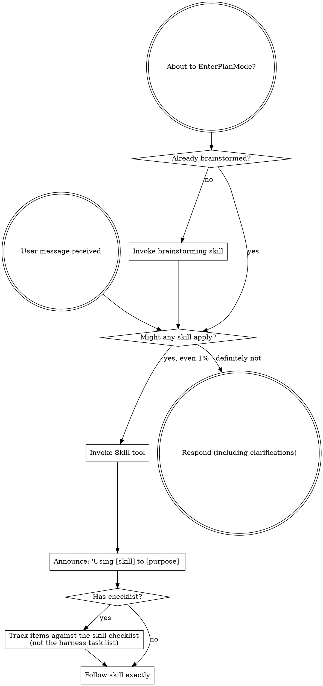

<BOOTSTRAP-CONTRACT>
Harness startup hooks should inject only a compact bootstrap that points to this
skill; they should not paste this whole file into every session. The full skill
body is for orchestrator sessions that need the complete skill-use discipline.

Subagents should receive only bounded task context. If you were dispatched as a
subagent, follow the stop rule below and load only skills directly relevant to
your assigned task.
</BOOTSTRAP-CONTRACT>

<SUBAGENT-STOP>
If you were dispatched as a subagent to execute a specific task, skip this skill.
</SUBAGENT-STOP>

<SUBAGENT-HARNESS-BOUNDARY>
Subagents must not invoke another agent harness through ANY channel — not the
shell (`claude`, `codex`, `opencode`) and not MCP tools
(e.g. `mcp__codex__codex`). Having the tool available is not permission to use
it. A subagent completes only its assigned bounded task. If more agents,
a different role, or a different model are needed, report `NEEDS_CONTEXT` or
`BLOCKED`; the orchestrator owns all further dispatch.
</SUBAGENT-HARNESS-BOUNDARY>

<EXTREMELY-IMPORTANT>
If you think there is even a 1% chance a skill might apply to what you are doing, you ABSOLUTELY MUST invoke the skill.

IF A SKILL APPLIES TO YOUR TASK, YOU DO NOT HAVE A CHOICE. YOU MUST USE IT.

This is not negotiable. This is not optional. You cannot rationalize your way out of this.
</EXTREMELY-IMPORTANT>

## Instruction Priority

1. **User's explicit instructions** (direct requests) — highest priority
2. **Project conventions** (CLAUDE.md, AGENTS.md, `.agents/`, project skills)
3. **jj-superpowers skills**
4. **Your system prompt** — lowest priority

If CLAUDE.md or AGENTS.md says "don't use TDD" and a skill says "always use TDD," follow the project. The user is in control.

**Conventions: layers 2 and 3 beat layer 4.** Code style, comments, documentation, tests, and commit descriptions are owned by the project and by these skills — *not* by your system prompt's coding conventions. Where a skill or the project speaks on a convention, follow it and do not fall back to a system-prompt default.

**Efficiency and safety: layer 4 can win.** If jj-superpowers guidance is wasteful, contradictory, or unsafe — including where it conflicts with provider guidance for operating efficiently — follow the provider guidance, tell the user what you saw, and ask them to notify jj-superpowers maintainers.

These two are the whole rule, and they are not in tension: **the escape hatch exists for how you operate, never for what the code should look like.** A provider default that says "match the surrounding code's comment density" does not override `writing-comments`; a provider default that says "don't burn a subagent on a one-line lookup" does override a skill that would.

One convention is important enough to be repeated in the session bootstrap, because the provider default is *actively wrong*: **never attribute a change to an LLM, model, or agent** (no `Co-Authored-By`, no "Generated with", no model names), and keep descriptions to one short title line. See `jj-superpowers:jujutsu`.

## How to Access Skills

**In Claude Code:** Use the `Skill` tool. When you invoke a skill, its content is loaded and presented to you—follow it directly. Never use the Read tool on skill files.

**In other environments:** Check your platform's documentation for how skills are loaded.

## Platform Adaptation

Skills use Claude Code tool names. Non-CC platforms translate tools as follows:

- **Codex:** see `references/codex-tools.md`
- **OpenCode:** plugin bootstrap maps common tools compactly; use OpenCode's native skill tool and subagent `@mention` system

This is about running jj-superpowers *inside* another harness — tool-name mapping only. Calling *out* to an external harness for a second opinion (ensemble review) is a different thing entirely and is owned by `jj-superpowers:choosing-model-and-effort`. Do not conflate the two senses of "harness".

## Command Invocation Discipline

Do not pack discovery, filtering, variable assignment, redirection, and output
truncation into a clever shell snippet. Harnesses often gate commands by
statically analyzing each invocation; command substitutions, pipes, shell
variables, redirects, and compound scripts can trigger security approval prompts
even when every underlying operation is harmless.

When searching for Markdown or code that contains literal backticks, wrap the
search pattern in single quotes or escape the backticks. In many shells,
backticks inside double quotes are command substitution and may execute the text
inside them.

Prefer small, literal, analyzable commands that push filtering into the tool:

1. Use native selectors first: path arguments, filesets, include/exclude flags,
   query flags, `--summary`, `--stat`, `--context`, `--limit`, or equivalent
   options. Do not dump a huge result just to pipe it into `grep` or `head`.
2. If discovery is still needed, ask the tool for the smallest useful summary
   and constrain it with literal arguments.
3. Run follow-up commands with literal paths, revisions, IDs, or query terms
   copied from the prior output. Do not hide them in shell variables.
4. Use the harness/tool output limit as the final guard, not as the primary
   filtering mechanism.

Bad pattern:

```sh
P=$(rg --files 2>/dev/null | grep -iE 'schema\.rs')
rg -n 'CameraSchema' "$P" 2>&1 | head -40
```

Good pattern:

```sh
rg -n -m 40 --glob '*[sS]chema.rs' 'CameraSchema'
```

## Decision Checkpoints

When orchestrator execution reaches a real user decision, pause and present 2-3 concrete alternatives. Lead with the recommended option and state the tradeoff briefly.

Use the harness-native ask/question tool for mutually exclusive choices when available. If no structured ask tool is available in the current mode, ask one concise plain-text question.

Use this pattern for design approvals, blockers, out-of-scope fixes, history organization choices, review handling choices, and final integration choices. Do not bury a decision request in prose when a structured choice UI exists.

Platform examples: Claude Code uses its ask-user question tool when available; Codex uses `request_user_input` when exposed in the active mode.

Subagents must not use ask/question tools. If a subagent needs a user decision, it reports `NEEDS_CONTEXT` or `BLOCKED` with 2-3 concrete options; the orchestrator asks the user.

### Autonomy Level

The **recommended option** is the lead option at a checkpoint — the one you "Lead with the recommended option" above (first in the ask tool). "Recommended", "lead", and "default" are interchangeable. A checkpoint with **no** designated recommended option is high-impact ambiguity → floor #3 (halt).

Two levels:

- **`Manual`** (default) — every decision-checkpoint pauses and asks, exactly as today.
- **`Rush`** — take the recommended option without pausing, *unless the safety floor trips*. The floor is also an action policy: any action matching it halts even outside a checkpoint (e.g. an irrecoverable deletion mid-implementation).

Rush auto-resolves **user checkpoints only**. Automated review nodes (`spec_review`, `design_review`, `verify`, `quality_review`, `simplification`, and the brainstorming adversarial spec-review loop) **always still run** — Rush removes the human sign-off wait on their results, never the check itself.

**Safety floor (always halts and asks, even in Rush):**

1. **Irrecoverable destruction** — effects not recoverable from version control: deleting untracked data the agent didn't create, discarding the user's uncommitted/dirty work, history-loss, outward-facing sends (publish/send). VCS-recoverable (committed/tracked) deletions proceed.
2. **Structural design flaw** — the `BLOCKED_STRUCTURAL` escalation that returns to brainstorming.
3. **High-impact ambiguity** — materially different outcomes **and** no clearly-recommended option (includes a no-designated-lead option menu and Rush × Agile net scope growth). Bias: when uncertain whether a default is clear, halt.
4. **Stuck review** — a `spec_review`/`verify`/`quality_review`/`simplification` failure still unresolved after `N = 3` automated fix-and-re-review attempts.

**Floor precedence.** Floor #2 (structural) short-circuits floor #4's retry budget: a failure diagnosed structural at *any* attempt escalates immediately, not retried to `N = 3`. The `N = 3` budget applies only to mechanical/local failures. On ambiguity, default to structural.

**`N = 3`** (the canonical constant, defined here; other skills reference it by name): the original failure is attempt 0; Rush makes up to 3 fix-and-re-review attempts; halt on the 3rd. One initial fix + two retries = 3.

**Canonical Rush-resolution table** (single source of truth; consumers reference it by name):

| Checkpoint | Rush resolution |
|------------|-----------------|
| Triage tier proposal | take the proposed tier |
| Planning strategy proposal | take the proposed strategy |
| Execution handoff (subagent vs inline) | subagent-driven when authorized **and** the harness supports named subagents; else inline |
| Spec user-review gate (brainstorming step 10) | auto-pass (automated adversarial spec-review loop still runs) |
| Agile phase boundary | auto-advance + non-blocking trail entry (exception: scope-drift → floor #3 halt) |
| `BLOCKED` / `SCOPE: related` | resolve mechanically per existing `executing-plans` rules (add edge / run producer / split); never defer; non-trivial scope expansion → floor #3 halt |
| `BLOCKED` / `SCOPE: unrelated` | "note as separate task for later" + continue (recorded) |
| `design_review` structural flaw | floor #2 — halt |
| `spec_review`/`verify`/`quality_review`/`simplification` failure | auto-route-back, retry ≤ N=3, then floor #4 — halt (if diagnosed structural at any attempt → floor #2 immediately) |
| Model/effort escalation | earned by a wall → take one step; speculative → floor #3 halt |
| Finishing integration choice (PR/push/merge) | floor #1 — halt (outward-facing) |

**Activation.** User-initiated ("rush", "autonomous mode") at or after design approval — the Rush boundary is *after* design approval, so clarifying-question and design-approval gates are never auto-resolved. The agent may offer Rush once when ambiguity is low (no nag). Explicit "pause" → `Manual`. A floor halt suspends auto-advance but does not clear the level. **Recording / read order on resume:** `roadmap.md` (Agile, authoritative if present), else the Waterfall design-doc header, else default `Manual`; every transition rewrites the record. Rush is inert at Trivial/Small (their only gate, design approval, is above the boundary); a Trivial/Small task self-escalated to Full becomes Rush- and Agile-eligible.

# Using Skills

## The Rule

**Invoke relevant or requested skills BEFORE any response or action.** Even a 1% chance a skill might apply means that you should invoke the skill to check. If an invoked skill turns out to be wrong for the situation, you don't need to use it.



## Routing Map

Your platform already injects every skill's description. The question is not *what exists*, it is *what do I reach for now*. Find your situation; invoke the skill.

**Building something**
- Starting a feature, component, or behavior change — any creative work → `brainstorming`
- Design approved, need an implementation plan → `writing-plans`
- Plan too uncertain for one pass (a later phase's tasks depend on an artifact an earlier phase will produce — not just size or task count) → `iterative-planning`
- Plan includes `project-network.dot` and you are executing it now → `subagent-driven-development`
- Executing a written plan in a separate session with review checkpoints → `executing-plans`
- About to write implementation code → `test-driven-development`
- Designing an API, interface, or state machine; adding one more branch to a growing `if`/`match` → `designing-with-types-and-abstractions`

**Something is wrong**
- Bug, test failure, or unexpected behavior → `systematic-debugging`
- Open-ended objective, many candidate causes, flaky behavior, or a metric to move → `hypothesis-driven-improvement`

**Wrapping up**
- About to claim "done", "fixed", or "passing" → `verification-before-completion`
- Want finished work reviewed → `requesting-code-review`
- Received review feedback → `receiving-code-review`
- Implementation complete, needs integrating or a PR → `finishing-a-development-branch`

**Version control (jj)**
- Any version control in a jj repo → `jujutsu`
- Splitting, cleaning, or reordering history for review → `jj-organizing-history`
- Hunk-level split or partial squash → `jj-hunk`

**Code and docs quality**
- "Clean this up", remove slop, general quality pass → `deslopify`
- Broad dead-code or dedup sweep across many directories → `codebase-cleanup`
- Writing or fixing docs; you had to read five files to understand one thing → `documentation`
- Writing or cleaning code comments → `writing-comments`

**Specs and project layout**
- Authoring or amending a spec, glossary, or invariants → `writing-specs`
- Any source edit in a project that has `.agents/layout.yaml` → `spec-code-sync`
- Auditing spec-vs-code drift or orphan references → `spec-drift-detector`
- Setting up or auditing `.agents/layout.yaml`, `AGENTS.md`, project skills → `project-layout`

**Running the agent itself**
- Choosing a model or effort for a subagent; hit a wall; want a second opinion → `choosing-model-and-effort`
- 2+ independent investigations, subagents authorized, no plan graph → `dispatching-parallel-agents`
- Command may flood context — builds, tests, logs, broad searches → `tool-output-discipline`
- Running Python, `uv`, packages, or virtualenvs → `uv-guide`
- Creating or editing a skill → `writing-skills`

## Tracking Progress

Track multi-step and subagent-driven work against the **durable artifact** — the
skill's own checklist, `project-network.dot`, or `roadmap.md` — **not** the
harness task tracker (Claude Code task-list tools and their per-platform equivalents).

The harness task list does not survive subagent dispatch: subagents cannot update
it, it drifts out of sync with what dispatched agents actually did, and it goes
stale across a long orchestration. The graph, roadmap, and skill checklists are
the source of truth — re-derive readiness from them. Use the harness tracker only
for purely inline, single-session work with no subagents, and never rely on it to
coordinate dispatched agents.

## Red Flags

These thoughts mean STOP—you're rationalizing:

| Thought | Reality |
|---------|---------|
| "Just a simple question" / "doesn't count as a task" / "the skill is overkill" | Questions and actions are tasks. Simple things become complex. Check. |
| "Let me explore / gather context / check the files first" | Skills tell you HOW to explore and gather. Check BEFORE, including before clarifying questions. |
| "I remember this skill" / "I know what that means" | Skills evolve, and knowing the concept ≠ using the skill. Invoke it. |
| "I'll just do this one thing first" / "this feels productive" | Undisciplined action wastes time. Check before doing anything. |

## Skill Priority

When multiple skills could apply, **process skills go first** (`brainstorming`, `systematic-debugging`) — they determine HOW to approach the task — then the execution and domain skills they hand off to.

"Let's build X" → brainstorming first, then planning and implementation skills.
"Fix this bug" → systematic-debugging first, then domain-specific skills.

## Skill Types

**Rigid** (TDD, debugging): Follow exactly. Don't adapt away discipline.

**Flexible** (patterns): Adapt principles to context.

The skill itself tells you which.

## User Instructions

Instructions say WHAT, not HOW. "Add X" or "Fix Y" doesn't mean skip workflows.

## Reporting Gaps

**If jj-superpowers guidance causes wasteful, contradictory, or unsafe behavior**
in an orchestrator session, including conflict with provider system prompts or
model guidance for efficient operation, follow the provider guidance unless the
user explicitly overrides that specific behavior. Tell the user what you saw and
ask them to notify jj-superpowers maintainers. Keep this report concise and
continue with the user's requested work when possible.

If you read multiple files or traced execution across modules to understand something
that a short documentation file could have explained immediately, use
**jj-superpowers:documentation** if the user wants the doc written now.

Continue with the user's requested work when possible; do not block on reporting gaps.
