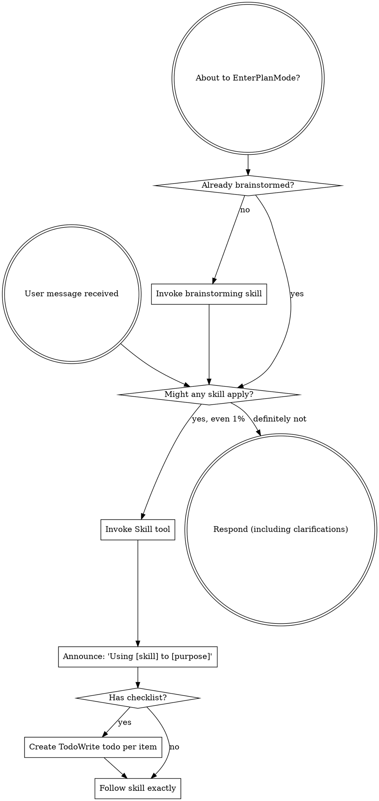

<BOOTSTRAP-CONTRACT>
Harness startup hooks should inject only a compact bootstrap that points to this
skill; they should not paste this whole file into every session. The full skill
body is for orchestrator sessions that need the complete skill-use discipline.

Subagents should receive only bounded task context. If you were dispatched as a
subagent, follow the stop rule below and load only skills directly relevant to
your assigned task.
</BOOTSTRAP-CONTRACT>

<SUBAGENT-STOP>
If you were dispatched as a subagent to execute a specific task, skip this skill.
</SUBAGENT-STOP>

<EXTREMELY-IMPORTANT>
If you think there is even a 1% chance a skill might apply to what you are doing, you ABSOLUTELY MUST invoke the skill.

IF A SKILL APPLIES TO YOUR TASK, YOU DO NOT HAVE A CHOICE. YOU MUST USE IT.

This is not negotiable. This is not optional. You cannot rationalize your way out of this.
</EXTREMELY-IMPORTANT>

## Instruction Priority

jj-superpowers skills override default system prompt behavior, but **user instructions always take precedence**:

1. **User's explicit instructions** (CLAUDE.md, GEMINI.md, AGENTS.md, direct requests) — highest priority
2. **jj-superpowers skills** — override default system behavior where they conflict
3. **Default system prompt** — lowest priority

If CLAUDE.md, GEMINI.md, or AGENTS.md says "don't use TDD" and a skill says "always use TDD," follow the user's instructions. The user is in control.

## How to Access Skills

**In Claude Code:** Use the `Skill` tool. When you invoke a skill, its content is loaded and presented to you—follow it directly. Never use the Read tool on skill files.

**In Gemini CLI:** Skills activate via the `activate_skill` tool. Gemini loads skill metadata at session start and activates the full content on demand.

**In GitHub Copilot CLI:** Use the `skill` tool. Skills are discovered automatically from the plugin's `skills/` directory.

**In other environments:** Check your platform's documentation for how skills are loaded.

## Platform Adaptation

Skills use Claude Code tool names. Non-CC platforms translate tools as follows:

- **Codex:** see `references/codex-tools.md`
- **Gemini CLI:** tool mapping loaded automatically via GEMINI.md
- **OpenCode:** plugin bootstrap maps common tools compactly; use OpenCode's native skill tool and subagent `@mention` system
- **GitHub Copilot CLI:** see `references/copilot-tools.md`

## Command Invocation Discipline

Do not pack discovery, filtering, variable assignment, redirection, and output
truncation into a clever shell snippet. Harnesses often gate commands by
statically analyzing each invocation; command substitutions, pipes, shell
variables, redirects, and compound scripts can trigger security approval prompts
even when every underlying operation is harmless.

Prefer small, literal, analyzable commands that push filtering into the tool:

1. Use native selectors first: path arguments, filesets, include/exclude flags,
   query flags, `--summary`, `--stat`, `--context`, `--limit`, or equivalent
   options. Do not dump a huge result just to pipe it into `grep` or `head`.
2. If discovery is still needed, ask the tool for the smallest useful summary
   and constrain it with literal arguments.
3. Run follow-up commands with literal paths, revisions, IDs, or query terms
   copied from the prior output. Do not hide them in shell variables.
4. Use the harness/tool output limit as the final guard, not as the primary
   filtering mechanism.

Bad pattern:

```sh
P=$(rg --files 2>/dev/null | grep -iE 'schema\.rs')
rg -n 'CameraSchema' "$P" 2>&1 | head -40
```

Good pattern:

```sh
rg -n -m 40 --glob '*[sS]chema.rs' 'CameraSchema'
```

## Decision Checkpoints

When orchestrator execution reaches a real user decision, pause and present 2-3 concrete alternatives. Lead with the recommended option and state the tradeoff briefly.

Use the harness-native ask/question tool for mutually exclusive choices when available. If no structured ask tool is available in the current mode, ask one concise plain-text question.

Use this pattern for design approvals, blockers, out-of-scope fixes, history organization choices, review handling choices, and final integration choices. Do not bury a decision request in prose when a structured choice UI exists.

Platform examples: Claude Code uses its ask-user question tool when available; Codex uses `request_user_input` when exposed in the active mode.

Subagents must not use ask/question tools. If a subagent needs a user decision, it reports `NEEDS_CONTEXT` or `BLOCKED` with 2-3 concrete options; the orchestrator asks the user.

# Using Skills

## The Rule

**Invoke relevant or requested skills BEFORE any response or action.** Even a 1% chance a skill might apply means that you should invoke the skill to check. If an invoked skill turns out to be wrong for the situation, you don't need to use it.



## Red Flags

These thoughts mean STOP—you're rationalizing:

| Thought | Reality |
|---------|---------|
| "This is just a simple question" | Questions are tasks. Check for skills. |
| "I need more context first" | Skill check comes BEFORE clarifying questions. |
| "Let me explore the codebase first" | Skills tell you HOW to explore. Check first. |
| "I can check git/files quickly" | Files lack conversation context. Check for skills. |
| "Let me gather information first" | Skills tell you HOW to gather information. |
| "This doesn't need a formal skill" | If a skill exists, use it. |
| "I remember this skill" | Skills evolve. Read current version. |
| "This doesn't count as a task" | Action = task. Check for skills. |
| "The skill is overkill" | Simple things become complex. Use it. |
| "I'll just do this one thing first" | Check BEFORE doing anything. |
| "This feels productive" | Undisciplined action wastes time. Skills prevent this. |
| "I know what that means" | Knowing the concept ≠ using the skill. Invoke it. |

## Skill Priority

When multiple skills could apply, use this order:

1. **Process skills first** (brainstorming, debugging) - these determine HOW to approach the task
2. **Implementation skills second** (frontend-design, mcp-builder) - these guide execution

"Let's build X" → brainstorming first, then implementation skills.
"Fix this bug" → debugging first, then domain-specific skills.

## Skill Types

**Rigid** (TDD, debugging): Follow exactly. Don't adapt away discipline.

**Flexible** (patterns): Adapt principles to context.

The skill itself tells you which.

## User Instructions

Instructions say WHAT, not HOW. "Add X" or "Fix Y" doesn't mean skip workflows.

## Reporting Gaps

**If jj-superpowers guidance causes wasteful, contradictory, or unsafe behavior**
in an orchestrator session, including conflict with provider system prompts or
model guidance for efficient operation, follow the provider guidance unless the
user explicitly overrides that specific behavior. Tell the user what you saw and
ask them to notify jj-superpowers maintainers. Keep this report concise and
continue with the user's requested work when possible.

**If you encounter a command invocation issue** that could have been prevented by information in a skill, invoke **jj-superpowers:capturing-workflow-friction** to log it — but only if:
- the relevant information is genuinely absent from existing skills, OR
- a skill has the information but its phrasing or trigger condition wasn't clear enough that you recognised you should use it at the right moment.

Do NOT invoke for issues caused by simply forgetting something a skill already documents clearly.

**If you find yourself doing something tedious, error-prone, or repetitive** that a reusable tool or script could automate but doesn't exist yet, invoke **jj-superpowers:capturing-workflow-friction** to log it.

**If you read multiple files or traced execution across modules** to understand something that a short documentation file could have explained immediately, invoke **jj-superpowers:capturing-workflow-friction** to log the gap, then use **jj-superpowers:documentation** if the user wants the doc written now.

Log and continue — do not block your task on logging.
