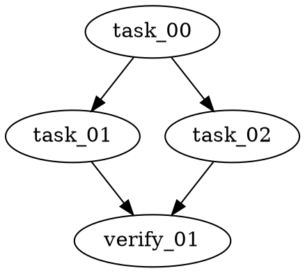

# Writing Plans

Write the plan for an implementer with zero context on this codebase: exact files, APIs, invariants, commands, and acceptance checks. Don't plan work nobody asked for, and never quietly drop work they did.

Every plan is an execution graph; a one-task change is a small graph, not a separate mode. `iterative-planning` may invoke this skill phase-scoped, to produce one phase's graph — same node kinds and rules.

Save to `docs/superpowers/plans/YYYY-MM-DD-<feature>/` unless the user prefers elsewhere:

```text
plan.md                  # index
project-network.dot      # execution contract
context/*.md             # only docs that several tasks would otherwise repeat
task-NN-<name>.md
verify-NN-<name>.md
```

## Project network

Edges mean "source must succeed before target may run." Parallelism comes from graph readiness plus non-overlapping file scopes. Author only two node kinds; review gates (`spec_review`, `design_review`, `simplification`, `quality_review`, `final`) are implied and must not appear as nodes — their triggers and scopes are defined in the Graph Contract in `subagent-driven-development`.

| Kind | Purpose | Required | Optional |
|------|---------|----------|----------|
| `task` | implementer-owned work | `file`, `files` | `scopes`, `stub` |
| `verify` | batched compile/test/lint/build gate; group reduction point | `file` | `simplify` |

- **`files`** — space-separated primary targets. Tasks run in parallel only when their `files` don't overlap.
- **`scopes`** — directories where the implementer may touch supporting files (imports, `mod.rs`, re-exports, local tests). `files` and `scopes` live only on the graph node; the orchestrator injects them, so don't restate them in task files.
- **A verify node's group** is every task that reaches it — this is where you choose which tasks batch together and which commands run.
- **API first.** The earliest task(s) establish new public surfaces (types, schemas, traits) as stubs (`todo!()`, `throw new Error("Not implemented")`) marked `stub=true`, so consumers compile immediately; this triggers `design_review`. Independent leaf tasks with no shared surface have no stub node.
- **`simplify=true`** on a verify node only when its group introduced new helpers or abstractions; it triggers `simplification`, the single owner of duplication detection.
- **Cleanup.** A plan that refactors, changes internal structures, or deprecates functionality includes a cleanup task before its verify node to remove dead code, obsolete tests, and unused imports, asking the user before deleting.
- **Contended commands** belong in verify nodes (SDD Verification Ownership). Write commands per `tool-output-discipline`.



Here the design review of `task_00`'s surface gates the start of both consumers, so a bad API is caught before anyone implements against it; simplification runs after `verify_01` and before quality review.

### Spec sync

In a project with `.agents/layout.yaml`, every plan touching source files addresses spec sync in one of two ways:

1. **Design-time intent** — the design doc named a spec amendment. Add `task-NN-spec-update-<topic>.md`, which invokes `writing-specs`, with edges to every task implementing the corresponding code change so the spec lands first.
2. **Deferred** — doc updates go to the `.agents/tech-debt/docs/` queue via `spec-code-sync` during execution. Say so in `plan.md`.

`executing-plans` invokes `spec-code-sync` before each source edit, so list `files` precisely enough for its lookup to mean something.

## Files and layout

Map which files will be created or modified and what each owns before defining tasks. Split by responsibility, keep things that change together together, and apply the file-size rule in `deslopify`. If a file you're modifying is already unwieldy, a focused split can be part of the plan when it serves the task.

## plan.md

The orchestrator's index — nothing else:

````markdown
# [Feature] Implementation Plan

> **Goal:** [one sentence]

**Project network:** `project-network.dot`

**Graph rationale:** [why this shape preserves dependencies, groups verification, and avoids file contention]

## Context Documents
- `context/architecture.md` - [one line]

## Tasks
1. `task-01-name.md` - [one line]

## Verification
1. `verify-01-name.md` - [commands and success criteria]
````

Context docs (`tech-stack.md`, `architecture.md`, `file-structure.md`) are short and contain no step-by-step instructions.

## Plan artifacts are a prompt prefix

Implementer prompts are assembled most-stable-first: agent role → `context/*.md` → shared API surface → this task's file → target files, scopes, and upstream reports. Providers cache the identical prefix, so:

- Put material shared by two or more tasks in `context/`, not in each task file.
- Don't transcribe an upstream interface into a consumer task. It breaks the cache and can drift from the real stub. Point at the source file; the graph guarantees the stub exists and has passed design review before the consumer starts. Write out a signature only in the task that defines it.

## Task files

````markdown
# Task N: [Component]

**Purpose:** [what this changes and why]

**Reuse:** [existing helpers/types in the codebase, stdlib, or dependencies the implementer should use; or "none exists" explicitly]

**Interfaces and Invariants (signatures only):**
- Upstream surface: read `src/api/mod.rs` (defined by the stub task).
- This task defines `MyTrait` in `src/thing.rs`:
  ```rust
  trait MyTrait { fn foo(&self) -> Result<Value, Error>; }
  ```
- Invariant: `foo` does not mutate persisted state on error.

**Subtasks:**
- [ ] Define `MyTrait` (stubbed) with docs.
- [ ] Implement it for `MyStruct`.
- [ ] Test success and error behavior.
````

Include a `Task-local checks` section only to name a specific narrow command; by default the implementer runs nothing contended. A `stub=true` task names its narrow scoped type-check (e.g. `cargo check -p <crate> -q`) and why it's safe — the one exception in Verification Ownership.

**No placeholders, no bodies.** Each step carries what the implementer needs to act. Plan failures: "TBD"/"TODO"; "add error handling" or "write tests" without saying what; "similar to Task N"; references to types not defined in this task or an upstream dependency; compatibility shims nobody asked for. Give complete public signatures, types, invariants, high-level algorithms, helper choices, and commands — but not function bodies, rendering code, styling, or full algorithm logic. Those are the implementer's job, and pre-writing them turns review into rubber-stamping.

## Verify files

````markdown
# Verify N: [Group]

**Upstream tasks:** `task_01`, `task_02`

**Primary commands:**
- `cargo test -p crate_name -q`

**Failure diagnostics:**
- On compile errors: `cargo check --message-format json-diagnostic-short -q | jq -crM 'select(.message.level == "error")'`

**Expected result:** Primary commands exit 0. Diagnostics are for concise reporting and may not preserve exit status. A task-owned failure returns to that task's implementer and re-runs its spec review before this node runs again.
````

A filtered pipeline is never the only pass/fail signal unless it preserves the exit status; full-log commands sit behind an explicit escalation note.

## Self-review

Check and fix inline:

1. Every requirement maps to a task or verify node.
2. Only `task`/`verify` nodes; no cycles; every task reaches a verify; `stub`/`simplify` set where they apply.
3. No parallel-ready tasks with overlapping `files`.
4. Build/test/lint/type-check commands live in verify files.
5. Shared material is in `context/`; no transcribed upstream interfaces.
6. Verbose tools use quiet or filtered output.
7. No placeholders or implementation bodies.

For a separate reviewer pass, use `plan-document-reviewer-prompt.md`. When editing this skill or `subagent-driven-development`, validate against `project-network-validation-scenarios.md`.

## Execution handoff

Phase-scoped invocations skip this: `iterative-planning` decides execution once for all phases.

In Waterfall, after saving, offer:

> Plan saved to `docs/superpowers/plans/<dir>/`. Execute with:
> 1. **Subagent-driven (recommended)** — `project-network.dot` with task fan-out, per-task spec review, verification fan-in, and group quality review.
> 2. **Inline** — this session via `executing-plans`, with checkpoints at verify and review nodes.

Then load `subagent-driven-development` or `executing-plans`. Under Rush, don't ask; resolve per `using-superpowers` `references/autonomy.md`.
