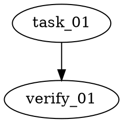
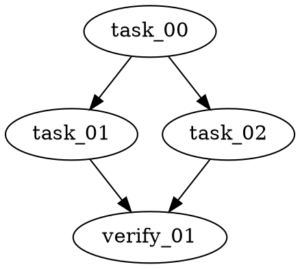

# Writing Plans

## Overview

Write comprehensive implementation plans assuming the engineer has zero context for our codebase and questionable taste. Document the exact files, APIs, invariants, commands, acceptance checks, and context needed to implement the work. Don't repeat yourself. Don't plan work nobody asked for — and never quietly drop work they did. TDD where it adds signal and reduces reviewer round trips. Verify often. Avoid contention.

Every plan is an execution graph. A small one-task change is just a small graph; do not create separate "simple", "chain", or "parallel" workflow modes.

**Phase-scoped invocation.** `writing-plans` may be invoked **phase-scoped** — typically by `iterative-planning`, to produce one phase's `project-network.dot` reaching its own `final`. A phase graph is just a normal plan graph (same node kinds, same rules); behavior is otherwise unchanged.

**Announce at start:** "I'm using the writing-plans skill to create the implementation plan."

**Save plans to:** `docs/superpowers/plans/YYYY-MM-DD-<feature-name>/` (directory)
- User preferences for plan location override this default.

## Plan Directory

Create:

```text
docs/superpowers/plans/YYYY-MM-DD-feature-name/
  plan.md
  project-network.dot
  context/
    architecture.md
    tech-stack.md
  task-01-component-name.md
  verify-01-component-name.md
```

Create only context docs that multiple tasks would otherwise need to repeat.

## Project Network Diagram

`project-network.dot` is the execution contract. Edges mean "the source node must complete successfully before the target node may run." Parallelism is derived from graph readiness plus non-overlapping file scopes.

**Author only what you actually choose.** The graph has exactly two node kinds. Every review gate still runs — the executor derives each gate's scope from the graph rather than reading it from a node you had to write. Do not add nodes for `spec_review`, `design_review`, `simplification`, `quality_review`, or `final`; they are implied.

| Kind | Purpose | Required attributes | Optional attributes |
|------|---------|---------------------|---------------------|
| `task` | Implementer-owned work | `file`, `files` | `scopes`, `stub` |
| `verify` | Batched compile/test/lint/build gate, and the group reduction point | `file` | `simplify` |

Implied gates — the executor runs these; you never author them:

| Gate | When it runs | Scope |
|------|--------------|-------|
| `spec_review` | after every `task` completes | that task |
| `design_review` | after a `stub=true` task's spec review, before its dependents start | the stubbed surface |
| `simplification` | after a `verify` marked `simplify=true` | that verify's task group |
| `quality_review` | after `verify` (or after `simplification` when present) | that verify's task group |
| `final` | when every `verify` node has passed | the whole graph |

Rules:
- **Target Files & Collision Gate:** `files` is a space-separated list of primary target files to be created or modified. Tasks may run in parallel only when their `files` do not overlap. `files` lives **only** on the graph node — do not restate it in the task file.
- **Allowed Directory Scopes:** `scopes` is a space-separated list of directories/packages where the implementer may modify supporting files (imports, `mod.rs`, `index.ts` re-exports, local tests) without tripping file-containment rules. Like `files`, it lives only on the graph node.
- **A `verify` node's task group** is every `task` node that reaches it. This is what makes `verify` the one gate you must author: it is the only place you choose *which tasks batch together* and *which commands run*.
- **API First / Early Stubbing:** The earliest task node(s) MUST establish the new public API surfaces, types, schemas, interfaces, or traits as empty/stubbed implementations (`todo!()`, `throw new Error("Not implemented")`, mock structures) and MUST be marked `stub=true`. This lets consumer tasks compile immediately, and it is what triggers the implied `design_review`. A graph with no shared API surface (independent leaf tasks) has no `stub=true` node and gets no design review.
- **`simplify=true`:** Set on a `verify` node **only when** its task group introduced new helpers, utilities, or abstractions — otherwise there is no duplication risk to check. This triggers the implied `simplification` gate, which is the **single owner** of duplication detection (`quality_review` covers maintainability only).
- **Cleanup / Dead Code Check:** If the plan refactors existing code, modifies internal structures, or deprecates functionality, it MUST include a dedicated cleanup `task` node (e.g. `task-cleanup.md`) before its verify node. It removes code made dead, obsolete tests, and unused imports, asking the user before deleting.
- **Contended commands** (`cargo`, `bazel`, test suites, type checks, linters, builds) belong in `verify` nodes, never in implementer tasks — the single exception is a `stub=true` task's narrow scoped type-check. Canonical rule: **Verification Ownership** in `jj-superpowers:subagent-driven-development`.
- **REQUIRED SUB-SKILL:** Use `jj-superpowers:tool-output-discipline` when writing verification commands.

**What `design_review` judges.** API *coherence* only — right variation axis, illegal states unrepresentable, explicit effects, no leaky boundaries. Its rubric defaults to `designing-with-types-and-abstractions`. It does **not** re-run type-checking: the `stub=true` task carries a narrow task-local type-check so consumers fan out against a compiling stub (see the stub type-check exception under Task Files). It gates consumer *start*, so a bad API is caught before implementations are produced against it.

### Agent-spec ecosystem integration

If the project has `.agents/layout.yaml`, every plan that touches source files MUST address spec sync explicitly. Two paths:

1. **Design-time intent** — the brainstorming design doc named a spec amendment. The plan MUST include a `task` node whose file is named `task-NN-spec-update-<topic>.md` and whose work invokes `writing-specs`. Add an edge from that spec-update task to every task implementing the corresponding code change, so the spec lands first.
2. **Deferred** — the plan explicitly acknowledges that doc updates are deferred to the `.agents/tech-debt/docs/` queue (a per-entry file written via `spec-code-sync`) during execution. Note this in `plan.md` so reviewers see the intent.

For source-file-touching tasks, `executing-plans` MUST invoke `spec-code-sync` before any edit to run the candidate-spec lookup on touched paths and surface specs likely relevant. Tasks MUST list `files` precisely enough for the lookup to be meaningful — vague file lists defeat the lookup.

One-task graph:



`task_01` is spec-reviewed on completion; `verify_01` then runs, followed by quality review over `task_01`; `final` is reached when `verify_01` has passed. None of that is authored.

API-first group (a stub task whose surface several consumers depend on, and a group that introduces new helpers):



`stub=true` on `task_00` triggers a design review of its stubbed surface after its spec review passes, and that review gates the *start* of `task_01` and `task_02` — so a bad API is caught before either consumer implements against it. `simplify=true` on `verify_01` triggers a simplification gate after verification and before quality review, because the group added new helpers.

A graph of independent leaf tasks (no shared API surface, no new helpers) carries neither attribute, and so gets neither gate.

## File Structure

Before defining tasks, map out which files will be created or modified and what each file is responsible for.

- Design units with clear boundaries and well-defined interfaces.
- Prefer focused files over large files that do too much.
- Apply the canonical file-size rule owned by `jj-superpowers:deslopify` when sizing touched files.
- Files that change together should live together. Split by responsibility, not by technical layer.
- In existing codebases, follow established patterns. If a file you're modifying is already unwieldy, include a focused split in the plan when it serves the task.

## Plan Document Header

`plan.md` is the lightweight index. It must contain only what the orchestrator needs to coordinate.

````markdown
# [Feature Name] Implementation Plan

> **Goal:** [One sentence describing what this builds]

**Project network:** `project-network.dot`

**Graph rationale:** [Why this graph shape preserves dependencies, groups verification, and avoids file contention.]

## Context Documents

- `context/architecture.md` - [one-line description]
- `context/tech-stack.md` - [one-line description]

## Tasks

1. `task-01-component-name.md` - [one-line summary]
2. `task-02-component-name.md` - [one-line summary]

## Verification

1. `verify-01-component-name.md` - [commands and expected success criteria]
````

No architecture prose, tech stack detail, or step detail in `plan.md`; those live in context, task, and verification files.

## Context Documents

Use short focused docs:

- `context/tech-stack.md` - languages, frameworks, key libraries and versions
- `context/architecture.md` - approach, key decisions, module boundaries
- `context/file-structure.md` - existing patterns to follow when non-obvious

No step-by-step implementation instructions in context docs.

## Plan Artifacts Are a Prompt Prefix

A subagent prompt is a **concatenation of context files**, assembled in a fixed order. LLM providers cache on the prompt *prefix*, so every byte that is identical across dispatches — and positioned before the first byte that differs — is served from cache: cheaper and faster. Structure plan artifacts to maximize that shared prefix.

Assembly order for every implementer dispatch, most-stable first:

| # | Segment | Varies with | Cacheable across |
|---|---|---|---|
| 1 | Agent role / system prompt | nothing | every dispatch, every plan |
| 2 | `context/*.md` (architecture, tech-stack, file-structure) | the plan | every task in this plan |
| 3 | Shared API/interface surface | the plan | every task in this plan |
| 4 | **This task's file** | the task | — cache boundary — |
| 5 | Target files, allowed scopes, upstream reports | the task | — |

Two consequences for how you write plans:

**Put shared material in `context/`, not in task files.** A fact repeated across five task files is five cache misses; the same fact in `context/architecture.md` is one cached prefix reused five times. This is the operational reason for the rule above — create a context doc exactly when multiple tasks would otherwise repeat something, and keep task files to what is genuinely task-specific.

**Never transcribe an upstream interface into a consumer task file.** It is variable-position content that busts the cache on every dispatch, *and* it can drift from the real stub. Point at the source file (see "Reference upstream interfaces" below). If a surface is broadly consumed, describe it once in a context doc — where it lands in the stable prefix — rather than in each consumer.

Keep segment order stable across dispatches. Reordering segments — even with identical content — invalidates the prefix and forfeits the cache.

## Task Files

Each task gets its own file at the plan root: `task-NN-component-name.md`.

A task file carries only what the graph cannot. **Target files and allowed scopes are NOT repeated here** — they live on the graph node (`files`, `scopes`), and the orchestrator injects them into the implementer's prompt. Restating them creates a third surface that silently drifts.

````markdown
# Task N: [Component Name]

**Purpose:** [What this task changes and why.]

**Reuse:** [Search the codebase, standard library, and current dependencies for helpers/types
that already do what this task needs, and name them so the implementer reuses them instead of
reinventing. If a needed utility genuinely does not exist, say so explicitly.]

**Interfaces and Invariants (API / Signature Only):**
- Upstream surface: read `exact/path/to/upstream.rs` — it exists and has passed design review.
- This task defines `MyTrait` in `exact/path/to/file.rs`. Public types, interfaces, traits, and
  function signatures ONLY — no implementation bodies:

  ```rust
  trait MyTrait {
      fn foo(&self) -> Result<Value, Error>;
  }
  ```

- Invariant: `foo` must not mutate persisted state on error.

**Subtasks:**
- [ ] Add the `MyTrait` definition and documentation (stubbed/mocked).
- [ ] Update `MyStruct` to implement `MyTrait`.
- [ ] Add tests covering success and error behavior.
````

**Omit `Task-local checks` entirely unless the task genuinely has one.** The default — group commands run at the `verify` node, the implementer runs nothing contended — is a standing rule, not something each task restates. Include the section only to name a specific narrow command.

**API-stub type-check exception:** a `stub=true` task MUST name a narrow, scoped type-check (e.g. `cargo check -p <crate> -q`) so the stub is known to compile before consumers start, and MUST document why it is safe and necessary. No other task kind may name a contended command.

### Reference upstream interfaces; do not transcribe them

Do not refer to sibling task files, and do not copy an upstream task's signatures into this one. **Point at the source file instead.** The graph guarantees a consumer cannot start until its upstream `stub=true` task has completed and passed design review, so the stubbed surface **exists on disk** by the time the implementer reads this task file. A transcribed copy can disagree with what the stub implementer actually wrote, and the implementer cannot tell which is authoritative. A pointer cannot drift.

```markdown
Upstream surface: read `src/api/mod.rs` (defined by the stub task; exists before this task starts).
```

Write out a signature only when this task is the one **defining** it. Everything a task consumes, it reads from the code.

## Verification Files

Each `verify` node uses a file named `verify-NN-name.md`.

````markdown
# Verify N: [Group Name]

**Upstream tasks:** `task_01`, `task_02`

**Primary commands:**
- `cargo test -p crate_name -q`

**Failure diagnostics:**
- If the primary command fails with compile errors, run: `cargo check --message-format json-diagnostic-short -q | jq -crM 'select(.message.level == "error")'`

**Expected result:** Primary commands exit 0. No ignored failures. Diagnostic commands are for concise failure reporting and may not preserve the primary command's exit status. If a command fails because of a task-owned issue, return to that task's implementer and re-run its spec review before this verification node runs again.
````

Verification files own contended commands: compile, type check, build, lint, test suites, and smoke tests. Keep these commands batched at graph reduction points to avoid multiple agents waiting on shared build locks.

Write verification commands with tool-output discipline:

- Prefer quiet, structured, scoped, or filtered forms when they answer the verification question.
- Separate primary pass/fail commands from diagnostic commands when useful; filtered diagnostic pipelines must not be the only pass/fail signal unless they preserve the underlying tool's exit status.
- Put full-log commands behind an explicit escalation note rather than making them the default.
- For commands likely to need unsandboxed, network, cache, or device permissions, use a short prefix-whitelistable command. Prefer checked-in helper scripts with named arguments over inline env assignments, heredocs, shell wrappers, or chained command strings.

## No Placeholders & No Code Bodies

Every step must contain the actual information an engineer needs. These are plan failures:

- "TBD", "TODO", "implement later", "fill in details"
- "Add appropriate error handling" / "add validation" / "handle edge cases"
- "Write tests for the above" without describing the behavior to test
- "Similar to Task N"
- Steps that describe what to do without enough design guidance to act
- References to types, functions, or methods not defined in this task or an upstream graph dependency
- Legacy compatibility shims or backward compatibility re-exports unless the user explicitly asked for compatibility
- **Writing full implementation bodies:** Pre-writing function/method bodies, component rendering code, styling details, or full algorithm logic is strictly forbidden.

You are writing a plan, not performing the implementation. Provide complete public signatures, type definitions, invariants, high-level algorithms, helper choices, and commands. You MUST NOT pre-write implementation code/bodies; implementation details belong strictly in the implementation subagent's scope.

## Self-Review

After writing the complete plan, check it yourself:

1. **Spec coverage:** Every requirement maps to at least one task or verify node.
2. **Graph validity:** Only `task` and `verify` nodes. No cycles. Every task reaches a `verify` node. A consumed API-stub task is marked `stub=true`; a verify node whose group added new helpers is marked `simplify=true`.
3. **File contention:** No parallel-ready tasks have overlapping `files`.
4. **Verification ownership:** Build/test/lint/type-check commands live in `verify-*` files, not implementer tasks.
5. **Prefix reuse:** Material shared by 2+ tasks lives in `context/`, not copied into each task file. No task file transcribes an upstream interface.
6. **Output discipline:** Verbose tools use quiet, structured, scoped, or filtered output where practical.
7. **Placeholder scan:** No red flags from the "No Placeholders" section.

Fix issues inline. If a spec requirement has no task, add the task and update `project-network.dot`.

For a deeper adversarial pass — or when you want to dispatch a separate reviewer subagent over the finished plan — use the prompt template in `plan-document-reviewer-prompt.md`. It checks the same dimensions as this self-review (completeness, spec alignment, task decomposition, graph validity, file contention, verification ownership, buildability) with the shared Critical/Important/Minor severity scale (defined in `jj-superpowers:requesting-code-review`).

## Skill Validation

When editing this skill or `subagent-driven-development`, validate the behavior with `project-network-validation-scenarios.md` before deployment.

## Execution Handoff

This handoff respects the autonomy level (see the Autonomy Level table in `using-superpowers`).

**When this handoff applies.** The subagent-vs-inline choice below is owned here only in **Waterfall** (a single full-plan invocation). When `writing-plans` was invoked **phase-scoped** by `iterative-planning` (Agile), the execution-skill choice is owned by `iterative-planning` — decided once at roadmap time and applied to every phase — so this per-phase handoff is **SKIPPED** entirely.

**Manual (Waterfall).** After saving the plan, offer execution choice:

**"Plan complete and saved to `docs/superpowers/plans/<directory-name>/`. Two execution options:**

**1. Subagent-Driven (recommended)** - Execute `project-network.dot` with task fan-out, per-task spec review, verification fan-in, and group code-quality review.

**2. Inline Execution** - Execute the graph in this session using `executing-plans`, with checkpoints at verification and review nodes.

**Which approach?"**

**Rush (Waterfall).** Do not ask; auto-pick per the Rush resolution for the execution-handoff checkpoint in the Autonomy Level table in `using-superpowers` (subagent-driven when subagents are authorized and the harness supports named subagents; else inline).

If Subagent-Driven is chosen:
- **REQUIRED SUB-SKILL:** Use `jj-superpowers:subagent-driven-development`.

If Inline Execution is chosen:
- **REQUIRED SUB-SKILL:** Use `jj-superpowers:executing-plans`.
