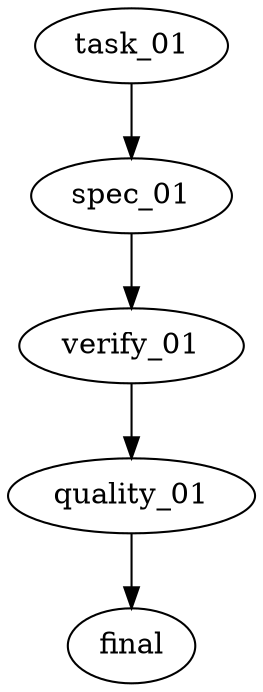
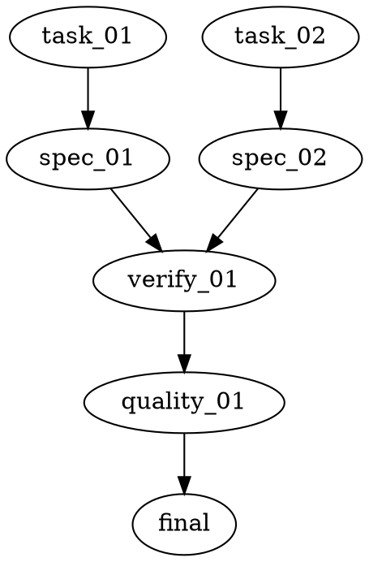
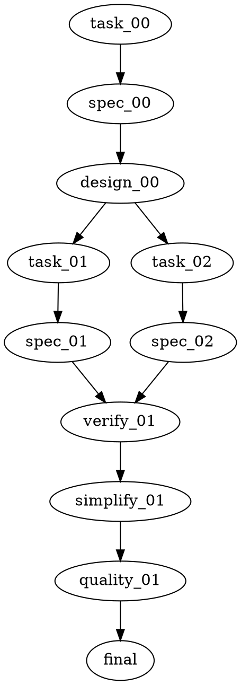

# Writing Plans

## Overview

Write comprehensive implementation plans assuming the engineer has zero context for our codebase and questionable taste. Document the exact files, APIs, invariants, commands, acceptance checks, and context needed to implement the work. DRY. YAGNI. TDD where it adds signal. Frequent verification.

Every plan is an execution graph. A small one-task change is just a small graph; do not create separate "simple", "chain", or "parallel" workflow modes.

**Phase-scoped invocation.** `writing-plans` may be invoked **phase-scoped** — typically by `iterative-planning`, to produce one phase's `project-network.dot` reaching its own `final`. A phase graph is just a normal plan graph (same node kinds, same rules); behavior is otherwise unchanged.

**Announce at start:** "I'm using the writing-plans skill to create the implementation plan."

**Save plans to:** `docs/superpowers/plans/YYYY-MM-DD-<feature-name>/` (directory)
- User preferences for plan location override this default.

## Plan Directory

Create:

```text
docs/superpowers/plans/YYYY-MM-DD-feature-name/
  plan.md
  project-network.dot
  context/
    architecture.md
    tech-stack.md
  task-01-component-name.md
  verify-01-component-name.md
```

Create only context docs that multiple tasks would otherwise need to repeat.

## Project Network Diagram

`project-network.dot` is the execution contract. Edges mean "the source node must complete successfully before the target node may run." Parallelism is derived from graph readiness plus non-overlapping file scopes.

Allowed node kinds:

| Kind | Purpose | Required attributes | Optional attributes |
|------|---------|---------------------|---------------------|
| `task` | Implementer-owned work | `file`, `files` | `scopes` |
| `spec_review` | Per-task compliance gate | `task` | |
| `design_review` | API-coherence gate on stubbed surfaces, before consumer fan-out | `tasks` | `rubric` |
| `verify` | Batched compile/test/lint/build gate | `file` | |
| `simplification` | Duplication/reduction review after verification | `scope` | |
| `quality_review` | Group-level code quality review after verification | `scope` | |
| `final` | Final completion gate | none | |

Rules:
- Every `task` node has exactly one downstream `spec_review`.
- A `verify` node may depend on one or more `spec_review` nodes.
- A `quality_review` node depends on a successful `verify` node, **or on a `simplification` node when one is present** (see Terminal Chain below).
- `final` depends on every terminal `quality_review`.
- **Target Files & Collision Gate:** `files` represents a space-separated list of primary target files to be created or modified. Tasks may run in parallel only when their `files` attributes do not overlap.
- **Allowed Directory Scopes:** `scopes` defines a space-separated list of directories/packages where the subagent is permitted to modify supporting files (such as imports, `mod.rs`, `index.ts` re-exports, and local tests) without trigger-blocking file containment rules.
- **API First / Early Stubbing:** The earliest task node(s) in the graph MUST establish the new public API surfaces, types, schemas, interfaces, or traits as empty/stubbed implementations (returning `todo!()`, `throw new Error("Not implemented")`, or mock structures). This allows subsequent parallel tasks to compile/type-check immediately and prevents downstream blockage on missing symbols.
- **Cleanup / Dead Code Check:** If the plan refactors existing code, modifies internal structures, or deprecates any functionality, it MUST include a dedicated cleanup `task` node (e.g. `task-cleanup.md`) at the end of the implementation phase (before verification). This cleanup task explicitly checks for and removes any pre-existing code that was made dead, obsolete tests, or unused imports, requesting user confirmation before performing deletions.
- Commands that contend on shared build state, such as `cargo`, `bazel`, test suites, type checks, and linters, belong in `verify` nodes, not implementer tasks.
- **REQUIRED SUB-SKILL:** Use `jj-superpowers:tool-output-discipline` when writing verification commands.

**Terminal chain.** The canonical terminal chain is `verify -> [simplification?] -> quality_review -> final`, where `simplification` is optional. A `quality_review` depends directly on its `verify` when no `simplification` node is present, and on the `simplification` node when one is.

**`design_review` (API-coherence gate).** When the graph has API-stub task(s) that other tasks consume, insert a `design_review` node that depends on the stub task(s)' `spec_review`(s), and make every consumer task depend on the `design_review` node (gating consumer *start*, so a bad API is caught before implementations are produced):
- `tasks` is a space-separated list of the upstream API-stub task ids.
- `rubric` is a free-text pass-through into the reviewer prompt; it defaults to `designing-with-types-and-abstractions`.
- `design_review` judges API *coherence* only (right variation axis, illegal states unrepresentable, explicit effects, no leaky boundaries). It does **not** re-run type-checking: the stub task carries a narrow task-local type-check so consumers fan out against a compiling stub (see the stub type-check exception under Task Files).
- A graph with no shared API surface (independent leaf tasks) needs no `design_review` node. Most non-trivial plans have a stub task (API First, above), so this node is common.

**`simplification` (duplication review).** Add a `simplification` node **only when** the verified group introduced new helpers, utilities, or abstractions (otherwise omit it — no duplication risk to check):
- It depends on a successful `verify` node; the downstream `quality_review` then depends on it.
- It is a reviewer node: it flags duplication of in-repo code, the standard library, or dependency functionality, and proposes deletion/reuse. Findings route back to an implementer (same pattern as `quality_review`), which then re-verifies.
- It is the **single owner** of duplication detection: `quality_review` covers maintainability only and does NOT also flag duplication.

### Agent-spec ecosystem integration

If the project has `.agents/layout.yaml`, every plan that touches source files MUST address spec sync explicitly. Two paths:

1. **Design-time intent** — the brainstorming design doc named a spec amendment. The plan MUST include a `task` node whose file is named `task-NN-spec-update-<topic>.md` and whose work invokes `writing-specs`. This task MUST be scheduled to complete BEFORE any task that implements the corresponding code change (add an edge from the implementing task's `task` node to the spec-update task's `spec_review` node, or earlier).
2. **Deferred** — the plan explicitly acknowledges that doc updates are deferred to the `.agents/tech-debt/docs/` queue (a per-entry file written via `spec-code-sync`) during execution. Note this in `plan.md` so reviewers see the intent.

For source-file-touching tasks, `executing-plans` MUST invoke `spec-code-sync` before any edit to run the candidate-spec lookup on touched paths and surface specs likely relevant. Tasks MUST list `files` precisely enough for the lookup to be meaningful — vague file lists defeat the lookup.

One-task graph:



Parallel group:



The parallel group above has no shared API surface (`api.rs` and `ui.rs` are independent), so it needs no `design_review`, and if it adds no new helpers it needs no `simplification`.

API-first group with `design_review` and `simplification` (a stub task whose surface several consumers depend on, and a group that introduces new helpers):



`design_00` gates the start of both consumers, so the stubbed API surface in `task_00` is reviewed for coherence before `task_01`/`task_02` implement against it. `simplify_01` runs after verification (the group added new helpers) and before quality review.

## File Structure

Before defining tasks, map out which files will be created or modified and what each file is responsible for.

- Design units with clear boundaries and well-defined interfaces.
- Prefer focused files over large files that do too much.
- Apply the file-size discipline (the ~500/1000-line thresholds) owned by `jj-superpowers:deslopify` — see its canonical file-size rule — when sizing touched files.
- Files that change together should live together. Split by responsibility, not by technical layer.
- In existing codebases, follow established patterns. If a file you're modifying is already unwieldy, include a focused split in the plan when it serves the task.

## Plan Document Header

`plan.md` is the lightweight index. It must contain only what the orchestrator needs to coordinate.

````markdown
# [Feature Name] Implementation Plan

> **Goal:** [One sentence describing what this builds]

**Project network:** `project-network.dot`

**Graph rationale:** [Why this graph shape preserves dependencies, groups verification, and avoids file contention.]

## Context Documents

- `context/architecture.md` - [one-line description]
- `context/tech-stack.md` - [one-line description]

## Tasks

1. `task-01-component-name.md` - [one-line summary]
2. `task-02-component-name.md` - [one-line summary]

## Verification

1. `verify-01-component-name.md` - [commands and expected success criteria]
````

No architecture prose, tech stack detail, or step detail in `plan.md`; those live in context, task, and verification files.

## Context Documents

Use short focused docs:

- `context/tech-stack.md` - languages, frameworks, key libraries and versions
- `context/architecture.md` - approach, key decisions, module boundaries
- `context/file-structure.md` - existing patterns to follow when non-obvious

No step-by-step implementation instructions in context docs.

## Task Files

Each task gets its own file at the plan root: `task-NN-component-name.md`.

````markdown
# Task N: [Component Name]

**Target Files:**
- Create: `exact/path/to/file.rs`
- Modify: `exact/path/to/existing.rs`

**Allowed Directory Scopes:**
- `exact/path/to/` (gives implementer permission to touch/create supporting files in this directory, e.g. imports, mod.rs, index.ts, local tests)

**Purpose:** [What this task changes and why.]

**Existing utilities to reuse:**
- Before defining this task, search the codebase, standard library, and current dependencies for helpers/types that already do what the task needs. Name them here so the implementer reuses them instead of reinventing. If a needed utility genuinely does not exist, say so explicitly.

**Interfaces and Invariants (API / Signature Only):**
- Define `MyTrait` in `exact/path/to/file.rs`. Define ONLY public types, interfaces, traits, and function signatures. Do NOT pre-write implementation code or function bodies:

  ```rust
  trait MyTrait {
      fn foo(&self) -> Result<Value, Error>;
  }
  ```

- Invariant: `foo` must not mutate persisted state on error.

**Subtasks:**
- [ ] Add the `MyTrait` definition and documentation (stubbed/mocked).
- [ ] Update `MyStruct` to implement `MyTrait`.
- [ ] Add tests covering success and error behavior.

**Task-local checks:**
- Run only these narrow checks if useful: `[exact command]`
- Do not run `cargo check`, `cargo build`, `cargo test`, or other commands that contend on shared build state unless this task documents a concrete exception.
- Group compile/test/lint/build verification is handled by `verify-*` files.

**API-stub type-check exception:** An API-stub task whose surface is gated by a `design_review` node is the one sanctioned exception to the contended-command rule. Because consumers fan out against the stub and the `design_review` node reviews coherence (not compilation), the stub task MUST name a narrow, scoped type-check (e.g. `cargo check -p <crate> -q`) so the stub is known to compile before consumers start. Document the command here and why it is safe and necessary; this is the only task kind that may name such a command.
````

Task files must be self-contained. Do not refer to sibling task files. If a task depends on a type or function produced by an upstream task, repeat the required interface in this task and make the dependency explicit in `project-network.dot`.

## Verification Files

Each `verify` node uses a file named `verify-NN-name.md`.

````markdown
# Verify N: [Group Name]

**Upstream tasks:** `task_01`, `task_02`

**Primary commands:**
- `cargo test -p crate_name -q`

**Failure diagnostics:**
- If the primary command fails with compile errors, run: `cargo check --message-format json-diagnostic-short -q | jq -crM 'select(.message.level == "error")'`

**Expected result:** Primary commands exit 0. No ignored failures. Diagnostic commands are for concise failure reporting and may not preserve the primary command's exit status. If a command fails because of a task-owned issue, return to that task's implementer and re-run its spec review before this verification node runs again.
````

Verification files own contended commands: compile, type check, build, lint, test suites, and smoke tests. Keep these commands batched at graph reduction points to avoid multiple agents waiting on shared build locks.

Write verification commands with tool-output discipline:

- Prefer quiet, structured, scoped, or filtered forms when they answer the verification question.
- Separate primary pass/fail commands from diagnostic commands when useful; filtered diagnostic pipelines must not be the only pass/fail signal unless they preserve the underlying tool's exit status.
- Put full-log commands behind an explicit escalation note rather than making them the default.
- For commands likely to need unsandboxed, network, cache, or device permissions, use a short prefix-whitelistable command. Prefer checked-in helper scripts with named arguments over inline env assignments, heredocs, shell wrappers, or chained command strings.
- Do not put contended commands such as `cargo check`, `cargo build`, or `cargo test` in task-local checks just because they can be package-scoped or test-filtered; they usually still block shared build state.

## No Placeholders & No Code Bodies

Every step must contain the actual information an engineer needs. These are plan failures:

- "TBD", "TODO", "implement later", "fill in details"
- "Add appropriate error handling" / "add validation" / "handle edge cases"
- "Write tests for the above" without describing the behavior to test
- "Similar to Task N"
- Steps that describe what to do without enough design guidance to act
- References to types, functions, or methods not defined in this task or an upstream graph dependency
- Legacy compatibility shims or backward compatibility re-exports unless the user explicitly asked for compatibility
- **Writing full implementation bodies:** Pre-writing function/method bodies, component rendering code, styling details, or full algorithm logic is strictly forbidden.

You are writing a plan, not performing the implementation. Provide complete public signatures, type definitions, invariants, high-level algorithms, helper choices, and commands. You MUST NOT pre-write implementation code/bodies; implementation details belong strictly in the implementation subagent's scope.

## Common Mistakes

| Mistake | Prevention |
|---------|------------|
| Writing implementation code in plans | Never write function/method bodies, JSX rendering code, CSS definitions, or complete logic loops. Provide only traits, types, interfaces, signature stubs, and plain text invariants. |
| Narrow file scopes blocking agents | Specify a directory scope (using `scopes` attribute in the graph, and `Allowed Directory Scopes` in task files) to allow minor edits (imports, mod.rs, tests) without causing BLOCKED status. |
| Sequential blockages on missing APIs | Designate the first task node as an "API & Interface Stubs" node, committing all public interfaces first so parallel consumer tasks compile immediately. |
| Forgetting codebase cleanup | If refactoring or replacing code, always include a dedicated cleanup task node at the end of the implementation phase to check for and delete dead code/unused imports. |

## Self-Review

After writing the complete plan, check it yourself:

1. **Spec coverage:** Every requirement maps to at least one task or verification node.
2. **Graph validity:** No orphan nodes, no cycles, every task reaches `spec_review -> verify -> [simplification?] -> quality_review -> final`. If the graph has a consumed API-stub task, a `design_review` node gates the consumers; if a verified group adds new helpers, a `simplification` node precedes its `quality_review`.
3. **File contention:** No parallel-ready tasks touch overlapping files.
4. **Verification ownership:** Build/test/lint/type-check commands live in `verify-*` files, not implementer tasks.
5. **Output discipline:** Verbose tools use quiet, structured, scoped, or filtered output where practical.
6. **Type consistency:** Types, method signatures, and property names stay consistent across tasks.
7. **Placeholder scan:** No red flags from the "No Placeholders" section.

Fix issues inline. If a spec requirement has no task, add the task and update `project-network.dot`.

For a deeper adversarial pass — or when you want to dispatch a separate reviewer subagent over the finished plan — use the prompt template in `plan-document-reviewer-prompt.md`. It checks the same dimensions as this self-review (completeness, spec alignment, task decomposition, graph validity, file contention, verification ownership, buildability) with the shared Major/Minor/Nit severity taxonomy.

## Skill Validation

When editing this skill or `subagent-driven-development`, validate the behavior with `project-network-validation-scenarios.md` before deployment.

## Execution Handoff

This handoff respects the autonomy level (see the Autonomy Level table in `using-superpowers`).

**When this handoff applies.** The subagent-vs-inline choice below is owned here only in **Waterfall** (a single full-plan invocation). When `writing-plans` was invoked **phase-scoped** by `iterative-planning` (Agile), the execution-skill choice is owned by `iterative-planning` — decided once at roadmap time and applied to every phase — so this per-phase handoff is **SKIPPED** entirely.

**Manual (Waterfall).** After saving the plan, offer execution choice:

**"Plan complete and saved to `docs/superpowers/plans/<directory-name>/`. Two execution options:**

**1. Subagent-Driven (recommended)** - Execute `project-network.dot` with task fan-out, per-task spec review, verification fan-in, and group code-quality review.

**2. Inline Execution** - Execute the graph in this session using `executing-plans`, with checkpoints at verification and review nodes.

**Which approach?"**

**Rush (Waterfall).** Do not ask; auto-pick per the Rush resolution for the execution-handoff checkpoint in the Autonomy Level table in `using-superpowers` (subagent-driven when subagents are authorized and the harness supports named subagents; else inline).

If Subagent-Driven is chosen:
- **REQUIRED SUB-SKILL:** Use `jj-superpowers:subagent-driven-development`.

If Inline Execution is chosen:
- **REQUIRED SUB-SKILL:** Use `jj-superpowers:executing-plans`.
