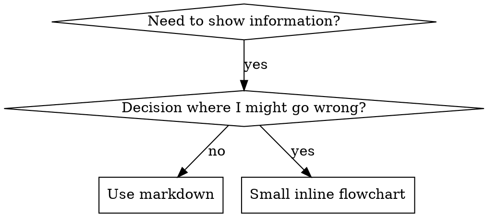

# Writing Skills

## Overview

**Writing skills IS Test-Driven Development applied to process documentation.** You write test cases (pressure scenarios with subagents), watch them fail (baseline behavior), write the skill (documentation), watch tests pass (agents comply), and refactor (close loopholes).

**Core principle:** If you didn't watch an agent fail without the skill, you don't know if the skill teaches the right thing.

**REQUIRED BACKGROUND:** You MUST understand jj-superpowers:test-driven-development before using this skill. That skill defines the fundamental RED-GREEN-REFACTOR cycle; this skill adapts it to documentation.

**Official guidance:** For Anthropic's official skill authoring best practices, see anthropic-best-practices.md. It complements the TDD-focused approach here.

**Personal skills live in agent-specific directories** (`~/.claude/skills` for Claude Code, `~/.agents/skills/` for Codex).

## The Iron Law

```
NO SKILL WITHOUT A FAILING TEST FIRST
```

This applies to NEW skills AND EDITS to existing skills.

Write skill before testing? Delete it. Start over. Edit skill without testing? Same violation.

**No exceptions:**
- Not for "simple additions", "just adding a section", or "documentation updates"
- Don't keep untested changes as "reference"
- Don't "adapt" while running tests
- Don't batch: after writing ANY skill, STOP and complete the deployment checklist before starting the next one
- Delete means delete

Deploying untested skills = deploying untested code.

## What is a Skill?

A **skill** is a reference guide for proven techniques, patterns, or tools — reusable, not a narrative about how you solved a problem once.

**Three types:**
- **Technique** — concrete method with steps (condition-based-waiting, root-cause-tracing)
- **Pattern** — way of thinking about problems (flatten-with-flags, test-invariants)
- **Reference** — API docs, syntax guides, tool documentation (office docs)

**Create when:** the technique wasn't intuitively obvious, you'd reference it again across projects, it applies broadly, and others would benefit.

**Don't create for:**
- One-off solutions
- Standard practices well-documented elsewhere
- Project-specific conventions (put in AGENTS.md, or register as a **project-specific skill** under `.agents/skills/<name>/` via `jj-superpowers:project-layout` — the projx-frontend pattern)
- Mechanical constraints (if it's enforceable with regex/validation, automate it — save documentation for judgment calls)

**Project-specific vs. global.** This skill governs *global* skills (cross-project techniques, patterns, references). For per-project guidance (a UI component library's conventions, a stack-specific code-style guide), use `jj-superpowers:project-layout` to register a skill under the project's `.agents/skills/` directory. Project-layout enforces the anti-keyword-bloat trigger check; this skill governs the body content.

## File Organization

```
skills/
  skill-name/
    SKILL.md              # Main reference (required)
    supporting-file.*     # Only if needed
```

**Flat namespace** — all skills in one searchable namespace.

**Keep inline:** principles, concepts, code patterns (< 50 lines), everything else.

**Separate files only for:**
1. **Heavy reference** (100+ lines) — API docs, comprehensive syntax (e.g. `pptx/` with `pptxgenjs.md`, `ooxml.md`)
2. **Reusable tools** — scripts, utilities, working helpers to adapt (e.g. `condition-based-waiting/example.ts`)

### No-Ship Hygiene (What Must NOT Live in a Skill Dir)

A shipped skill directory contains only `SKILL.md` plus the files it references. The installer symlinks the *whole* directory into every harness, so anything inside ships.

Keep these OUT (move elsewhere or delete):
- Pressure-test scenarios and baseline RED logs
- Creation/handoff logs and session notes
- Build/packaging files (e.g. `pyproject.toml`, lockfiles)

If an artifact isn't referenced by `SKILL.md` and isn't a tool the skill uses, it does not belong in the skill dir.

## SKILL.md Structure

**Frontmatter (YAML):** two required fields, `name` and `description` (see [agentskills.io/specification](https://agentskills.io/specification) for all supported fields). Max 1024 characters total.
- `name`: lowercase letters, numbers, and hyphens only (no parentheses or special chars)
- `description`: see CSO below

```markdown
---
name: skill-name-with-hyphens
description: Use when [specific triggering conditions and symptoms]
---

# Skill Name

## Overview
What is this? Core principle in 1-2 sentences.

## When to Use
[Small inline flowchart IF decision non-obvious]

Bullet list with SYMPTOMS and use cases
When NOT to use

## Core Pattern (for techniques/patterns)
Before/after code comparison

## Quick Reference
Table or bullets for scanning common operations

## Implementation
Inline code for simple patterns
Link to file for heavy reference or reusable tools

## Common Mistakes
What goes wrong + fixes

## Real-World Impact (optional)
Concrete results
```

## Claude Search Optimization (CSO)

**Critical for discovery:** future Claude needs to FIND your skill. Claude reads the description to decide which skills to load. Make it answer: "Should I read this skill right now?"

### 1. Description = When to Use, NOT What the Skill Does

The description must ONLY describe triggering conditions. **NEVER summarize the skill's process or workflow.**

**Why:** a description that summarizes workflow creates a shortcut Claude takes *instead of* reading the skill. Testing showed a description saying "code review between tasks" caused Claude to do ONE review, even though the skill's flowchart showed TWO. Removing the workflow summary fixed it.

Rules: start with "Use when...", write in third person (it is injected into the system prompt), keep under 500 characters if possible.

```yaml
# ❌ BAD: Summarizes workflow - Claude may follow this instead of reading skill
description: Use when executing plans - dispatches subagent per task with code review between tasks

# ❌ BAD: Too much process detail
description: Use for TDD - write test first, watch it fail, write minimal code, refactor

# ❌ BAD: Too abstract, doesn't say when to use
description: For async testing

# ❌ BAD: First person
description: I can help you with async tests when they're flaky

# ❌ BAD: Mentions technology but skill isn't specific to it
description: Use when tests use setTimeout/sleep and are flaky

# ✅ GOOD: Triggering conditions only
description: Use when implementing any feature or bugfix, before writing implementation code

# ✅ GOOD: Describes the problem, not language-specific symptoms
description: Use when tests have race conditions, timing dependencies, or pass/fail inconsistently

# ✅ GOOD: Technology-specific skill with explicit trigger
description: Use when using React Router and handling authentication redirects
```

Describe the *problem* (race conditions, inconsistent behavior), not *language-specific symptoms* (setTimeout, sleep). Keep triggers technology-agnostic unless the skill itself is technology-specific. For discipline skills, include the symptoms of being ABOUT to violate the rule (e.g. "before writing implementation code").

### 2. Keyword Coverage

Use words Claude would search for, early and often:
- Error messages: "Hook timed out", "ENOTEMPTY", "race condition"
- Symptoms: "flaky", "hanging", "zombie", "pollution"
- Synonyms: "timeout/hang/freeze", "cleanup/teardown/afterEach"
- Tools: actual commands, library names, file types

### 3. Descriptive Naming

Name by what you DO or the core insight. Active voice, verb-first; gerunds (-ing) work well for processes.

- ✅ `condition-based-waiting` > `async-test-helpers`
- ✅ `flatten-with-flags` > `data-structure-refactoring`
- ✅ `root-cause-tracing` > `debugging-techniques`
- ✅ `creating-skills`, `testing-skills`, `debugging-with-logs` (not `skill-creation`, `skill-usage`)

### 4. Token Efficiency (Critical)

getting-started and frequently-referenced skills load into EVERY conversation. Every token counts.

**Target word counts:**
- getting-started workflows: <150 words each
- Frequently-loaded skills: <200 words total
- Other skills: <500 words (still be concise)

```bash
wc -w skills/path/SKILL.md   # verify
```

**Techniques:**
- **Move details to tool help** — "search-conversations supports multiple modes and filters. Run --help for details." beats documenting every flag.
- **Cross-reference instead of repeating** — "Always use subagents (50-100x context savings). REQUIRED: Use [other-skill-name] for workflow." beats 20 lines of restated instructions.
- **Compress examples** — cut dialogue to essentials: `Partner: "How did we handle auth errors in React Router?" / You: Searching... [Dispatch subagent → synthesis]`
- **Eliminate redundancy** — don't repeat cross-referenced skills, don't explain what's obvious from the command, don't give multiple examples of the same pattern.

### 5. Cross-Referencing Other Skills

Use the skill name only, with explicit requirement markers:
- ✅ `**REQUIRED SUB-SKILL:** Use jj-superpowers:test-driven-development`
- ✅ `**REQUIRED BACKGROUND:** You MUST understand jj-superpowers:systematic-debugging`
- ❌ `See skills/test-driven-development` (unclear if required)
- ❌ `@skills/test-driven-development/SKILL.md` — `@` force-loads the file immediately, burning 200k+ context before you need it

## Flowchart Usage



**Use flowcharts ONLY for:** non-obvious decision points, process loops where you might stop too early, "when to use A vs B" decisions.

**Never use flowcharts for:**
- Reference material → tables, lists
- Code examples → markdown blocks (code in a flowchart can't be copy-pasted)
- Linear instructions → numbered lists
- Labels without semantic meaning (`step1`, `helper2` — labels must be semantic)

See `graphviz-conventions.dot` in this directory for graphviz style rules.

**Visualizing for your human partner:** use `render-graphs.js` in this directory to render a skill's flowcharts to SVG:
```bash
./render-graphs.js ../some-skill           # Each diagram separately
./render-graphs.js ../some-skill --combine # All diagrams in one SVG
```

## Code Examples

**One excellent example beats many mediocre ones.** You're good at porting — one great example is enough.

**Choose the most relevant language used in the current repo** — an example in a language the project doesn't use is one the reader has to translate before they can trust it.

Absent a repo signal, prefer **Rust or TypeScript**. Both have type systems strong enough that the example can *show* an invariant rather than describe it in a comment. Reach for Python only when the domain genuinely calls for it (data processing, quick scripting); its weaker type system makes it easier to write an example that looks right and isn't.

**Good example:** complete and runnable, well-commented explaining WHY, from a real scenario, shows the pattern clearly, ready to adapt.

**Don't:** implement in 5+ languages (mediocre quality, maintenance burden), create fill-in-the-blank templates, write contrived examples, or tell narrative war stories ("In session 2025-10-03, we found...") — too specific to reuse.

## Testing Skills

**Testing methodology:** see `testing-skills-with-subagents.md` in this directory for how to write pressure scenarios, pressure types (time, sunk cost, authority, exhaustion), plugging holes systematically, and meta-testing.

### RED-GREEN-REFACTOR

**RED — write the failing test (baseline).** Run a pressure scenario with a subagent WITHOUT the skill. Document exactly: what choices they made, what rationalizations they used (verbatim), which pressures triggered violations. You must see what agents naturally do before writing the skill.

**GREEN — write the minimal skill.** Address those specific rationalizations. Don't add content for hypothetical cases. Run the same scenarios WITH the skill; the agent should now comply.

**REFACTOR — close loopholes.** Agent found a new rationalization? Add an explicit counter. Re-test until bulletproof.

### Test Approach by Skill Type

| Skill type | Test with | Success criteria |
|---|---|---|
| **Discipline-enforcing** (TDD, verification-before-completion) | Academic questions (do they understand the rules?); pressure scenarios (do they comply under stress?); multiple pressures combined (time + sunk cost + exhaustion) | Agent follows rule under maximum pressure |
| **Technique** (condition-based-waiting, root-cause-tracing) | Application scenarios; variation scenarios (edge cases); missing-information tests (do the instructions have gaps?) | Agent successfully applies technique to a new scenario |
| **Pattern** (reducing-complexity, information-hiding) | Recognition scenarios; application scenarios; counter-examples (do they know when NOT to apply?) | Agent correctly identifies when/how to apply the pattern |
| **Reference** (API docs, command references) | Retrieval scenarios; application scenarios; gap testing (are common use cases covered?) | Agent finds and correctly applies the information |

### Rationalizations for Skipping Testing

| Excuse | Reality |
|--------|---------|
| "It's obviously clear" / "I'm confident it's good" / "Testing is overkill" | Clear to you ≠ clear to other agents. Overconfidence guarantees issues. Untested skills have issues, always. |
| "It's just a reference" | References have gaps and unclear sections. Test retrieval. |
| "No time" / "Too tedious" / "I'll test if problems emerge" | 15 min of testing saves hours. Problems emerging = agents can't use your skill. Test BEFORE deploying. |
| "Academic review is enough" | Reading ≠ using. Test application scenarios. |

## Bulletproofing Skills Against Rationalization

Skills that enforce discipline (like TDD) need to resist rationalization. Agents are smart and will find loopholes under pressure.

**Psychology note:** understanding WHY persuasion techniques work helps you apply them systematically. See persuasion-principles.md for the research foundation (Cialdini, 2021; Meincke et al., 2025) on authority, commitment, scarcity, social proof, and unity.

**1. Close every loophole explicitly.** Don't just state the rule — forbid the specific workarounds.

<Bad>
```markdown
Write code before test? Delete it.
```
</Bad>

<Good>
```markdown
Write code before test? Delete it. Start over.

**No exceptions:**
- Don't keep it as "reference"
- Don't "adapt" it while writing tests
- Don't look at it
- Delete means delete
```
</Good>

**2. Address "spirit vs letter" arguments** with a foundational principle stated early:

```markdown
**Violating the letter of the rules is violating the spirit of the rules.**
```

This cuts off an entire class of "I'm following the spirit" rationalizations.

**3. Build a rationalization table** from baseline testing. Every excuse agents actually made goes in it:

```markdown
| Excuse | Reality |
|--------|---------|
| "Too simple to test" | Simple code breaks. Test takes 30 seconds. |
| "I'll test after" | Tests passing immediately prove nothing. |
```

**4. Create a red flags list** so agents can self-check when rationalizing:

```markdown
## Red Flags - STOP and Start Over

- Code before test
- "I already manually tested it"
- "It's about spirit not ritual"
- "This is different because..."

**All of these mean: Delete code. Start over with TDD.**
```

## Skill Creation Checklist (TDD Adapted)

**IMPORTANT: Work through EACH item in order, tracking against this checklist itself — not the harness task/todo tracker. Skill creation dispatches subagents (the pressure tests), and the harness task list doesn't survive subagent dispatch (see `jj-superpowers:using-superpowers`).**

**RED Phase — Write Failing Test:**
- [ ] Create pressure scenarios (3+ combined pressures for discipline skills)
- [ ] Run scenarios WITHOUT skill — document baseline behavior verbatim
- [ ] Identify patterns in rationalizations/failures

**GREEN Phase — Write Minimal Skill:**
- [ ] Name uses only letters, numbers, hyphens (no parentheses/special chars)
- [ ] YAML frontmatter with required `name` and `description` fields (max 1024 chars)
- [ ] Description starts with "Use when...", third person, specific triggers/symptoms, no workflow summary
- [ ] Keywords throughout for search (errors, symptoms, tools)
- [ ] Clear overview with core principle
- [ ] Address specific baseline failures identified in RED
- [ ] Code inline OR link to separate file
- [ ] One excellent example (not multi-language)
- [ ] Run scenarios WITH skill — verify agents now comply

**REFACTOR Phase — Close Loopholes:**
- [ ] Identify NEW rationalizations from testing
- [ ] Add explicit counters (if discipline skill)
- [ ] Build rationalization table from all test iterations
- [ ] Create red flags list
- [ ] Re-test until bulletproof

**Quality Checks:**
- [ ] Small flowchart only if decision non-obvious
- [ ] Quick reference table
- [ ] Common mistakes section
- [ ] No narrative storytelling
- [ ] Supporting files only for tools or heavy reference
