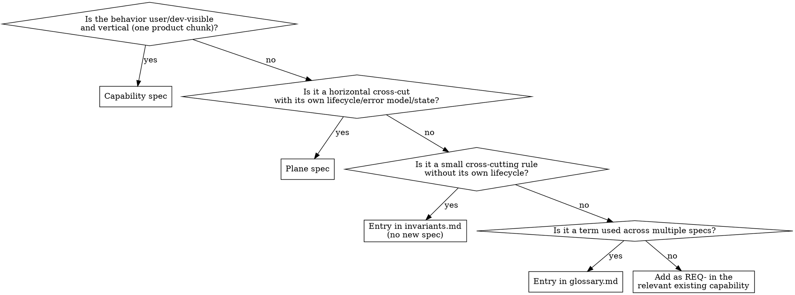

# Writing Specs

Author and amend capability specs, plane specs, the glossary, invariants, and code-as-spec module surfaces. A finished spec is enough for a clean-room reimplementation that preserves externally observable behavior, including concurrency semantics, without dictating implementation.

Not for: setting up `layout.yaml` (`project-layout`), auditing drift (`spec-drift-detector`), routing code changes whose behavior is already specified (`spec-code-sync`), or mdbook user docs (`documentation`).

## Principles

- **Short, but complete.** Keep each requirement to 1–3 plain sentences; the first should say what it is about. Brevity governs how you write a requirement, not whether you write it.
- **One home per fact.** Spec frontmatter is canonical for `owns:`/`code_spec:`, and `layout.yaml` indices follow it. Each glossary term is defined once; each requirement lives in exactly one place (a prose REQ-, a plane INV-, or a code-as-spec item).
- **Don't duplicate the code.** A spec carries what code can't: clock and timing models, ordering and concurrency semantics, edge-case behavior, cross-component contracts, the reason behind a value. If paraphrasing a signature, enum, or constant would regenerate the requirement (`max size is 2 GiB`, `formats are MP4/MOV/MKV`), cut it or replace it with the intricacy it was hiding. When a value is a genuine external contract, state the guarantee clients rely on rather than retyping the constant. Whether a non-obvious fact belongs in a spec, comment, or doc is decided by the placement rule in `jj-superpowers:writing-comments`.
- **Remove superseded specs immediately**, so nobody implements against a stale one.

## Preflight

1. Read `.agents/layout.yaml` and check `schema_version`; refuse unknown future versions.
2. Read `glossary.md` and `invariants.md`.
3. When amending, read only the target `SPEC.yaml` (plus its parent's, per the parent rule below), not the whole corpus.
4. If a code-as-spec module is involved, read the module too.

## Choosing the spec kind



When unclear, ask the user; plane vs. invariant is the usual ambiguity. An invariant that grows its own lifecycle or state should be promoted to a plane. If two specs use one word with different meanings, raise it with the user — one probably needs renaming.

## Sub-specs

Split a capability or plane when it reaches about 15 requirements, or when a coherent functional area maps to its own set of `owns:` paths. Nesting is one level deep: sub-specs have no `sub_specs:` of their own. If a sub-spec outgrows that, split the parent into separate top-level specs.

**Parent rule:** parent requirements apply to every sub-spec and must not be contradicted. Whenever you load a sub-spec (`parent:` set), also load the parent's `SPEC.yaml`. Other skills defer to this rule.

To create one:

1. Make `capabilities/<parent>/<leaf>/` (kebab-case leaf, one functional area).
2. Write its `SPEC.yaml` with `id: <parent>/<leaf>` (exactly), `kind:` matching the parent, and `parent: <parent>`.
3. Add the leaf to the parent's `sub_specs:`.
4. Set `owns:` to globs narrower than the parent's.
5. Add `code_map` entries for `<parent>/<leaf>` in `layout.yaml`.

## IDs

- Capability requirements: `REQ-<SHORT>-NNN`; plane requirements: `INV-<SHORT>-NNN`.
- New requirements in a sub-spec: `REQ-{PARENT_SHORT}-{SUB_SHORT}-NNN` (or `INV-…` for planes). `PARENT_SHORT` is the parent's existing prefix (`CHAT`); `SUB_SHORT` is 2–4 uppercase letters (`STR` for streaming). Check the combined prefix against the parent's other sub-specs.
- Requirements moved from a parent keep their IDs (`REQ-CHAT-001`) and coexist with new nested ones. Each ID appears in exactly one `SPEC.yaml`, so remove a moved requirement from the parent.
- IDs are stable across renames. Never reuse a number: retire with `level: DEPRECATED` and `replaced_by:` where applicable. Take the next free integer.

## SPEC.yaml format

Prose sections are KYAML `|` blocks; structured data is inline YAML. `references` holds slugs and IDs, never file paths. A fill-in template is in `references/spec-template.md`.

```yaml
id: video-upload
kind: capability                # capability | plane
status: draft                   # draft | stable | deprecated
owns:                           # globs — canonical source for code_map
  - js/projx_frontend/src/upload/**
code_spec:                      # modules carrying normative typed API for this spec
  - rust/projx_upload_service/src/api.rs
references:                     # slugs/IDs only — never file paths
  planes:     [auth, observability]
  capabilities: [video-transcode]
  invariants: [INV-CONSISTENCY-001]
  glossary:   [video, presigned-upload]

purpose: |
  One paragraph describing what this capability does and why it exists.

# optional prose: actors_and_surfaces, state_and_lifecycle,
# scaling_assumptions (observable performance contracts only), out_of_scope

requirements:
  - id: REQ-VID-001
    summary: Upload visible only after commit
    level: MUST
    text: |
      A video MUST NOT appear in listings until all its bytes are durably
      stored; a listed video MUST be fully downloadable.

failure_modes:
  - code: ERR-VID-001
    condition: Storage commit fails after bytes were received
    behavior: Discard the partial upload; the video never becomes listed.
```

Omit optional sections you can't fill; an empty section is noise.

## `impl:` annotations

Mark the primary implementation site of a requirement — the outermost entry point or handler, once per requirement — so `spec-drift-detector` can find it by grep:

```rust
// impl: REQ-CAM-001, REQ-CAM-003
pub async fn fetch_pipeline_state(...) { ... }
```

## Code-as-spec module changes

This is the canonical statement; other skills point here. A module listed under `spec_code.modules` carries normative typed API, and this skill is the only authoring path for its public surface (adding, removing, renaming, retyping, or changing visibility of a public item). Each such change lands in one change set across:

(a) the module — signature plus RFC 2119 doc in the native format (rustdoc, jsdoc, javadoc);
(b) every `SPEC.yaml` prose section referencing the item (grep its name and bound ID);
(c) the bound `requirements:` entry, if any.

The module holds only API surface (signatures, types, enums, constants); implementation lives in sibling modules. Items may carry an ID prefix (`/// REQ-INF-014:`). A rename is a deprecation plus a new item: keep the old one `#[deprecated]`, or hard-rename and set `replaced_by:`. Changing (a) alone is unfinished work, and `spec-code-sync` will route it back here.

## Specifying user interfaces

Express user-facing behavior (screens, forms, dashboards, CLI flows) as observable contracts in the existing sections: surfaces in `actors_and_surfaces`, state machines in `state_and_lifecycle`, event → effect contracts in `requirements`, and what the user sees on failure in `failure_modes`. Always cover the cross-cutting rules: errors are surfaced, never swallowed; long operations report progress; work doesn't freeze the UI. Specify states and transition guarantees, not widget props or markup. Load `references/ui-spec-patterns.md` for notation and a worked example.

## Self-review before finishing

Fix issues in place; don't ship "TBD".

1. Could a competent engineer implement this from the spec alone?
2. Normative terms are capitalized (no lowercase normative "should"), and every MUST is externally observable: "MUST use Postgres" becomes "MUST persist records durably across restarts"; "MUST be efficient" becomes "p99 < 100 ms at 10k QPS".
3. No implementation leakage: no algorithms, data structures, class names, or named libraries ("validate with `zod`", "store in Redis"). The exception is interop with a named external system that is itself the contract ("MUST produce S3-compatible presigned URLs"). "Use a web worker" is implementation; "the surface MUST stay responsive while extraction runs" is normative.
4. No requirement merely paraphrases code (see Principles), and glossary terms are referenced rather than restated.
5. `owns:`/`code_spec:` are written, and `layout.yaml` `code_map`/`spec_code.modules` match them.
6. If a requirement lands on a co-owned path ("Conflict rules" in `project-layout/references/manifest-schema.md`), list the other owners and confirm with the user that it doesn't contradict theirs.
7. Every cited plane, glossary term, and invariant ID exists.
8. For a new MUST with an obvious implementation site, note the file that should get `// impl:`.
9. A parent's `sub_specs:` lists exactly the leaf directories that have a `SPEC.yaml`.

Author one spec at a time; specs bulk-generated from code just duplicate it.
