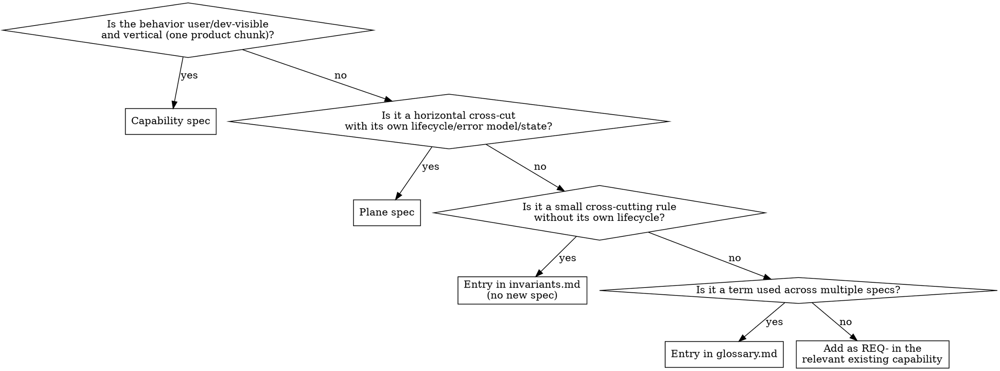

# Writing Specs

Author and amend agent-oriented specifications: capability specs, plane specs, glossary, invariants, and code-as-spec module signatures + docs. Output is sufficient for clean-room reimplementation preserving externally observable behavior — including concurrency/parallelism semantics — without dictating implementation details.

## Golden rules

> **A. Shorter is better.** Shorter specs are easier to read, modify, and keep current. Nobody reads long documentation. Keep each requirement to 1-3 short, simple sentences. The first sentence should be sufficient to understand what the requirement is about.
>
> **B. Shorter is not an excuse to skip.** If a normative requirement exists, write it. Brevity is about *how*, not *whether*.
>
> **C. No fact in two places.** Spec frontmatter is canonical for `owns:`/`code_spec:`; `layout.yaml` indices follow. Glossary terms are defined once. Each requirement has exactly one home (prose REQ-, plane INV-, or code-as-spec item).
>
> **D. Don't duplicate the code.** A spec captures intent the code can't carry: time/clock models, ordering and concurrency semantics, edge-case behavior, cross-component contracts, the *why* behind a value. A requirement that merely transcribes a signature, type, enum, or visible constant (`reject files > 2 GiB`, `formats are MP4/MOV/MKV`) adds nothing — the code is already canonical for that fact. **Test:** if you could regenerate the requirement text by paraphrasing the code, it's duplication. Cut it, or replace it with the non-obvious intricacy it was burying. When a value IS a normative external contract, bind it to a code-as-spec item or REQ that states the *guarantee clients depend on*, not a re-typed copy of the constant. Whether a non-obvious fact belongs in a spec, a comment, or a doc is decided by the placement rule in `jj-superpowers:writing-comments`.
>
> **E. No outdated/superseeded specs.** Remove superseeded/out of date specs immediately to avoid confusion.

## When to use

- Authoring a new capability or plane spec.
- Amending an existing spec (adding/changing a normative requirement).
- Adding/refining glossary terms or invariants.
- Editing a typed API surface that is registered as a code-as-spec module (this is the **only** authorized path — see "Code-as-spec module changes" below).

**Not for:**
- Setting up `layout.yaml` → `project-layout`.
- Auditing drift → `spec-drift-detector`.
- Code changes whose behavior is already specified → `spec-code-sync` decides routing.
- mdbook user docs → `documentation`.

## Preflight

1. Read `.agents/layout.yaml`. Verify `schema_version`. Refuse on unknown future versions.
2. Read `glossary.md` and `invariants.md` — they're small and you'll reference them.
3. If amending an existing spec, read only that spec's `SPEC.yaml` (plus its parent's, per the parent rule below). Don't load the corpus.
4. If the change touches a code-as-spec module, read the module file too.

## Choosing the spec kind



When unclear, ask the user. The plane-vs-invariant boundary is the most common ambiguity.

## Sub-spec authoring

Split a capability or plane into sub-specs when:
- It reaches 15 or more requirements, OR
- A coherent functional area maps cleanly to a distinct set of `owns:` paths that would be split in `code_map` anyway.

Cap at one level: sub-specs MUST NOT have `sub_specs:` of their own. If a sub-spec grows too large, refactor the parent into separate top-level capabilities instead.

**Parent rule:** parent-level requirements apply to every sub-spec and must not be contradicted. Whenever you load a sub-spec (`parent:` set), also load the parent's `SPEC.yaml` (frontmatter + cross-cutting requirements). Other skills defer to this rule.

### Creating a sub-spec

1. Create a subdirectory inside the capability/plane directory: `capabilities/<parent>/<leaf>/`.
2. Write `SPEC.yaml` with `id: <parent>/<leaf>`, `kind: capability` (or `plane`), and `parent: <parent>`.
3. Add the leaf name to `sub_specs:` in the parent's `SPEC.yaml`.
4. Set `owns:` globs to the paths specific to this sub-spec (narrower than the parent's globs).
5. Update `layout.yaml` `code_map`: add entries using the sub-spec slug (`<parent>/<leaf>`) in the `capabilities:` or `planes:` list.

### Naming

- Leaf directory name: kebab-case, one functional area (e.g., `session-management`, `streaming`).
- Sub-spec `id` MUST equal `{parent-slug}/{leaf-directory-name}` exactly.

### REQ-ID scheme for sub-specs

New requirements in a **capability** sub-spec:
```
REQ-{PARENT_SHORT}-{SUB_SHORT}-NNN
```

New requirements in a **plane** sub-spec:
```
INV-{PARENT_SHORT}-{SUB_SHORT}-NNN
```

- `PARENT_SHORT`: matches the parent's existing ID prefix (e.g., `CHAT` for `chat-workspace`).
- `SUB_SHORT`: 2–4 uppercase characters abbreviating the sub-spec's functional area (e.g., `STR` for streaming, `SES` for session-management).
- Verify the combined prefix (`CHAT-STR`) doesn't collide with existing prefixes already in use in the parent's namespace (check the parent's `sub_specs:` siblings — no need to load the full corpus).

Migrated requirements (moved from the parent) keep their stable IDs (`REQ-CHAT-001`). New requirements added after the split use the nested form (`REQ-CHAT-STR-001`). Both coexist indefinitely in the same sub-spec file.

**Ownership rule:** each REQ-/INV- ID MUST appear in exactly one SPEC.yaml file. When a requirement is moved from parent to sub-spec, remove it from the parent's `requirements:` list.

## SPEC.yaml format

Prose sections are KYAML `|` blocks; structured data is inline YAML. Example schema:

```yaml
id: video-upload
kind: capability                # capability | plane
status: draft                   # draft | stable | deprecated
owns:                           # globs — canonical source for code_map
  - js/projx_frontend/src/upload/**
code_spec:                      # modules carrying normative typed API for this spec
  - rust/projx_upload_service/src/api.rs
references:                     # slugs/IDs only — never file paths
  planes:     [auth, observability]
  capabilities: [video-transcode]
  invariants: [INV-CONSISTENCY-001]
  glossary:   [video, presigned-upload]

purpose: |
  One paragraph describing what this capability does and why it exists.

actors_and_surfaces: |          # optional — omit if trivial
  Who triggers behavior through which interface.

state_and_lifecycle: |          # optional — omit if stateless
  State machine or lifecycle description.

scaling_assumptions: |          # optional — entity counts, traffic shape,
  Externally observable performance contracts only (e.g., "p99 < 100 ms at
  10k QPS"). MUST NOT mandate data structures, algorithms, or libraries.

out_of_scope: |                 # optional — explicit non-goals
  List things this spec deliberately does not cover.

requirements:
  - id: REQ-VID-001
    summary: Upload visible only after commit
    level: MUST
    text: |
      A video MUST NOT appear in listings until all its bytes are durably
      stored; a listed video MUST be fully downloadable.
  - id: REQ-VID-002
    summary: Stale presigned URLs
    level: MUST
    text: |
      A presigned upload URL MUST stop accepting bytes once it expires, even
      mid-upload; the client restarts with a fresh URL (ERR-VID-002).

failure_modes:
  - code: ERR-VID-001
    condition: Storage commit fails after bytes were received
    behavior: Discard the partial upload; the video never becomes listed.
  - code: ERR-VID-002
    condition: Presigned URL expired before the upload completed
    behavior: Reject the remaining bytes; the client must request a new URL.
```

> **Note:** `references` uses slugs/IDs only — never file paths.

## ID rules

- Capability: `REQ-<SHORT>-NNN` (e.g., `REQ-VID-014`).
- Plane: `INV-<SHORT>-NNN`.
- Sub-spec IDs and the one-file-per-ID ownership rule: see "REQ-ID scheme for sub-specs" above.
- IDs are **stable across renames**.
- **Deprecation-only retirement**: never reuse a number. Set `level: DEPRECATED` and add a `replaced_by:` if applicable.
- Pick the next free integer; don't try to make it pretty.

## impl: annotations in code files

When a code file is the primary implementation site for a normative requirement, annotate it with a comment so the requirement can be found by grepping:

```rust
// impl: REQ-CAM-001, REQ-CAM-003
pub async fn fetch_pipeline_state(...) { ... }
```

```tsx
{/* impl: REQ-CAM-002 */}
<PipelineGraph state={pipelineState} />
```

Annotations are not mandatory on every line — only at the outermost entry point or primary handler for the requirement. One annotation per requirement is enough. `spec-drift-detector` greps for `impl: REQ-XXX-NNN` to locate implementations.

## Code-as-spec module changes (atomic three-artifact rule)

This is the canonical statement; other skills point here. A module registered under `spec_code.modules` carries normative typed API, and this skill is the **sole** authoring path for its public surface (adding, removing, renaming, or retyping a public item, or changing its visibility). Every such change lands in **one change set** across:

(a) the module — signature + RFC2119 doc in the native doc format (rustdoc / jsdoc / javadoc);
(b) every `SPEC.yaml` prose section that references the item (grep for its name and bound ID);
(c) the `SPEC.yaml` `requirements:` entry bound to the item, if any.

The module contains **only API surface** (signatures, types, enums, constants); implementation lives in sibling modules. Items MAY carry an ID prefix (`/// REQ-INF-014:`). A rename is a deprecation plus a new item: keep the old one `#[deprecated]`, or hard-rename and set `replaced_by:`. Editing (a) alone is unfinished; `spec-code-sync` routes it back here.

## Glossary and invariants

- **Glossary**: define each term once. If two specs use the same word with different meaning, that's a sign one needs renaming — bring it up with the user.
- **Invariants**: small cross-cutting rules that don't merit a plane spec. Each gets an `INV-` ID. If an invariant grows lifecycle/state, promote it to a plane.

## Specifying user interfaces

When a capability covers user-facing behavior (screens, panels, forms, editors, dashboards, CLI flows), express the UI as **observable, normative behavior** inside the existing sections — no new keys:

- `actors_and_surfaces` — the **pages/surfaces** and who triggers what through them.
- `state_and_lifecycle` — the **state machine(s)**: states, transitions as `event [guard] → target / effect`, initial/terminal states, illegal transitions, and async/timing semantics.
- `requirements` — **interaction contracts** (event → observable effect) and widget behavior guarantees, plus the cross-cutting UI rules: errors/warnings are surfaced (never swallowed), long/async operations report progress, and the surface stays responsive (work MUST NOT block/freeze the UI thread).
- `failure_modes` — each user-facing failure's condition and its **observable UI surface** behavior.

Honor golden rule D: specify the *contract* (which states exist, what a transition guarantees, when an error/progress signal must appear), never transcribe widget props or markup — the component code is canonical for that. Full notation, page/widget/interaction patterns, and a worked example live in `references/ui-spec-patterns.md`.

## Self-review checklist (run before declaring done)

Quick inline check — fix in place, don't loop on it:

1. **Clean-room sufficiency**: "Could a competent engineer with no other context implement this from the spec alone?" If no, what's missing?
2. **RFC2119 correctness**: MUST/SHOULD/MAY used where they belong, capitalized when normative:
   - No lowercase "should" as a normative term — write SHOULD (or MUST, if that is what you meant).
   - No MUST plus implementation detail ("MUST use Postgres" → "MUST persist records durably across restarts").
   - Every MUST is externally observable ("MUST be efficient" → "p99 < 100 ms at 10k QPS").
3. **No implementation leakage**: scaling assumptions don't mandate algorithms/libraries; failure modes don't prescribe class names; nothing dictates code structure or naming.
4. **No code duplication (golden rule D)**: read each requirement and ask "could I regenerate this by paraphrasing the signature/enum/constant?" If yes, it's transcription — cut it or replace it with the intricacy it was burying (timing model, edge case, contract, *why*).
5. **Frontmatter ↔ `layout.yaml`**: `owns:` and `code_spec:` written; if `layout.yaml` `code_map`/`spec_code.modules` disagree, update `layout.yaml`.
6. **Co-ownership check** ("Conflict rules" in `project-layout/references/manifest-schema.md`): when this spec adds/changes a requirement on a co-owned path, list the other owners and confirm with the user that the new requirement does not contradict theirs.
7. **References resolve**: every plane/glossary/invariant ID you cite exists.
8. **`impl:` annotations**: if this spec change adds a new MUST requirement that has an obvious primary implementation site, note the file so developers know to add `// impl: REQ-XXX-NNN` there.
9. **Sub-specs (if applicable):** the parent's `sub_specs:` lists exactly the leaf directories that have a `SPEC.yaml`; ids, ID prefixes, and nesting follow "Sub-spec authoring".
10. **UI as observable behavior (if user-facing):** states, transitions, interactions, and error/progress surfaces are specified as observable contracts (golden rule D) — no transcribed widget props — and long/async behavior names its responsiveness + progress guarantees.

If you find a placeholder, ambiguity, or contradiction → fix and continue. Don't ship "TBD" sections.

## Anti-patterns

- **Transcribing code into requirements.** A REQ that restates a signature, enum, or constant the reader can see in the owned code ("the service accepts MP4, MOV, MKV"; "max size is 2 GiB") duplicates the source. The code is canonical for *what it is*; the spec is for what the code can't show — the timing model, the edge case, the cross-system contract, the *why*. If a paraphrase of the function would produce your REQ, delete it (golden rule D).
- **Transcribing widget props or markup.** Listing a component's props, fields, or layout in a requirement duplicates the code (golden rule D). Specify the behavior the UI guarantees — states, transitions, interaction effects, error/progress surfacing, responsiveness — not the component's shape.
- **Writing implementation hints.** "Use a B-tree for the index" is implementation. "Lookup MUST be O(log n) on the upload path" is normative. (UI form: "use a web worker" is implementation; "the surface MUST stay responsive while extraction runs" is normative.)
- **Naming a specific library, crate, package, or tool.** "Validate with `zod`", "use `tokio`", "store in Redis" dictates *how*, not *what*. A clean-room reimplementation may pick a different library. Specify the observable behavior or contract (e.g., "MUST reject payloads failing schema validation"), never the dependency that provides it. The exception is when interop with a *named external system* is itself the requirement (e.g., "MUST produce S3-compatible presigned URLs") — that's an observable contract, not an implementation choice.
- **Duplicating glossary terms inline.** Reference, don't restate.
- **Reusing retired IDs.** Even if the number is small. Deprecation-only.
- **Editing only a code-as-spec module without updating SPEC.yaml.** Breaks the atomic three-artifact rule; spec-code-sync will block.
- **Bulk-generating specs from code.** Quality > coverage. Author one capability at a time.
- **Adding sections "for completeness" that you can't fill.** Empty section = noise. Drop it; add when needed.

## References (load on demand)

- `references/spec-template.md` — copy-and-fill `SPEC.yaml` template.
- `references/ui-spec-patterns.md` — express UI (states, pages, widgets, transitions, interactions, error/progress) as observable behavior.
