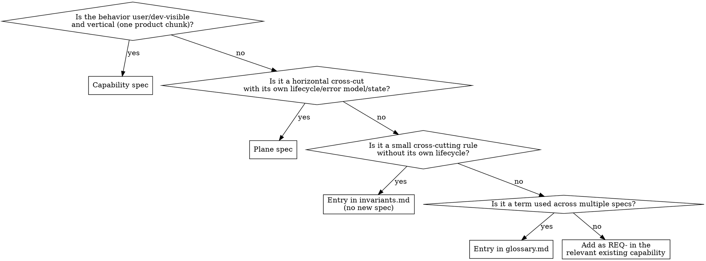

# Writing Specs

Author and amend agent-oriented specifications: capability specs, plane specs, glossary, invariants, and code-as-spec module signatures + docs. Output is sufficient for clean-room reimplementation preserving externally observable behavior — including concurrency/parallelism semantics — without dictating implementation details.

**Spec reference:** `docs/superpowers/specs/2026-05-28-agent-spec-ecosystem-design.md` §4, §5.1.

## Golden rules

> **A. Shorter is better.** Shorter specs are easier to read, modify, and keep current.
>
> **B. Shorter is not an excuse to skip.** If a normative requirement exists, write it. Brevity is about *how*, not *whether*.
>
> **C. No fact in two places.** Spec frontmatter is canonical for `owns:`/`code_spec:`; `layout.yaml` indices follow. Glossary terms are defined once. Each requirement has exactly one home (prose REQ-, plane INV-, or code-as-spec item).

## When to use

- Authoring a new capability or plane spec.
- Amending an existing spec (adding/changing a normative requirement).
- Adding/refining glossary terms or invariants.
- Editing a typed API surface that is registered as a code-as-spec module (this is the **only** authorized path — see §4 of design spec, rule 4).

**Not for:**
- Setting up `layout.yaml` → `project-layout`.
- Auditing drift → `spec-drift-detector`.
- Code changes whose behavior is already specified → `spec-code-sync` decides routing.
- mdbook user docs → `documentation`.

## Preflight

1. Read `.agents/layout.yaml`. Verify `schema_version`. Refuse on unknown future versions.
2. Read `glossary.md` and `invariants.md` — they're small and you'll reference them.
3. If amending an existing spec, read only that spec's `SPEC.yaml`. Don't load the corpus. **Exception:** if the spec has a `parent:` field, also load the parent's `SPEC.yaml` (frontmatter + cross-cutting requirements) — parent-level requirements apply to all sub-specs and must not be contradicted.
4. If the change touches a code-as-spec module, read the module file too.

## Choosing the spec kind



When unclear, ask the user. The plane-vs-invariant boundary is the most common ambiguity.

## Sub-spec authoring

Split a capability or plane into sub-specs when:
- It reaches 15 or more requirements, OR
- A coherent functional area maps cleanly to a distinct set of `owns:` paths that would be split in `code_map` anyway.

Cap at one level: sub-specs MUST NOT have `sub_specs:` of their own. If a sub-spec grows too large, refactor the parent into separate top-level capabilities instead.

### Creating a sub-spec

1. Create a subdirectory inside the capability/plane directory: `capabilities/<parent>/<leaf>/`.
2. Write `SPEC.yaml` with `id: <parent>/<leaf>`, `kind: capability` (or `plane`), and `parent: <parent>`.
3. Add the leaf name to `sub_specs:` in the parent's `SPEC.yaml`.
4. Set `owns:` globs to the paths specific to this sub-spec (narrower than the parent's globs).
5. Update `layout.yaml` `code_map`: add entries using the sub-spec slug (`<parent>/<leaf>`) in the `capabilities:` or `planes:` list.

### Naming

- Leaf directory name: kebab-case, one functional area (e.g., `session-management`, `streaming`).
- Sub-spec `id` MUST equal `{parent-slug}/{leaf-directory-name}` exactly.

### REQ-ID scheme for sub-specs

New requirements in a **capability** sub-spec:
```
REQ-{PARENT_SHORT}-{SUB_SHORT}-NNN
```

New requirements in a **plane** sub-spec:
```
INV-{PARENT_SHORT}-{SUB_SHORT}-NNN
```

- `PARENT_SHORT`: matches the parent's existing ID prefix (e.g., `CHAT` for `chat-workspace`).
- `SUB_SHORT`: 2–4 uppercase characters abbreviating the sub-spec's functional area (e.g., `STR` for streaming, `SES` for session-management).
- Verify the combined prefix (`CHAT-STR`) doesn't collide with existing prefixes already in use in the parent's namespace (check the parent's `sub_specs:` siblings — no need to load the full corpus).

Migrated requirements (moved from the parent) keep their stable IDs (`REQ-CHAT-001`). New requirements added after the split use the nested form (`REQ-CHAT-STR-001`). Both coexist indefinitely in the same sub-spec file.

**Ownership rule:** each REQ-/INV- ID MUST appear in exactly one SPEC.yaml file. When a requirement is moved from parent to sub-spec, remove it from the parent's `requirements:` list.

## SPEC.yaml format

A single SPEC.yaml file replaces the former SPEC.md + requirements.yaml pair. Prose sections are KYAML `|` blocks; structured data is inline YAML. Example schema:

```yaml
id: video-upload
kind: capability                # capability | plane
status: draft                   # draft | stable | deprecated
owns:                           # globs — canonical source for code_map
  - js/projx_frontend/src/upload/**
code_spec:                      # modules carrying normative typed API for this spec
  - rust/projx_upload_service/src/api.rs
references:                     # slugs/IDs only — never file paths
  planes:     [auth, observability]
  capabilities: [video-transcode]
  invariants: [INV-CONSISTENCY-001]
  glossary:   [video, presigned-upload]

purpose: |
  One paragraph describing what this capability does and why it exists.

actors_and_surfaces: |          # optional — omit if trivial
  Who triggers behavior through which interface.

state_and_lifecycle: |          # optional — omit if stateless
  State machine or lifecycle description.

scaling_assumptions: |          # optional — entity counts, traffic shape,
  Externally observable performance contracts only (e.g., "p99 < 100 ms at
  10k QPS"). MUST NOT mandate data structures, algorithms, or libraries.

out_of_scope: |                 # optional — explicit non-goals
  List things this spec deliberately does not cover.

requirements:
  - id: REQ-VID-001
    summary: File size limit
    level: MUST
    text: |
      The upload service MUST reject any file exceeding 2 GiB with error
      code ERR-VID-001.
  - id: REQ-VID-002
    summary: Allowed formats
    level: MUST
    text: |
      The upload service MUST accept MP4, MOV, and MKV containers only.

failure_modes:
  - code: ERR-VID-001
    condition: Uploaded file exceeds 2 GiB
    behavior: Reject with HTTP 413 and structured error body.
  - code: ERR-VID-002
    condition: Unsupported container format
    behavior: Reject with HTTP 415 and structured error body.
```

> **Note:** `references` uses slugs/IDs only — never file paths.

## ID rules

- Capability: `REQ-<SHORT>-NNN` (e.g., `REQ-VID-014`).
- Plane: `INV-<SHORT>-NNN`.
- **Sub-spec requirements** use the nested form `REQ-{PARENT_SHORT}-{SUB_SHORT}-NNN` (capabilities) or `INV-{PARENT_SHORT}-{SUB_SHORT}-NNN` (planes). See "Sub-spec authoring" for SHORT selection.
- Migrated requirements keep their original IDs. New sub-spec requirements use the nested form.
- Each ID MUST appear in exactly one SPEC.yaml. Moving a requirement to a sub-spec means removing it from the parent.
- IDs are **stable across renames**.
- **Deprecation-only retirement**: never reuse a number. Set `level: DEPRECATED` and add a `replaced_by:` if applicable.
- Pick the next free integer; don't try to make it pretty.

## impl: annotations in code files

When a code file is the primary implementation site for a normative requirement, annotate it with a comment so the requirement can be found by grepping:

```rust
// impl: REQ-CAM-001, REQ-CAM-003
pub async fn fetch_pipeline_state(...) { ... }
```

```tsx
{/* impl: REQ-CAM-002 */}
<PipelineGraph state={pipelineState} />
```

Annotations are not mandatory on every line — only at the outermost entry point or primary handler for the requirement. One annotation per requirement is enough. `spec-drift-detector` greps for `impl: REQ-XXX-NNN` to locate implementations.

## Code-as-spec module changes (atomic three-artifact rule)

When a normative requirement is encoded in a typed API (Rust trait, TS interface, etc.) registered under `spec_code.modules`, this skill is the **sole** authoring path. Every change is atomic across:

(a) the code-as-spec module itself — signature edit + RFC2119 doc edit in the native doc format (rustdoc / jsdoc / javadoc);
(b) any prose section in `SPEC.yaml` that references the changed item — keep cross-references current;
(c) `SPEC.yaml` — if a `REQ-`/`INV-` ID is bound to the item.

**All three in one change set.** If you edit only (a), `spec-code-sync` will treat the edit as unfinished and re-route you here.

Rules for code-as-spec modules:
1. Module contains **only API surface**: signatures, types, enums, constants. Implementation logic MUST live in sibling modules.
2. Every public item carries RFC2119-grade docs (MUST/SHOULD/MAY).
3. Items MAY carry stable ID prefixes (`/// REQ-INF-014:`) when bound to a numbered requirement — optional, not gated.

## Glossary and invariants

- **Glossary**: define each term once. If two specs use the same word with different meaning, that's a sign one needs renaming — bring it up with the user.
- **Invariants**: small cross-cutting rules that don't merit a plane spec. Each gets an `INV-` ID. If an invariant grows lifecycle/state, promote it to a plane.

## Self-review checklist (run before declaring done)

Quick inline check — fix in place, don't loop on it:

1. **Clean-room sufficiency**: "Could a competent engineer with no other context implement this from the spec alone?" If no, what's missing?
2. **RFC2119 correctness**: MUST/SHOULD/MAY used where they belong; no casual "should" that meant MUST.
3. **No implementation leakage**: scaling assumptions don't mandate algorithms/libraries; failure modes don't prescribe class names; nothing dictates code structure.
4. **Frontmatter ↔ `layout.yaml`**: `owns:` and `code_spec:` written; if `layout.yaml` `code_map`/`spec_code.modules` disagree, update `layout.yaml`.
5. **Co-ownership check**: other capabilities/planes MAY share `owns:` over the same path — that's allowed. But when this spec adds/changes a requirement on a co-owned path, confirm with the user that the new requirement does not contradict requirements in the co-owning specs. List the other owners explicitly; don't paper over the overlap.
6. **References resolve**: every plane/glossary/invariant ID you cite exists.
7. **`impl:` annotations**: if this spec change adds a new MUST requirement that has an obvious primary implementation site, note the file so developers know to add `// impl: REQ-XXX-NNN` there.
8. **Sub-spec consistency (if applicable):** `sub_specs:` in parent lists exactly the leaf directory names that have a `SPEC.yaml`. No extra entries, no missing entries.
9. **Sub-spec id format:** each sub-spec's `id` equals `{parent-slug}/{leaf-directory-name}`.
10. **No double-nesting:** no sub-spec has a `sub_specs:` key.

If you find a placeholder, ambiguity, or contradiction → fix and continue. Don't ship "TBD" sections.

## Anti-patterns

- **Writing implementation hints.** "Use a B-tree for the index" is implementation. "Lookup MUST be O(log n) on the upload path" is normative.
- **Duplicating glossary terms inline.** Reference, don't restate.
- **Reusing retired IDs.** Even if the number is small. Deprecation-only.
- **Editing only a code-as-spec module without updating SPEC.yaml.** Breaks the atomic three-artifact rule; spec-code-sync will block.
- **Bulk-generating specs from code.** Quality > coverage. Author one capability at a time.
- **Adding sections "for completeness" that you can't fill.** Empty section = noise. Drop it; add when needed.

## References (load on demand)

- `references/rfc2119-cheatsheet.md` — when to use MUST/SHOULD/MAY/MUST NOT/SHOULD NOT.
- `references/code-as-spec-checklist.md` — atomic-change procedure for typed API edits.
